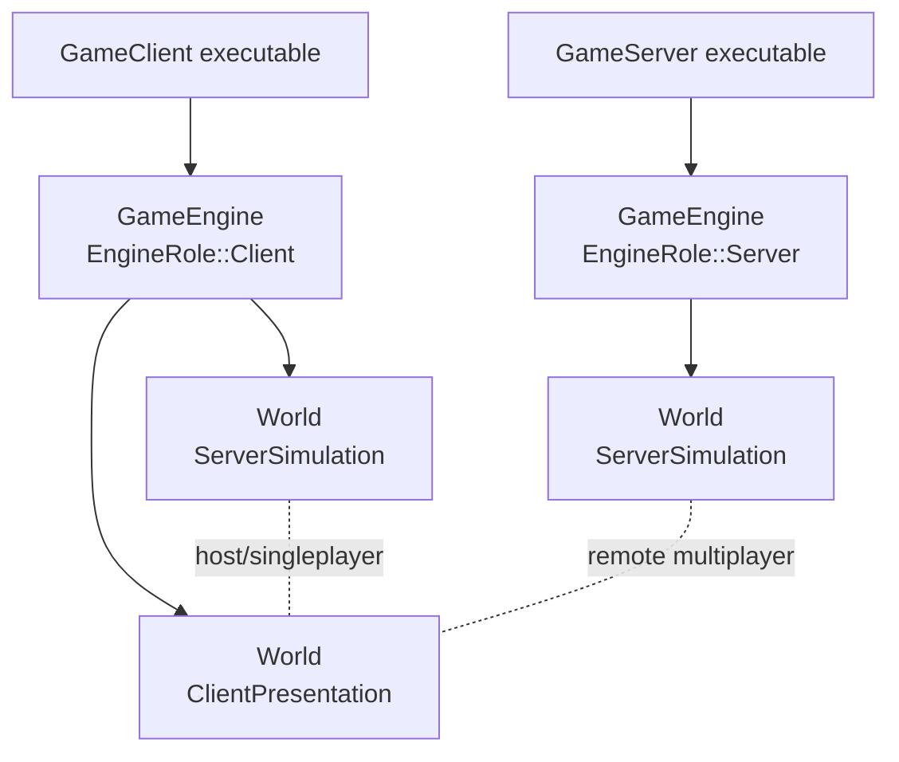
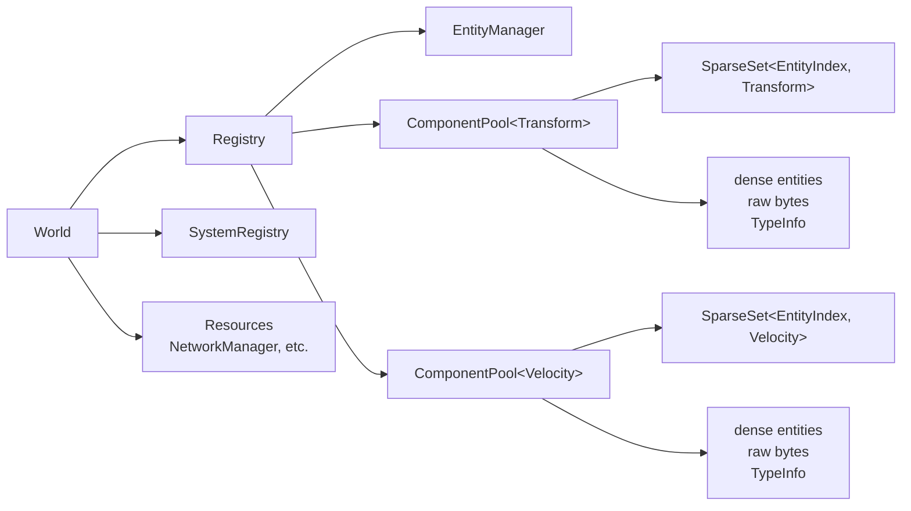
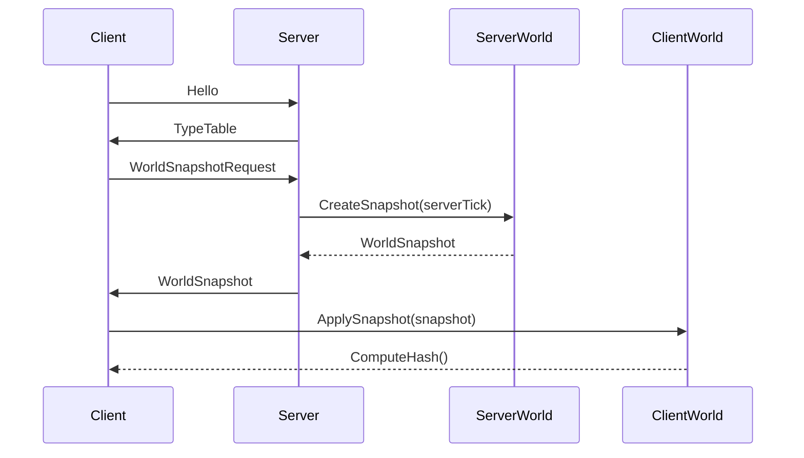
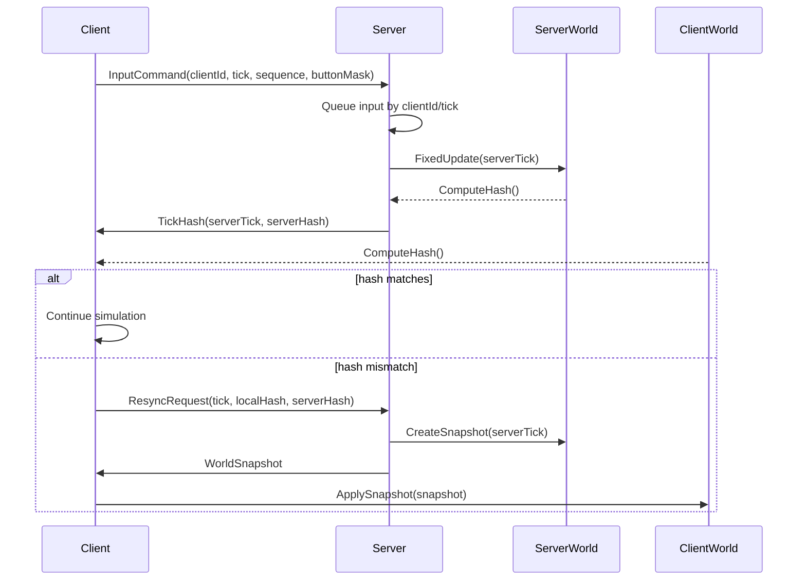
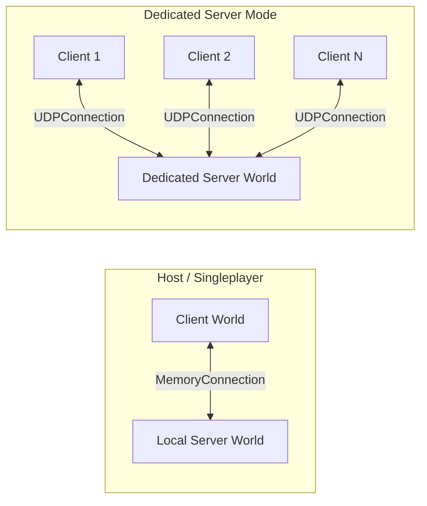
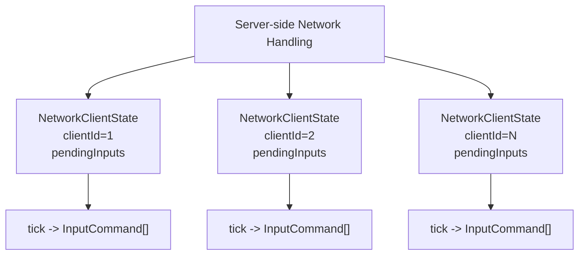

# ECSFactory

외부 라이브러리 의존을 최소화한 C++20 기반 ECS 게임 엔진 실험 프로젝트입니다.

---

# 작업 스케치

이 영역은 구현 전에 생각나는 계획, TODO, 설계 메모를 자유롭게 적는 공간입니다.
아래의 구조 문서는 현재 코드 기준 설명이고, 이 위쪽은 계속 바뀌어도 됩니다.

## 지금 생각 중인 것들

- 서버랑 클라 월드는 만들어짐 -> 연결 흐름을 실제 게임 시스템에 붙여야 함
- 서버와 클라를 연결할 때 타입 id/type table 교환
- 이후 서버 월드 데이터를 snapshot으로 복사해서 클라가 적용
- 모든 월드 데이터를 가져온 후 클라도 결정론적 시뮬레이션 시작
- 클라와 서버는 `INetworkConnection`을 통해서만 통신
- 호스트/싱글플레이는 `MemoryConnection`
- 원격 클라는 `UDPConnection`
- 월드 정보는 trivial component 기준 bit/raw byte 복사
- 락스텝보다는 서버 시간에 맞춰 클라가 입력 전달
- 특정 시간마다 hash 비교로 세션 유효성 확인
- hash가 다르면 snapshot 재다운로드 및 적용

## 다음 할 일

- 실제 게임 시스템에서 `NetworkManager` 패킷 처리 루프 연결
- UDP 접속 handshake 완성
- `InputManager` -> `InputCommand` 변환
- 서버 tick 기준 입력 소비
- `TickHash` 주기 송수신
- hash mismatch 자동 resync
- prediction/rollback/replay 정책 결정
- UDP reliable ack/retry 정책 강화

---
---
---


# 구현 구조 문서

목표는 서버 권위형 멀티플레이와 결정론적 시뮬레이션을 지원하는 작은 엔진 코어를 만드는 것입니다.

## 목표

- ECS 기반 월드/엔티티/컴포넌트 관리
- 고정 소수점 수학(`Fixed64`) 기반 결정론적 계산
- 서버 권위 구조
- 싱글플레이와 호스트 모드에서도 서버 월드 사용
- 클라이언트와 서버는 `INetworkConnection` 인터페이스만 통해 통신
- 월드 상태를 snapshot으로 복사하고 hash로 검증

## 현재 상태

- `GameEngine`은 여러 `World`를 생성하고 fixed tick으로 업데이트할 수 있습니다.
- `GameClient`는 같은 엔진 안에 클라이언트 월드와 로컬 서버 월드를 만들 수 있습니다.
- `GameServer`는 dedicated server 실행 파일로 동작하며 UDP 포트 `6780`에 bind합니다.
- `MemoryConnection`은 호스트/싱글플레이처럼 같은 프로세스 안의 통신에 사용합니다.
- `UDPConnection`은 원격 클라이언트와 dedicated server 사이 통신에 사용합니다.
- `NetworkManager`는 패킷 송수신, 타입 테이블, 월드 snapshot, 입력 명령, tick hash, 재동기화 요청을 담당합니다.
- 실제 키보드/마우스 입력을 `InputCommand`로 만드는 시스템은 개발중입니다.

## 빌드와 테스트

```powershell
cmake --build --preset default
ctest --preset default
```

현재 테스트는 다음 네트워크 시나리오를 포함합니다.

- `MemoryConnection` byte 전송
- 호스트 모드: 로컬 서버 월드와 클라이언트 월드 사이 통신
- 서버-단일 클라이언트: 입력 전송과 snapshot 적용
- 서버-다중 클라이언트: 클라이언트별 독립 입력 큐와 snapshot 전송
- 월드 snapshot round-trip
- 타입 크기 불일치 시 snapshot 적용 거부
- 월드 hash 변경 감지
- hash mismatch 후 재동기화 snapshot 재적용

## 게임 엔진 구조

`GameEngine`은 엔진의 실행 루프와 월드 목록을 소유합니다.

- `EngineRole::Client`
- `EngineRole::Server`
- `WorldRole::ServerSimulation`
- `WorldRole::ClientPresentation`

서버 권위 구조에서는 서버 월드가 authoritative state를 소유하고, 클라이언트 월드는 서버 snapshot을 받아 같은 상태로 맞춘 뒤 표시/예측/보간에 사용합니다.

호스트나 싱글플레이에서도 별도 서버 실행 파일을 띄우지 않고, 같은 `GameEngine` 안에 `ServerSimulation` 월드를 추가해서 서버 흐름을 유지합니다.



## ECS 구조

### Entity

엔티티는 `EntityId`로 표현합니다.

- 64bit 모드 기본 사용
- index와 version으로 구성
- 삭제된 entity index가 재사용되면 version이 증가합니다.

### Registry

`Registry`는 entity와 component pool을 관리합니다.

- entity 생성/삭제
- component 추가/삭제
- view 생성
- 런타임 component pool 순회
- snapshot 적용을 위한 raw component 추가

### ComponentPool

컴포넌트 타입마다 하나의 `ComponentPool<T>`가 생성됩니다.

- 내부 저장소는 `SparseSet<EntityIndex, T>`
- dense entity 목록 제공
- trivial component의 raw byte span 제공
- `TypeInfo` 제공

월드 snapshot은 이 pool 순회 API를 사용해 생성됩니다.



### TypeInfo

`TypeInfo`는 컴포넌트 타입의 네트워크 비교와 저장 위치 계산에 사용됩니다.

- `hash`
- `index`
- `name`
- `size`
- `alignment`
- `isTrivial`

서버와 클라이언트가 snapshot을 주고받을 때 `hash`, `size`, `alignment`, `isTrivial`이 맞는 타입만 적용합니다.

## 월드 Snapshot

`World::CreateSnapshot(tick)`은 현재 월드의 trivial component들을 raw byte로 복사합니다.

Snapshot에는 다음 정보가 들어갑니다.

- 서버 tick
- 타입 테이블
- component type descriptor
- entity index 목록
- component raw bytes

`World::ApplySnapshot(snapshot)`은 클라이언트 월드를 새 registry로 재구성합니다.
적용 가능한 타입은 클라이언트가 `RegisterSnapshotComponent<T>()`로 등록한 trivial component입니다.

비trivial component는 현재 snapshot 대상에서 제외됩니다.



## 동기화

현재 동기화 방향은 서버 권위입니다.

- 클라이언트는 tick 기준 `InputCommand`를 서버로 보냅니다.
- 서버는 클라이언트별 pending input queue에 저장합니다.
- 서버는 필요한 시점에 `WorldSnapshot`을 보냅니다.
- 클라이언트는 snapshot을 적용해 서버 상태와 맞춥니다.
- `World::ComputeHash()`로 월드 상태 hash를 계산합니다.
- hash가 다르면 `ResyncRequest`를 보내고 서버 snapshot을 다시 적용합니다.

기본 설계상 1초마다 hash 비교를 수행할 수 있도록 `TickHash` 패킷이 준비되어 있습니다.
주기적으로 보내는 시스템은 아직 게임 시스템으로 연결되지 않았습니다.



## 입력

현재 입력 패킷은 스텁입니다.

```cpp
struct InputCommand {
    uint32_t clientId;
    uint64_t tick;
    uint32_t sequence;
    uint64_t buttonMask;
    Fixed64 aimYaw;
    Fixed64 aimPitch;
};
```

아직 구현되지 않은 부분:

- `InputManager` 상태를 `InputCommand`로 변환
- 클라이언트 tick에 맞춰 입력 전송
- 서버 tick에서 입력 소비
- 클라이언트 prediction/rollback/replay

## 네트워크

### INetworkConnection

모든 통신은 `INetworkConnection` 인터페이스를 통해 수행합니다.

```cpp
virtual int Send(const void* data, size_t size) = 0;
virtual int Receive(void* data, size_t size) = 0;
```

구현체:

- `MemoryConnection`: 같은 프로세스 안에서 클라이언트와 로컬 서버를 연결
- `UDPConnection`: dedicated server와 원격 클라이언트 연결



### NetworkManager

`NetworkManager`는 connection 리소스로 월드에 추가됩니다.

담당 기능:

- `Hello`
- `TypeTable`
- `WorldSnapshotRequest`
- `WorldSnapshot`
- `InputCommand`
- `TickHash`
- `ResyncRequest`

서버는 클라이언트별 상태를 `NetworkClientState`로 관리합니다.

- `clientId`
- 마지막 수신 tick
- 타입 테이블 수신 여부
- snapshot 적용 여부
- pending input queue



### NetUtils

`NetUtils.hpp`에는 네트워크 byte order 기반 직렬화 유틸이 있습니다.

- `PacketWriter`
- `PacketReader`
- `Fixed64`는 `Raw()` / `FromRaw()` 기준으로 직렬화
- trivial component raw write 지원

## 수학

### Fixed64

`Fixed64`는 결정론적 계산을 위한 64bit 고정 소수점 타입입니다.

- 기본 Q32.32 구조
- raw 값 접근: `Raw()`
- raw 값 생성: `Fixed64::FromRaw()`
- 정수 생성: `Fixed64::FromInt()`
- floating point 변환은 초기화/도구용으로 제한적으로 사용

월드 snapshot에서는 `Fixed64`를 포함한 trivial component가 raw byte 그대로 복사됩니다.


## 렌더링

렌더링 계층은 아직 구체화 전입니다.
현재 엔진 코어는 ECS, deterministic math, network snapshot/sync 기반을 먼저 만들고 있습니다.
