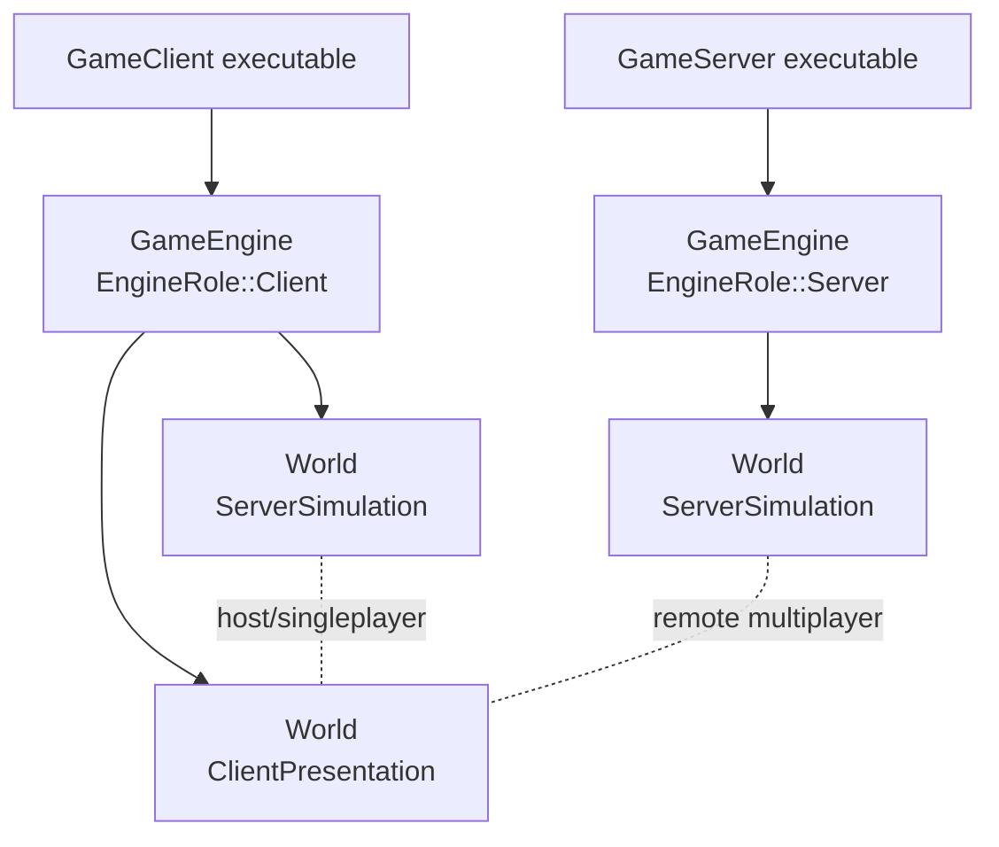
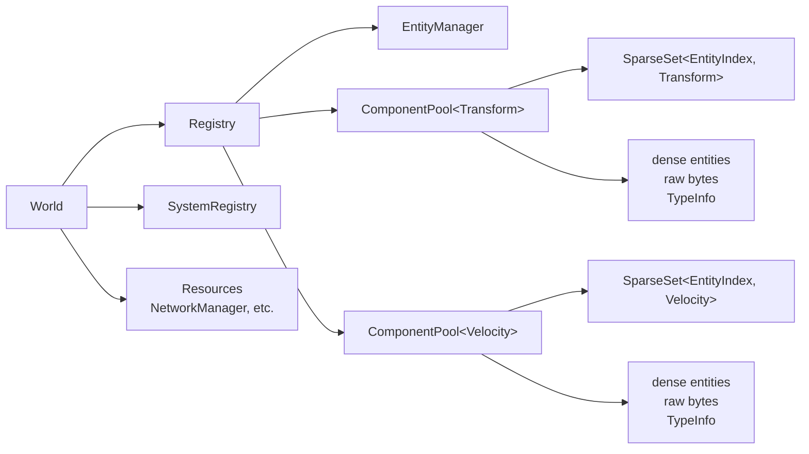
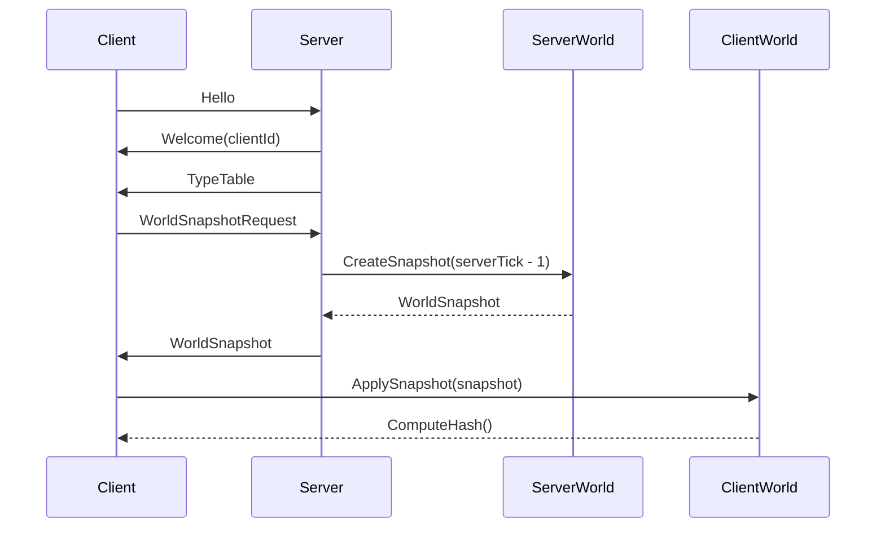
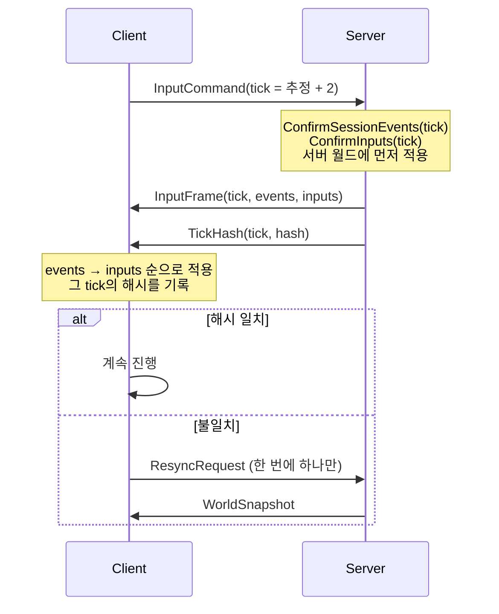
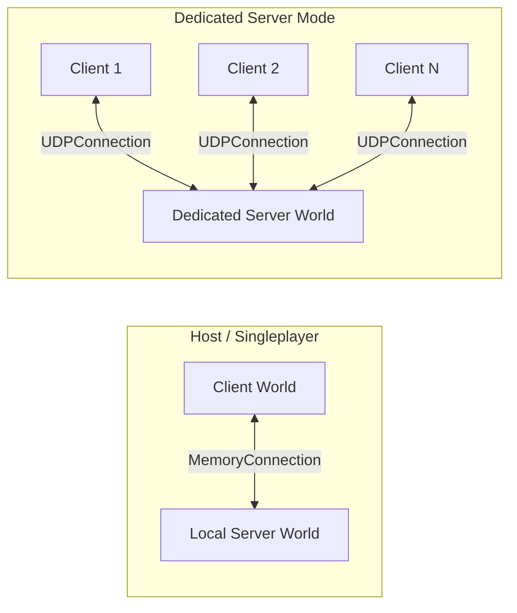

# ECSFactory

외부 라이브러리 의존을 최소화한 C++20 기반 ECS 게임 엔진 실험 프로젝트입니다.

## 프로젝트 성격

**학습용 사이드 프로젝트**입니다. 상용 제품이 아니라, 두 가지 목표를 동시에 두고 만듭니다.

1. **엔진/시스템 개발을 직접 만들면서 공부한다.** AI를 협업자로 쓰되, 돌아가는 코드만큼 *왜 그렇게 설계했는가*가 결과물입니다.
2. **이 엔진 위에 공장(팩토리) 게임을 만든다.** 자동화·생산 라인 장르이고, 2D / 3D 중 어느 쪽으로 갈지는 아직 정하지 않았습니다(렌더링 방향은 [docs/design/rendering-dx11.md](docs/design/rendering-dx11.md) 참조).

그래서 이 저장소의 규칙은 다음과 같습니다.

- **주석은 일반적인 상용 코드보다 많이** 답니다. 문법을 다시 읽어주는 주석이 아니라 **설계 의도**(왜 이 형태인가, 호출자가 지켜야 할 불변식은 무엇인가)를 적습니다.
- 클래스와 자명하지 않은 함수에는 **헤더 주석을 반드시** 답니다.
- 비자명한 선택을 했으면 **버린 대안과 그 이유**도 같이 적습니다.
- **틀린 주석은 없는 주석보다 나쁩니다.** 학습용 코드에서 잘못된 설명은 그대로 잘못 배우게 됩니다. 확실하지 않으면 확실하지 않다고 적습니다.
- 문서·주석·커밋 메시지는 **한국어**로 씁니다.
- 소스·문서·설정·로그의 한글 인코딩은 프로젝트 전체에서 **UTF-8**로 통일합니다. Windows PowerShell 5.1용 스크립트는 UTF-8 BOM을 사용합니다.

---

# 작업 스케치

이 영역은 구현 전에 생각나는 계획, TODO, 설계 메모를 자유롭게 적는 공간입니다.
아래의 구조 문서는 현재 코드 기준 설명이고, 이 위쪽은 계속 바뀌어도 됩니다.

> 📍 **마일스톤 전체 계획은 [docs/design/roadmap.md](docs/design/roadmap.md)에 있습니다.** 여기는 짧은 요약만 둡니다.

## 끝난 것

- ECS(Registry / ComponentPool / View / World)와 결정론 수학(`Fixed64` Q32.32)
- 월드 snapshot 복사 + `ComputeHash()` 검증 + hash mismatch 자동 resync
- 신뢰성 UDP 전송 — `Endpoint` 기반 다중 peer 라우팅, `ReliabilityChannel`(reliable / sequenced / unreliable), 조각화·재조립
- 접속 handshake(`Hello → Welcome → TypeTable → WorldSnapshot`)를 `NetworkSyncSystem`이 fixed tick 안에서 처리
- **결정론 입력 lockstep** — 클라가 미래 tick 입력을 제출하고, 서버가 확정(결측은 직전 입력 hold)해서 `InputFrame`으로 전 클라에 재전파하고, 모두가 같은 확정 입력으로 같은 시뮬을 돌림
- `TickHash` 주기 송수신으로 디싱크 감지, 손실·재정렬 링크에서의 수렴 테스트
- **렌더 계층 골격** — `EngineRender` 타깃 분리(서버는 DX11을 링크조차 하지 않고, CI가 임포트 DLL로 검사), `Win32Window`(메시지 펌프), DX11 device/swapchain/RTV, 런타임 셰이더 컴파일 + Dynamic VB. `--frames N --capture x.ppm`으로 백버퍼를 파일로 뽑아 확인한다
- **화면과 시뮬레이션 연결** — 직교 카메라(월드 XZ → 화면), `Renderable` + `RenderSystem`, 실제 키보드 → `InputCommand`, 내 플레이어를 따라가는 카메라. **키를 누르면 서버 확정을 거쳐 두 창의 캐릭터가 같이 움직인다**
- **결정론 스폰·디스폰** — 접속·해제가 확정 이벤트(`SessionEvent`)로 `InputFrame`에 실려 흐른다. 누가 들어와도 기존 클라이언트가 resync하지 않는다. 타임아웃(5초)으로 사라진 클라이언트를 정리한다
- **사람 없이 돌리는 검증** — 창 제목의 `tick`·`hash`, 가짜 키보드(`--input-script`), 시드 고정 링크 열화(`--net-loss` 등), 디싱크 주입. 방법은 [docs/reference/testing-guide.md](docs/reference/testing-guide.md)
- UI 앵커 레이아웃 코어(순수 함수, 단위 테스트 11케이스). 그릴 수단이 아직 없어 화면엔 안 나온다

> 초기 스케치에는 "락스텝보다는 서버 시간에 맞춰 클라가 입력 전달"이라고 적혀 있었지만,
> 결국 **결정론 lockstep + 입력 릴레이**로 갔습니다. 이유는 [docs/design/deterministic-input-lockstep.md](docs/design/deterministic-input-lockstep.md) §1.2에 있습니다 —
> `Fixed64`·`TickHash`·resync를 갖춘 이유가 애초에 그것이었기 때문입니다.

## 다음 할 일

렌더링·실제 입력·결정론 스폰이 끝나서 **공장 게임플레이를 시작할 수 있는 상태**입니다.

1. **보간(R7)** — 50Hz 시뮬을 그대로 그려서 빠르게 움직이면 끊겨 보입니다. 이전 위치와 현재 위치를 누산기 비율로 섞어 그립니다.
2. **디버그 오버레이(U1 드로우 목록 → U2 폰트 → U5)** — 지금은 창 제목이 그 역할을 대신합니다. 공장 게임을 만들면서 화면 안에 상태를 띄워야 할 일이 많아집니다.
3. **엔진 위생** — `SystemRegistry::SortSystems()`(현재 TODO). 클라이언트가 이미 시스템 등록 순서에 의존하고 있어서(`PlayerVisualSystem → RenderSystem` 등) 우선순위가 올라갔습니다. 그리고 `ComputeHash()`에 `EntityManager` 상태 넣기 — N2가 끝나서 이제 가능합니다.
4. **직렬화 & 리플렉션(S2)** — 공장 게임플레이보다 먼저 합니다. G 트랙이 컴포넌트를 여럿 새로 만드는데, 리플렉션이 먼저 있으면 처음부터 갖고 태어납니다. [roadmap.md §7.5](docs/design/roadmap.md).
5. **공장 게임플레이** — 그리드 좌표계 → 건설/철거 → 채굴기 → 벨트 → 저장고.
   첫 결승선: **아이템이 채굴기에서 저장고까지 자동으로 흐르고, 그게 화면에 보이고, 클라와 서버 해시가 일치한다.**

나중으로 미룬 것: prediction/rollback(공장 장르는 입력 지연 체감이 작아 정말 필요한지부터 확인), 텍스처/스프라이트, 3D 전환, 세이브 계층.

---
---
---


# 구현 구조 문서

목표는 서버 권위형 멀티플레이와 결정론적 시뮬레이션을 지원하는 작은 엔진 코어를 만드는 것입니다.

## 목표

- ECS 기반 월드/엔티티/컴포넌트 관리
- 고정 소수점 수학(`Fixed64`) 기반 결정론적 계산
- 서버 권위 구조
- 싱글플레이와 호스트 모드에서도 서버 월드 사용
- 클라이언트와 서버는 `INetworkConnection` 인터페이스만 통해 통신
- 월드 상태를 snapshot으로 복사하고 hash로 검증

## 현재 상태

- `GameEngine`은 여러 `World`를 생성하고 fixed tick으로 업데이트할 수 있습니다.
- `GameClient`는 같은 엔진 안에 클라이언트 월드와 로컬 서버 월드를 만들 수 있습니다.
- `GameServer`는 dedicated server 실행 파일로 동작하며 UDP 포트 `6780`에 bind합니다.
- `MemoryConnection`은 호스트/싱글플레이처럼 같은 프로세스 안의 통신에 사용합니다.
- `UDPConnection`은 원격 클라이언트와 dedicated server 사이 통신에 사용합니다.
- `NetworkManager`는 패킷 송수신, 타입 테이블, 월드 snapshot, 입력 명령, tick hash, 재동기화 요청을 담당합니다.
- `GameClient`는 창을 띄우고 DX11로 월드를 그리며, 실제 키보드(WASD·방향키)를 `InputCommand`로 바꿔 서버에 보냅니다. 마우스 조준은 변환 계층만 있고 시뮬레이션이 아직 쓰지 않습니다.

## 빌드와 테스트

**개발 도구:** 루트의 `Launch-ECSFactory.cmd`를 더블클릭하면 빌드·테스트·싱글/멀티 실행과
VS Code / Visual Studio 열기를 제공하는 런처가 뜹니다.
설치 및 디버깅 방법은 [개발 환경과 런처](docs/reference/development-tools.md)를 참고하세요.

```powershell
cmake --build --preset default
ctest --preset default
```

현재 테스트는 다음 네트워크 시나리오를 포함합니다.

- `MemoryConnection` byte 전송
- 호스트 모드: 로컬 서버 월드와 클라이언트 월드 사이 통신
- 서버-단일 클라이언트: 입력 전송과 snapshot 적용
- 서버-다중 클라이언트: 클라이언트별 독립 입력 큐와 snapshot 전송
- 월드 snapshot round-trip
- 타입 크기 불일치 시 snapshot 적용 거부
- 월드 hash 변경 감지
- hash mismatch 후 재동기화 snapshot 재적용

## 게임 엔진 구조

`GameEngine`은 엔진의 실행 루프와 월드 목록을 소유합니다.

- `EngineRole::Client`
- `EngineRole::Server`
- `WorldRole::ServerSimulation`
- `WorldRole::ClientPresentation`

서버 권위 구조에서는 서버 월드가 authoritative state를 소유하고, 클라이언트 월드는 서버 snapshot을 받아 같은 상태로 맞춘 뒤 표시/예측/보간에 사용합니다.

호스트나 싱글플레이에서도 별도 서버 실행 파일을 띄우지 않고, 같은 `GameEngine` 안에 `ServerSimulation` 월드를 추가해서 서버 흐름을 유지합니다.



## ECS 구조

### Entity

엔티티는 `EntityId`로 표현합니다.

- 64bit 모드 기본 사용
- index와 version으로 구성
- 삭제된 entity index가 재사용되면 version이 증가합니다.

### Registry

`Registry`는 entity와 component pool을 관리합니다.

- entity 생성/삭제
- component 추가/삭제
- view 생성
- 런타임 component pool 순회
- snapshot 적용을 위한 raw component 추가

### ComponentPool

컴포넌트 타입마다 하나의 `ComponentPool<T>`가 생성됩니다.

- 내부 저장소는 `SparseSet<EntityIndex, T>`
- dense entity 목록 제공
- trivial component의 raw byte span 제공
- `TypeInfo` 제공

월드 snapshot은 이 pool 순회 API를 사용해 생성됩니다.



### TypeInfo

`TypeInfo`는 컴포넌트 타입의 네트워크 비교와 저장 위치 계산에 사용됩니다.

- `hash`
- `index`
- `name`
- `size`
- `alignment`
- `isTrivial`

서버와 클라이언트가 snapshot을 주고받을 때 `hash`, `size`, `alignment`, `isTrivial`이 맞는 타입만 적용합니다.

## 월드 Snapshot

`World::CreateSnapshot(tick)`은 현재 월드의 trivial component들을 raw byte로 복사합니다.

Snapshot에는 다음 정보가 들어갑니다.

- 서버 tick
- 타입 테이블
- component type descriptor
- entity index 목록
- component raw bytes

`World::ApplySnapshot(snapshot)`은 클라이언트 월드를 새 registry로 재구성합니다.
적용 가능한 타입은 클라이언트가 `RegisterSnapshotComponent<T>()`로 등록한 trivial component입니다.

비trivial component는 현재 snapshot 대상에서 제외됩니다.



## 동기화 — 결정론 입력 lockstep

이 엔진은 상태가 아니라 **입력**을 중계합니다. 서버와 모든 클라이언트가 같은 확정 입력으로 같은 시뮬레이션을 돌립니다. 스냅샷은 **조인과 디싱크 복구 때만** 씁니다.

- 클라이언트는 미래 tick(서버 tick 추정 + 2)을 겨냥한 `InputCommand`를 보냅니다.
- 서버는 tick마다 입력을 **확정**합니다(clientId 정렬, 결측은 직전 입력 hold). 같은 tick에 예약된 접속·해제(`SessionEvent`)도 함께 확정합니다.
- 서버가 먼저 적용한 뒤, 확정한 것 전부를 `InputFrame`(reliable)으로 모든 클라이언트에 보냅니다.
- 클라이언트는 `InputFrame`을 tick 순서대로 **이벤트 → 입력** 순으로 적용합니다.
- 서버는 매 tick `TickHash`를 보내고, 클라이언트는 **그 tick을 시뮬레이션한 순간의** 로컬 해시와 비교합니다. 어긋나면 `ResyncRequest` → 새 `WorldSnapshot`.



전체 스펙과 근거는 [docs/design/deterministic-input-lockstep.md](docs/design/deterministic-input-lockstep.md)에 있습니다.

## 입력

```cpp
struct InputCommand {
    uint32_t clientId;
    uint64_t tick;        // 이 입력이 적용될 tick
    uint32_t sequence;
    uint64_t buttonMask;  // kInputMoveRight / Left / Forward / Back
    Fixed64 aimYaw;       // 조준은 픽셀(float)이 아니라 Fixed64로 싣는다
    Fixed64 aimPitch;
};
```

- 키보드(WASD·방향키) → `BuildButtonMask` → `QueueLocalInput`. tick당 하나만 넣습니다.
- 마우스 델타를 `Fixed64` 조준으로 바꾸는 경계는 `Gameplay/InputMapping`에 있습니다. 시뮬레이션은 아직 조준을 쓰지 않습니다.
- 사람 없이 돌릴 때는 `--input-script "20:W,80:"`로 같은 경로에 가짜 입력을 넣습니다.

아직 없는 것: 클라이언트 prediction/rollback(공장 장르에서 정말 필요한지부터 확인할 예정).

## 네트워크

세 계층이 쌓여 있습니다. 전송 계층은 패킷을 모르고, 동기화 시스템은 소켓을 만지지 않습니다.

### 1. 전송 — `INetworkConnection`

데이터그램 단위이고 주소 기반입니다.

```cpp
virtual bool SendTo(const Endpoint& target, std::span<const uint8_t> message) = 0;
virtual std::optional<Datagram> ReceiveFrom() = 0;   // Datagram{from, bytes}
virtual Endpoint DefaultPeer() const = 0;
```

- `MemoryConnection` — 같은 프로세스(호스트·싱글플레이)
- `UDPConnection` — dedicated server ↔ 원격 클라이언트(포트 `6780`)
- `LossyConnection` — 다른 연결을 감싸 손실·지연·중복을 시드 고정으로 주입(검증용)
- `SimulatedNetwork` — 테스트 전용 인메모리 허브



### 2. 신뢰성 — `ReliabilityChannel`

원격 endpoint마다 하나. ack·재전송·조각화·재조립·순서를 처리하고, 전달 등급이 셋입니다(`Reliable` / `Sequenced` / `Unreliable`).

### 3. 프로토콜 — `NetworkManager`

월드 리소스로 붙습니다. 패킷 타입은 `Hello`, `Welcome`, `TypeTable`, `WorldSnapshotRequest`, `WorldSnapshot`, `InputCommand`, `InputFrame`, `TickHash`, `ResyncRequest`입니다.

서버는 클라이언트별 상태를 `NetworkClientState`로 관리합니다 — endpoint, 조종 엔티티, 아직 확정되지 않은 입력 슬롯(`inputByTick`), 마지막 확정 입력, 마지막으로 소식을 들은 tick(5초 무응답이면 정리). clientId는 페이로드가 아니라 **보낸 endpoint로** 인가합니다(스푸핑 방지).

### NetUtils

`NetUtils.hpp`에는 네트워크 byte order 기반 직렬화 유틸이 있습니다.

- `PacketWriter`
- `PacketReader`
- `Fixed64`는 `Raw()` / `FromRaw()` 기준으로 직렬화
- trivial component raw write 지원

## 수학

### Fixed64

`Fixed64`는 결정론적 계산을 위한 64bit 고정 소수점 타입입니다.

- 기본 Q32.32 구조
- raw 값 접근: `Raw()`
- raw 값 생성: `Fixed64::FromRaw()`
- 정수 생성: `Fixed64::FromInt()`
- floating point 변환은 초기화/도구용으로 제한적으로 사용

월드 snapshot에서는 `Fixed64`를 포함한 trivial component가 raw byte 그대로 복사됩니다.


## 렌더링

DX11 백엔드가 `IRenderer` 인터페이스 뒤에 있고, `EngineRender`라는 별도 타깃이라 **서버는 DX11을 링크하지 않습니다**(CI가 검사).

- 창: `Win32Window` (`IWindow` 구현)
- 카메라: 직교 투영. 월드 XZ 평면을 화면에 매핑하고 Y(높이)는 버립니다. 내 플레이어를 따라갑니다.
- `RenderSystem`: `View<Transform, Renderable>` → `DrawItem` → `IRenderer`. `Fixed64 → float` 변환이 일어나는 유일한 자리입니다.
- `Renderable`은 클라 전용 표현이라 스냅샷에도 결정론 해시에도 들어가지 않습니다.

아직 없는 것: 보간(50Hz를 그대로 그림), 텍스처, 화면 안 UI. 설계는 [docs/design/rendering-dx11.md](docs/design/rendering-dx11.md)에 있습니다.
