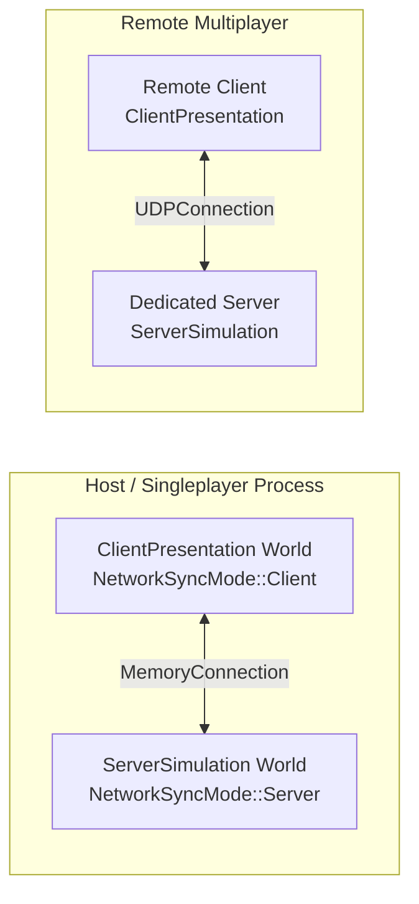
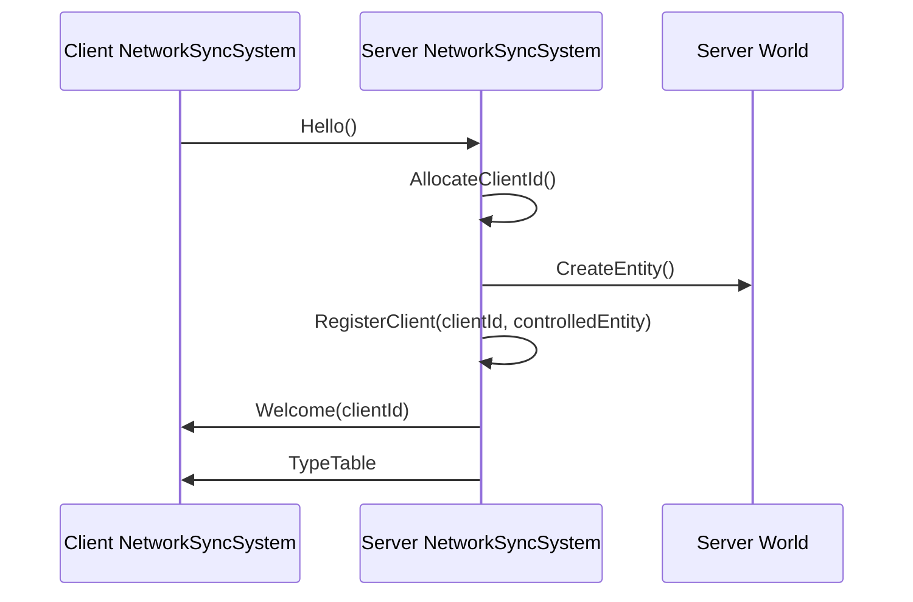
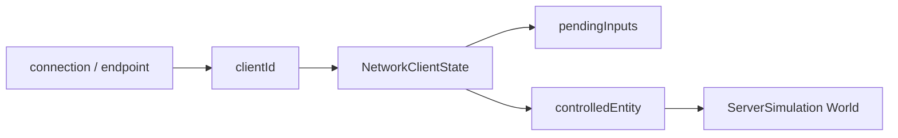
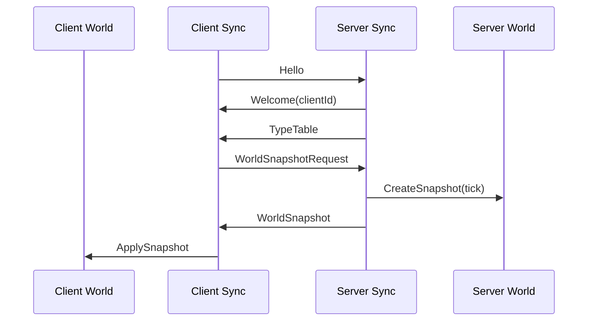

## 들어가며

지난 글에서는 `INetworkConnection`, `PacketWriter/Reader`, 그리고 `NetworkManager`를 만들었다. 이제 서버와 클라이언트는 바이트를 규칙 있게 주고받을 수 있다.

그런데 여기서 끝이 아니다. 패킷을 보낼 수 있다는 것과, **게임 월드가 매 tick 어떤 순서로 동기화되는지**는 다른 문제다.

예를 들어 클라이언트가 서버에 접속하면 실제로는 이런 질문들이 생긴다.

- `Hello`는 언제 보내야 할까?
- 서버가 보낸 `TypeTable`을 받으면 다음에 뭘 해야 할까?
- snapshot은 어느 월드에 적용해야 할까?
- 입력은 매 frame 보내야 할까, fixed tick에 맞춰 보내야 할까?
- 서버 hash와 클라이언트 hash가 다르면 누가 다시 맞춰야 할까?

이 흐름을 전부 게임 코드 여기저기에 흩뿌리면 금방 헷갈린다. 그래서 이번에는 `NetworkManager` 위에 한 층을 더 얹었다. 이름은 `NetworkSyncSystem`이다.

이번 작업을 하면서 드러난 핵심은 이렇다. `NetworkManager`는 패킷을 다루는 데는 충분했지만, 실제 멀티플레이 구조로 가려면 몇 가지가 더 필요했다.

1. **동기화 흐름을 실행할 시스템**
2. **서버가 발급하는 client id**
3. **client id와 서버 player entity의 연결**
4. **tick 기준 입력 큐**
5. **hash mismatch를 복구하는 resync 루프**

아래는 이 기능들을 왜 추가했고, 어디에 구현했는지에 대한 기록이다.

---

## `NetworkManager`는 패킷·연결 관리, `NetworkSyncSystem`가 실제 동기화 담당

처음에는 `NetworkManager`가 모든 걸 다 해도 될 것처럼 보인다. 실제로 패킷을 보내고 받는 함수는 이미 거기에 있다.

```cpp
network.SendHello();
network.SendWorldSnapshot(snapshot);
network.SendInputCommand(command);
network.TryReceivePacket();
```

하지만 `NetworkManager`가 *"언제 Hello를 보낼지"*, *"TypeTable 다음에 SnapshotRequest를 보낼지"*, *"받은 snapshot을 어느 World에 적용할지"* 까지 책임지기 시작하면 역할이 너무 커진다.

그래서 기준을 나눴다.

| 계층 | 책임 |
|---|---|
| `NetworkManager` | 패킷 인코딩/디코딩, 전송, 수신, 입력 큐 저장 |
| `NetworkSyncSystem` | fixed tick에서 동기화 순서 실행 |

즉 `NetworkManager`는 **패킷 도구**이고, `NetworkSyncSystem`은 **월드에 붙는 동기화 상태 머신**이다.

수신 패킷을 나누는 함수 이름도 이 기준을 따랐다. `HandlePacketOnClient`는 클라이언트 모드 시스템에서 받은 패킷을 처리한다는 뜻이고, `HandlePacketOnServer`는 서버 모드 시스템에서 받은 패킷을 처리한다는 뜻이다. 여기서 client/server는 패킷의 소유자가 아니라, 패킷을 처리하는 월드의 역할을 가리킨다.

---

## 월드는 둘이고, 방향도 둘이다

호스트나 싱글플레이에서는 같은 프로세스 안에 월드가 두 개 있다.

```text
GameClient.exe
  GameEngine
    ServerSimulation World
    ClientPresentation World
```

둘은 같은 스레드에서 차례대로 돈다. 별도 서버 스레드를 띄우지 않는다. 대신 `MemoryConnection`으로 서로 패킷을 주고받는다.

```text
ClientPresentation World ── MemoryConnection ── ServerSimulation World
```

dedicated server 모드에서는 프로세스가 나뉜다.

```text
GameServer.exe
  ServerSimulation World

GameClient.exe
  ClientPresentation World

UDPConnection
```

중요한 점은 둘 다 같은 규칙을 쓴다는 것이다. 서버 역할 월드에는 서버 모드 동기화 시스템을 붙이고, 클라 역할 월드에는 클라 모드 동기화 시스템을 붙인다.

```cpp
serverWorld.RegisterSystem<NetworkSyncSystem>(NetworkSyncMode::Server);
clientWorld.RegisterSystem<NetworkSyncSystem>(NetworkSyncMode::Client);
```



---

## 추가로 필요했던 것 1: 서버가 발급하는 client id

초기에는 클라이언트가 id를 직접 들고 시작하는 구조도 생각했지만, 현재 코드는 그렇게 하지 않는다. 클라이언트는 `NetworkSyncSystem` 등록 시 id를 넘기지 않고, `Hello()`만 보낸다.

하지만 실제 멀티플레이에서는 클라이언트가 자기 id를 정하면 안 된다. 두 클라이언트가 같은 id를 요청할 수도 있고, 악의적인 클라이언트가 다른 플레이어 id를 흉내 낼 수도 있다.

그래서 서버가 id를 발급하도록 바꿨다.

```cpp
uint32_t NetworkManager::AllocateClientId();
bool NetworkManager::SendWelcome(uint32_t assignedClientId);
```

패킷도 하나 추가했다.

```cpp
enum class PacketType : uint8_t {
    ...
    Welcome = 8
};
```

이제 연결 시작은 이렇게 된다.

```text
Client -> Server: Hello()
Server -> Client: Welcome(assignedClientId)
Server -> Client: TypeTable
```



클라이언트는 `Welcome`을 받기 전까지 자기 id가 없다.

```cpp
network.SetLocalClientId(assignedClientId);
```

그리고 입력을 보낼 때도 더 이상 클라이언트가 임의로 정한 id에 기대지 않는다. `NetworkManager::LocalClientId()`가 0이면 아직 서버가 id를 안 준 상태이므로 입력 전송을 보류한다.

```cpp
if (network.LocalClientId() == 0) {
    return;
}
```

---

## 추가로 필요했던 것 2: client id와 player entity 연결

`clientId`만 있어서는 충분하지 않다. 서버가 입력을 받았을 때 결국 알아야 하는 건 이것이다.

> 이 입력은 어떤 서버 월드 entity에 적용해야 하지?

그래서 서버 쪽 client 상태에 조종 대상 entity를 넣었다.

```cpp
struct NetworkClientState {
    uint32_t clientId;
    EntityId controlledEntity;
    bool hasControlledEntity;
    ...
};
```

현재는 `Hello`를 받은 시점에 서버가 entity를 하나 만든다.

```cpp
const uint32_t clientId = network.AllocateClientId();
const EntityId controlledEntity = world.CreateEntity();
NetworkClientState& client = network.RegisterClient(clientId, controlledEntity);
```

아직 이 entity에 `Transform`이나 `Velocity`를 붙여 spawn하는 단계까지는 아니다. 하지만 이제 연결 구조는 잡혔다.

```text
clientId -> NetworkClientState -> controlledEntity
```



나중에 gameplay system은 `clientId`로 `NetworkClientState`를 찾고, 그 안의 `controlledEntity`에 입력을 적용하면 된다.

---

## 초기 동기화: 같은 세계로 맞추기

처음 연결된 클라이언트는 아직 서버 월드 상태를 모른다. 그래서 가장 먼저 해야 할 일은 **서버 snapshot을 받아 자기 월드를 같은 상태로 맞추는 것**이다.

흐름은 이렇게 된다.

```text
Client: Hello
Server: Welcome
Server: TypeTable
Client: WorldSnapshotRequest
Server: WorldSnapshot
Client: ApplySnapshot
```



왜 `TypeTable`이 먼저 필요할까? snapshot은 raw byte 덩어리다. 클라이언트가 그 byte를 `Transform`으로 복원해도 되는지 확인하려면 타입의 `hash`, `size`, `alignment`, `isTrivial` 정보가 필요하다.

클라이언트 월드는 적용 가능한 component를 미리 등록한다.

```cpp
world.RegisterSnapshotComponent<Transform>();
world.RegisterSnapshotComponent<Velocity>();
```

이건 새로 만든 기능이 아니라 기존 `World`의 snapshot 적용 등록 기능이다. 이번 작업에서는 실제 앱의 client/server world 생성 시 이 등록을 붙였다. 그래야 테스트뿐 아니라 런타임에서도 snapshot이 적용된다.

초기 동기화가 끝나면 클라이언트 월드의 hash와 서버 월드의 hash가 같아진다.

---

## 한 tick 안에서 벌어지는 일

네트워크 동기화는 `FrameUpdate`가 아니라 `FixedUpdate`에서 처리한다. 렌더 프레임은 60Hz일 수도, 144Hz일 수도 있지만, 시뮬레이션과 입력은 fixed tick에 묶여야 하기 때문이다.

클라이언트 tick은 대략 이렇다.

```text
Client FixedUpdate
  1. 아직 Hello를 안 보냈으면 Hello 전송
  2. 받은 패킷을 모두 처리
     - Welcome이면 LocalClientId 저장
     - TypeTable이면 저장하고, Welcome도 받은 상태라면 snapshot 요청
     - WorldSnapshot이면 ApplySnapshot
     - TickHash면 local hash와 비교
  3. queued input이 있으면 InputCommand 전송
```

서버 tick은 이렇다.

```text
Server FixedUpdate
  1. 받은 패킷을 모두 처리
     - Hello면 clientId 발급 후 Welcome/TypeTable 전송
     - WorldSnapshotRequest면 snapshot 전송
     - InputCommand면 pending input queue에 저장
     - ResyncRequest면 snapshot 전송
  2. 현재 World hash를 TickHash로 전송
```

여기서 중요한 점은 서버가 입력을 받자마자 바로 게임 로직에 먹이지 않는다는 것이다. 일단 `pendingInputs`에 쌓아 둔다.

---

## 입력은 서버 tick에 맞춰 소비한다

클라이언트 입력은 이런 식으로 큐에 들어간다. 테스트 코드에서는 `RegisterSystem`이 돌려준 참조를 `clientSync`라는 지역 변수로 받지만, 실제 `GameClient`에서는 같은 포인터를 `m_clientSync` 멤버에 저장해 둔다.

```cpp
if (m_clientSync) {
    m_clientSync->QueueLocalInput(InputCommand{
        .buttonMask = buttonMask,
        .aimYaw = yaw,
        .aimPitch = pitch
    });
}
```

다음 fixed tick에서 `NetworkSyncSystem`이 빈 값을 채운다.

- `clientId == 0`이면 서버가 발급한 local client id
- `tick == 0`이면 현재 fixed tick
- `sequence == 0`이면 다음 입력 sequence

그리고 서버로 보낸다.

```text
QueueLocalInput
  -> InputCommand(clientId, tick, sequence, buttonMask, aim)
  -> server pendingInputs
```

이때 local client id가 아직 0이면 입력은 전송하지 않는다. `Welcome`을 받기 전에는 서버가 인정한 client가 아니기 때문이다.

서버는 client별로 입력 큐를 가진다.

```cpp
std::deque<InputCommand> pendingInputs;
uint32_t lastInputSequence;
bool hasInput;
```

같은 입력이 중복으로 오거나, 과거 sequence가 뒤늦게 오면 버린다.

```cpp
if (state.hasInput &&
    static_cast<int32_t>(cmd.sequence - state.lastInputSequence) <= 0) {
    return false;
}
```

게임 시스템은 자기 tick에서 필요한 입력만 꺼내면 된다.

```cpp
auto inputs = network.ConsumePendingInputs(clientId, currentTick);
```

`ConsumePendingInputs`는 `currentTick` 이하 입력을 반환하고 큐에서 제거한다. 아직 미래 tick 입력은 남겨둔다.

---

## Hash mismatch와 resync

서버는 매 fixed tick 현재 월드 hash를 보낸다.

```cpp
TickHash{
    .tick = tick,
    .worldHash = world.ComputeHash()
}
```

클라이언트는 자기 월드 hash와 비교한다.

```text
serverHash == clientHash
  계속 진행

serverHash != clientHash
  ResyncRequest 전송
  서버가 WorldSnapshot 재전송
  클라이언트가 ApplySnapshot
```

이 구조의 의미는 단순하다. 클라이언트가 잠깐 틀어져도 서버가 authoritative state를 다시 보내서 강제로 맞춘다.

지금은 이해와 테스트를 위해 서버가 매 tick `TickHash`를 보낸다. 실제 규모에서는 1초마다 한 번, 또는 N tick마다 한 번으로 줄이는 게 낫다. `ComputeHash()`는 trivial component pool 전체를 순회하기 때문이다.

---

## 내부 저장소는 어떻게 생겼나

`NetworkManager`는 전송과 수신 상태를 들고 있다.

```cpp
std::shared_ptr<INetworkConnection> m_connection;
uint32_t m_localClientId;
uint32_t m_nextClientId;
std::unordered_map<uint32_t, NetworkClientState> m_clients;
std::vector<uint8_t> m_currentFrame;
std::size_t m_frameOffset;
```

`m_currentFrame`과 `m_frameOffset`은 한 transport message 안에서 packet record를 하나씩 꺼내기 위한 버퍼다. 지금은 대부분 한 프레임에 패킷 하나만 넣지만, 포맷은 여러 record를 담을 수 있게 되어 있다.

`NetworkSyncSystem`은 동기화 상태를 들고 있다.

```cpp
NetworkSyncMode m_mode;
bool m_sentHello;
bool m_hasWelcome;
bool m_requestedSnapshot;
bool m_hasTypeTable;
bool m_hasSnapshot;
bool m_hasHashMismatch;
uint64_t m_lastSnapshotTick;
uint32_t m_nextInputSequence;
TickHash m_lastRemoteTickHash;
std::deque<InputCommand> m_localInputs;
std::vector<ComponentTypeDescriptor> m_remoteTypes;
```

이 값들이 있기 때문에 매 tick마다 “내가 지금 어디까지 했는지” 기억할 수 있다. 예를 들어 `m_sentHello`가 false면 Hello를 보내고, `Welcome`과 `TypeTable`을 모두 받은 뒤 아직 요청하지 않았다면 snapshot을 요청한다.

client id 쪽 저장소는 이렇게 정리된다.

```text
Server:
  m_nextClientId -> 다음 발급 id
  m_clients[clientId] -> NetworkClientState
  NetworkClientState.controlledEntity -> 서버 월드의 조종 대상

Client:
  m_localClientId -> Welcome으로 받은 내 id
```

---

## UDP는 아직 완성형이 아니다

이번에 `UDPConnection::Receive()`는 마지막으로 받은 sender 주소를 peer로 저장하도록 보강했다. 그래야 dedicated server가 client에게 답장을 보낼 수 있다.

하지만 이건 아직 단일 peer 수준이다.

```text
현재 UDPConnection
  마지막 sender 하나만 기억
```

여러 원격 클라이언트를 제대로 지원하려면 endpoint table이 필요하다.

```text
client address -> NetworkClientState / send target
```

그리고 아직 남은 것도 있다.

- packet loss 처리
- ack/retry
- 순서 뒤바뀜 처리
- 큰 snapshot 분할/재조립
- delta snapshot
- prediction / rollback

이번 글의 범위는 거기까지가 아니라, **동기화 루프의 뼈대를 닫는 것**이다.

---

## 마무리

이번 단계에서 패킷은 단순한 바이트 덩어리에서, fixed tick 안에서 의미 있는 대화로 바뀌었다.

- 클라이언트는 `Hello`로 시작한다.
- 서버는 `Welcome`으로 client id를 발급한다.
- 서버는 `TypeTable`과 `WorldSnapshot`으로 월드를 맞춰준다.
- 서버는 `clientId`와 `controlledEntity`를 연결한다.
- 클라이언트 입력은 `InputCommand`로 서버에 쌓인다.
- 서버는 `TickHash`로 상태 검증 기준을 보낸다.
- 클라이언트 hash가 틀어지면 `ResyncRequest`로 다시 맞춘다.

아직 게임 시스템이 입력을 실제 movement에 적용하지는 않는다. 다음 단계는 `InputManager`를 `QueueLocalInput()`에 연결하고, 서버 gameplay system에서 `ConsumePendingInputs()`를 사용해 authoritative simulation을 전진시키는 것이다.
