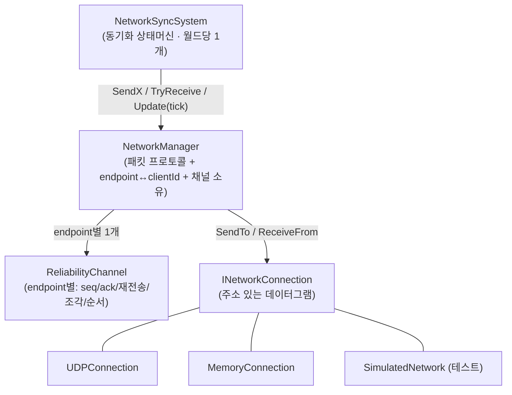
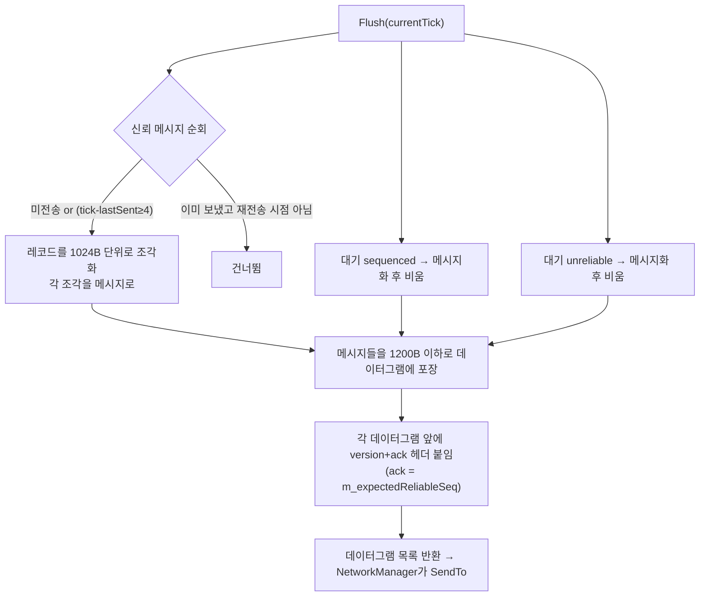
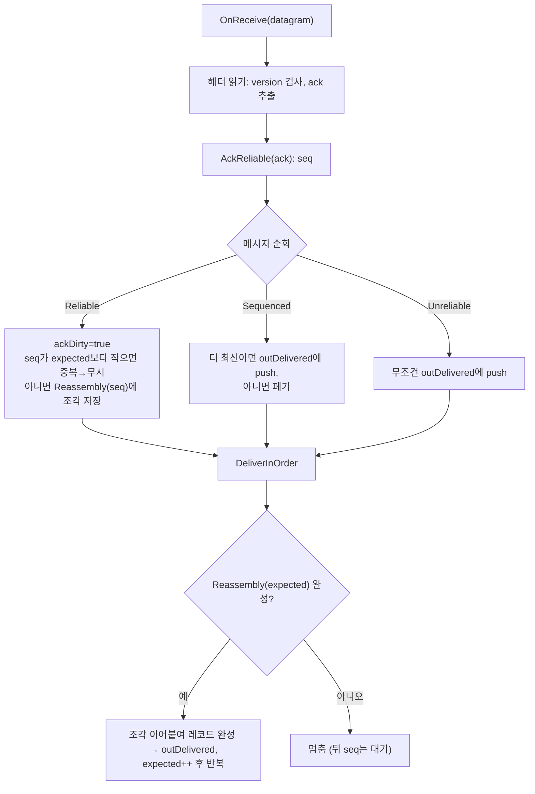
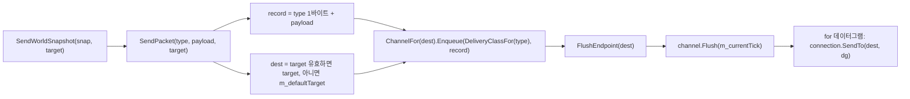
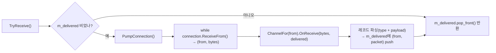
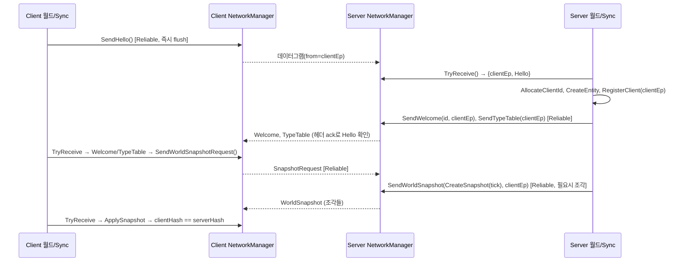

## 들어가며

- **05**에서 바이트를 규칙 있게 포장하는 법(`INetworkConnection`, `PacketWriter/Reader`, 프레임 포맷, `NetworkManager`)을 만들었다.
- **06**에서 그 위에 동기화 상태 머신(`NetworkSyncSystem`)을 올려, `Hello → Welcome → TypeTable → Snapshot → TickHash → Resync`가 fixed tick 안에서 흐르게 했다.

그런데 06의 마지막에 이렇게 적어뒀다.

> UDP는 아직 완성형이 아니다. 단일 peer만 기억하고, 손실·순서·중복·조각화 처리가 없다.

이번 글은 그 문장을 닫는 기록이다. **전송 계층을 다시 세워서**, 서버 하나가 여러 클라이언트를 상대하고(다중 peer), UDP의 손실/중복/순서뒤바뀜을 견디는(신뢰성) 데까지 간다.

이 글은 공부용 기록이라, "무엇을 했다"보다 **"왜 그렇게 판단했는지"** 와 **"코드가 서로 어떻게 호출되는지(호출 구조)"** 에 무게를 둔다. 그리고 05의 설계에서 무엇이 바뀌는지도 짚는다.

---

## 1. 문제부터: 왜 "단일 peer"가 무너지는가

05의 `UDPConnection`은 point-to-point였다. 소켓 하나에 peer 주소 하나(`m_peerAddress`)만 들고 있었다.

```cpp
// 05 시점의 UDPConnection (실제 코드)
std::optional<std::vector<uint8_t>> Receive() {
    sockaddr_in fromAddress;
    recvfrom(m_socket, ..., &fromAddress, &fromAddressSize);
    // fromAddress를 받아 놓고 아무 데도 쓰지 않는다. 여기서 그냥 버려진다.
    return buffer;
}

bool Send(std::span<const uint8_t> message) {
    if (m_socket == INVALID_SOCKET || !m_isConnected) return false;  // ← Connect() 한 적 있어야만
    sendto(m_socket, ..., &m_peerAddress, ...);   // ← Connect()가 정한 그 하나에게만
}
```

05 시점에 `m_peerAddress`와 `m_isConnected`를 세팅하는 곳은 **`Connect()` 하나뿐**이었다. 그래서 문제는 "여러 클라를 구분 못 한다"보다 한 단계 더 심각했다.

```text
클라A가 Hello  → 서버.Receive() → fromAddress 를 읽고 버림. A가 누군지 남지 않는다
클라B가 Hello  → 서버.Receive() → 마찬가지

서버는 Bind()만 했지 Connect()를 부른 적이 없다
  → m_isConnected == false
  → Send()가 첫 줄에서 false 를 반환하고 끝난다  ✗

즉 05의 서버는 "엉뚱한 클라에게 보내는" 게 아니라 애초에 아무에게도 못 보냈다.
```

그리고 이걸 아무도 못 잡았다. 05가 추가한 네트워크 테스트 10종 중 **`UDPConnection`을 쓰는 것은 하나도 없었기 때문이다** — 연결을 쓰는 7종은 전부 `MemoryConnection::CreatePair()`이고, 나머지 3종(스냅샷 왕복·shape 불일치·해시 검사)은 아예 연결을 안 쓴다. **UDP 경로는 테스트가 없어서 안 도는 줄도 몰랐다.**

### 06에서 한 번 땜질했고, 그래서 증상이 바뀌었다

여기서 시점을 갈라 두어야 한다. **07이 실제로 갈아엎은 대상은 05가 아니라 06 시점의 코드**다. 06에서 `Receive()`에 두 줄이 붙었기 때문이다.

```cpp
// 06 시점의 UDPConnection::Receive() — 06에서 추가된 부분
if (bytesReceived <= 0) return std::nullopt;

m_peerAddress  = fromAddress;   // ← 06에서 추가: 방금 보낸 사람을 peer로 기억
m_isConnected  = true;          // ← 06에서 추가: 이제 Send()가 통과한다
```

이 땜질로 "서버가 아무에게도 못 보낸다"는 증상은 사라졌다. 06의 핸드셰이크가 어쨌든 돌아간 이유가 이것이다. 대신 증상이 **더 조용한 것**으로 바뀌었다.

그 "조용한 증상"이 무엇인지도 짚고 가자. 06의 서버 루프는 이렇게 생겼다.

```cpp
// 06 시점의 NetworkSyncSystem::UpdateServer
while (auto packet = network.TryReceivePacket())
    HandlePacketOnServer(world, network, *packet, tick);   // 받은 자리에서 바로 답장

// ← 루프를 다 돌고 나서 한 번. 대상을 고를 수단이 없다
network.SendTickHash(TickHash{ .tick = tick, .worldHash = world.ComputeHash() });
```

`Receive()` 한 번 → 그 패킷 처리 → `SendWelcome`/`SendTypeTable`까지가 **한 반복 안에서 이어진다.** 그래서 A의 `Hello`를 처리하는 동안에는 `peer == A`이고, B의 `Hello`는 그다음 반복에서야 읽히면서 `peer == B`가 된다. **즉 "A용 Welcome을 B가 받는" 인터리브는 이 호출 구조에서는 일어나지 않는다.** (글을 처음 쓸 때는 이 인터리브를 증상으로 적었는데, 나중에 06 코드를 다시 열어 보니 아니었다.)

실제로 깨지는 건 **수신에 딸려 있지 않은 송신**이다.

```text
peer = "가장 마지막에 패킷을 보낸 사람"  ← 수신할 때마다 덮어쓰인다

클라A가 Hello  → peer = A → Welcome/TypeTable이 A에게 간다  ✓ (같은 반복 안)
클라B가 Hello  → peer = B → Welcome/TypeTable이 B에게 간다  ✓ (다음 반복)

루프를 다 돌고 SendTickHash()  → peer(=B)에게만 간다  ✗
  → A는 TickHash를 영영 못 받는다 (= 브로드캐스트 자체가 불가능)
  → 이번 tick에 아무도 안 보냈으면, 아무 상관 없는 옛 peer에게 간다
```

즉 06의 결함을 한 줄로 쓰면 *"응답은 우연히 맞지만, **브로드캐스트할 수 없고 후속 송신이 마지막 peer에 묶인다**"* 이다. 클라이언트가 하나일 때는 완벽하게 동작하고, 둘이 되는 순간 한 명이 조용히 검증에서 빠진다. 05의 "아예 안 보내진다"는 즉시 드러나지만, 06의 "한 명한테만 간다"는 드러나지 않는다. **땜질이 문제를 고친 게 아니라 눈에 안 띄게 만든 셈**이고, 이게 07에서 전송 계층을 주소 기반으로 다시 세운 이유다.

이 두 시점의 차이는 나중에 코드를 다시 열어 보고서야 정리됐다. 05를 쓸 때는 "peer 주소 하나만 기억하니 두 명이 붙으면 덮어쓰겠구나" 정도로 이해하고 있었는데, 그 덮어쓰기는 06에서 시작된 이야기였다.

게다가 `NetworkManager`는 **연결을 하나만**(`std::shared_ptr<INetworkConnection> m_connection`) 들고 있었고, `TryReceivePacket()`은 *"이 패킷을 누가 보냈는가"* 를 알려주지 않았다. 06까지도 그대로였다. 그래서 서버가 `Hello`를 받아도 그 클라의 주소와 `clientId`를 묶을 방법 자체가 없었다. 06의 땜질이 전송 계층 안에만 머물렀던 이유이기도 하다.

정리하면, 고쳐야 할 두 개의 구멍은 이렇다.

1. **전송 계층에 주소가 없다.** 보낼 때 대상을 못 고르고, 받을 때 출처를 모른다.
2. **`NetworkManager`가 point-to-point 가정에 묶여 있다.** 클라이언트별 채널/라우팅이 없다.

여기에 UDP 자체의 성질(손실·중복·순서뒤바뀜)까지 더하면, 신뢰성 계층도 필요하다.

---

## 2. 05 설계와 무엇이 달라지는가 (한눈에)

"before" 칸은 **05에서 세운 설계**를 가리킨다. 06은 이 설계를 그대로 물려받았고, 위에서 본 `UDPConnection` 한 칸만 두 줄짜리 땜질을 거쳤다.

| 계층 | 05 (before) | 07 (after) | 왜 바뀌었나 |
|---|---|---|---|
| `INetworkConnection` | `Send(bytes)` / `Receive()->bytes` (point-to-point) | `SendTo(Endpoint, bytes)` / `ReceiveFrom()->{from, bytes}` (주소 기반) + 편의 래퍼 | 서버가 출처를 알고 대상을 골라야 함 |
| 주소 | (없음) `sockaddr_in` 직접 | `Endpoint` 값 타입 (IPv4/Memory, 해시 가능) | endpoint를 map 키로 써서 디먹스 |
| `UDPConnection` | sender를 버림 + `Connect()`가 정한 peer 하나에만 송신 (06에서 "마지막 sender 기억"으로 땜질) | `recvfrom`의 sender를 `Endpoint`로 노출, 대상 지정 `sendto` | 다중 peer |
| 와이어 포맷 | `[version][type][size][payload]…` 프레임 | `[version][ack][채널 메시지…]` 신뢰성 데이터그램 | ack/조각/순서를 실을 자리 |
| 신뢰성 | 없음 (`Packet.hpp`의 `sequenceNumber/ackNumber`는 빈자리) | `ReliabilityChannel` 실체화 (채널 분리) | 손실/순서/조각화 |
| `NetworkManager` | 연결 1개, payload의 `clientId`로 상태 조회 | endpoint↔clientId 테이블 + endpoint별 `ReliabilityChannel` | 라우팅 + 신뢰성 |
| 수신 API | `TryReceivePacket()->packet` | `TryReceive()->{from, packet}` (+ 옛 API는 래퍼로 유지) | 응답 라우팅 |
| 테스트 전송 | `MemoryConnection` (무손실) | + `SimulatedNetwork` (손실/중복/재정렬, 다중 host) | 신뢰성 로직 검증 |

05의 프레임 포맷(`[version][type][size][payload]`)이 통째로 사라지는 게 아니라 **한 층 아래로 밀려난다.** 그때 `size`로 풀던 "프레임 안 여러 레코드 경계" 문제는, 이제 신뢰성 데이터그램 안의 "채널 메시지 경계"로 형태만 바뀌어 그대로 살아 있다(05에서 강조한 *2층 framing* 통찰이 여기서도 반복된다).

---

## 3. 결정 1: 서버 멀티플렉싱을 어디에 둘까

### 처음 의도한 그림: "커넥션 하나 = 클라 하나"

솔직히 처음 그린 그림은 이거였다. **연결(`INetworkConnection`) 하나가 클라이언트 하나를 담당한다.** 클라가 셋이면 서버에 연결이 셋. 각 연결이 자기 클라만 상대하니 깔끔해 보인다.

이 직관은 사실 **TCP의 그림**이다. TCP 서버는 `accept()` 할 때마다 그 클라 전용 소켓이 하나씩 생긴다. 그래서 "1 소켓 = 1 클라"가 공짜로 따라온다. 우리가 "연결"이라 하면 머릿속에 기본으로 떠오르는 게 대개 이 TCP 그림이다.

### 그런데 UDP에선 그 그림이 안 통한다

문제는 우리 서버가 **UDP**라는 것이다. UDP는 connectionless라서 클라마다 소켓이 생기지 않는다.

> **비유.** TCP는 상대마다 깔리는 **전용 전화선**이다. 전화가 오면 회선이 하나 생기고, 그 회선은 그 사람만의 것이다.
> UDP는 건물 앞 **공용 사서함 하나**다. 모두가 같은 주소(`서버ip:6780`)로 편지를 보내고, 서버는 그 사서함 하나에서 편지를 전부 꺼낸다. 누가 보냈는지는 **봉투의 발신인(sender 주소)** 을 봐야 안다.

즉 UDP 서버는 소켓 **하나**에 모든 클라의 데이터그램이 섞여 들어온다(`recvfrom`이 발신인 주소를 함께 준다). 그래서 "연결 하나 = 클라 하나"를 UDP에서 하려면, **사서함에서 꺼낸 편지를 발신인별로 분류하는 사람**이 반드시 있어야 한다. 이 분류가 바로 **디먹스(demultiplexing)** 다.

### 핵심 통찰: 디먹스는 못 피한다, "어디서 하냐"만 다르다

여기가 이 결정의 전부다. UDP 서버인 이상 발신인별 분류는 **어차피 해야 한다.** 남는 선택은 *그 분류를 어느 계층에서 하느냐* 하나다.

**A. endpoint-aware `NetworkManager`.** `NetworkManager` 하나가 사서함(소켓 하나)을 직접 열고, 편지를 `endpoint → (clientId, ReliabilityChannel)`로 분류한다. 클라별 상태는 `NetworkManager` 안 endpoint별 칸에 들어간다.

**B. endpoint별 `NetworkManager`.** 멀티플렉서가 사서함을 열어 발신인별 바구니(가상 `INetworkConnection`)에 나눠 담고, 서버는 그 바구니(=연결)마다 `NetworkManager`를 하나씩 붙인다. 이러면 겉보기엔 "연결 하나 = 클라 하나"가 되지만, 월드 안에는 클라 수만큼 manager가 생긴다.

**C. multi-connection `NetworkManager`.** 원래 의도에 가장 가까운 그림이다. `NetworkManager` 하나가 여러 `INetworkConnection`을 들고, 각 connection을 `clientId`와 묶는다. 즉 월드에는 manager가 하나만 있고, manager 내부에 `clientId -> IConnection` 또는 `endpoint -> IConnection` 테이블이 있다.

**셋 다 디먹스를 한다.** B/C라고 분류를 안 하는 게 아니라, 그 분류를 어디에 두느냐가 다르다. B는 `NetworkManager` 바깥의 멀티플렉서가, C는 `NetworkManager` 안의 connection 테이블이, A는 `NetworkManager` 안의 endpoint 테이블이 맡는다.

**A. 지금 구현: endpoint-aware `NetworkManager`**

```text
UDP socket
  -> NetworkManager 1개
       -> endpoint table
            -> endpoint A: clientId 1 + ReliabilityChannel 1
            -> endpoint B: clientId 2 + ReliabilityChannel 2
```

**B. endpoint별 `NetworkManager`**

```text
UDP socket
  -> UdpMultiplexer
       -> virtual INetworkConnection 1 -> NetworkManager 1
       -> virtual INetworkConnection 2 -> NetworkManager 2
```

**C. multi-connection `NetworkManager`**

```text
UDP socket
  -> connection demux
       -> INetworkConnection 1 --+
       -> INetworkConnection 2 --+-> NetworkManager 1개
                                      -> clientId -> INetworkConnection table
```

### 왜 A를 골랐나

- **비대칭이 실제로 그렇다.** 클라이언트는 본질적으로 서버 하나만 상대한다(point-to-point). one-to-many가 필요한 건 **서버뿐**이다. B의 "가상 연결"은 소켓이 하나뿐인 현실 위에 개념을 하나 더 얹는 셈이라 오히려 겉돈다.
- **06 구조와 맞물린다.** 06까지 서버 코드는 `world.GetResource<NetworkManager>()`로 리소스 **하나**를 잡는다. B는 "월드당 N개의 `NetworkManager`"를 끼워야 해서 `NetworkSyncSystem`의 서버 루프를 크게 뜯어야 한다. A는 `NetworkManager` 하나가 내부에 endpoint별 상태만 더 들면 끝난다.
- **C와 A는 거의 같은 책임을 진다.** C의 `IConnection` 여러 개도 UDP에서는 결국 같은 소켓에서 온 endpoint를 나눈 가상 connection이다. 그래서 이번 구현에서는 가상 connection 객체를 만들기보다, 그 테이블을 endpoint/channel/state로 바로 들었다.
- **스푸핑이 공짜로 막힌다.** 입력 payload의 `clientId`를 믿으면 남을 사칭할 수 있다. A는 **발신인 endpoint**(봉투의 발신인은 위조가 어렵다)를 authoritative 키로 삼아 이 문제를 자연스럽게 닫는다.

그 대신 A는 `INetworkConnection`을 주소 기반(`SendTo`/`ReceiveFrom`)으로 바꿔야 한다. 이게 결정 1의 대가다.

### 사실 "1 연결 = 1 클라"는 이미 반쯤 이뤄져 있다

처음 의도한 그림이 완전히 사라진 건 아니다.

- **호스트/싱글플레이(`MemoryConnection`)** 는 pair 구조라 지금도 **연결 하나 = 상대 하나**다. 여기선 사서함을 공유하지 않으니 디먹스가 아예 필요 없다.
- **원격 UDP 서버**에서만 사서함이 공유되어 디먹스가 생기고, 그 분류를 A는 `NetworkManager` 안에 둔 것이다.

그리고 클라별 분리(각자의 `ReliabilityChannel`, `NetworkClientState`)는 A에서도 **endpoint별로 이미 존재한다.** 단지 그걸 `INetworkConnection`이라는 겉껍데기로 감싸지 않았다. 나중에 접속/끊김을 연결 객체 단위로 다루고 싶어지면, A의 endpoint 테이블을 C의 `clientId -> IConnection` 테이블 형태로 감싸는 선택지는 열려 있다.

---

## 4. 결정 2: 신뢰성을 어떻게 줄까

UDP는 손실/중복/순서뒤바뀜이 기본이다. 방법은 셋이었다.

- **전부 reliable-ordered (TCP처럼).** 단순하지만 *head-of-line blocking*. 스냅샷 조각 하나가 늦으면 그 뒤 입력·틱해시까지 전부 막힌다. 실시간 게임엔 독이다.
- **이번엔 신뢰성 없이 라우팅만.** 손실 복구를 기존 resync(hash mismatch → snapshot 재전송)에 맡긴다. 작지만, 초기 스냅샷 자체가 유실되면 클라가 영영 못 뜬다.
- **채널 분리.** 패킷 성격별로 보장 수준을 다르게 준다.

**채널 분리를 골랐다.** 게임 엔진의 정석이고, 각 패킷이 실제로 요구하는 보장이 다르기 때문이다.

> 시점 주의: 아래 표는 **07 커밋(`a5a4f59`) 그 시점의 배정**이다. 이 시점의 `PacketType`은 `Welcome = 8`까지고 **`InputFrame`은 아직 존재하지 않는다.** `InputFrame = 9`와 그 `Reliable` 배정은 08(`8f50934`)에서 추가된다. 표에 미리 적어 둔 건 "이 그릇이 나중에 무엇을 받게 되는가"를 보여주기 위해서다.

| 채널 | 대상 | 보장 | 왜 |
|---|---|---|---|
| **Reliable** | Hello / Welcome / TypeTable / **WorldSnapshot** / SnapshotRequest / Resync (+ 08부터 **InputFrame**) | ack + 재전송 + 조각화 + 순서 | 하나라도 유실되면 세션이 안 뜨거나 lockstep 입력 스트림이 멈춘다 |
| **Sequenced** | TickHash | 최신만, 구식 폐기 | 검증용 체크섬이라 옛 값은 무의미. 재전송하면 오히려 낭비 |
| **Unreliable** | InputCommand (클라→서버 제출) | 재전송·순서 없이 즉시 전달 | 저지연 우선. **손실을 어떻게 견디는지는 transport 바깥, 입력 모델의 몫** → 08 |

핵심 판단 하나: **WorldSnapshot을 reliable에 둔다.** 스냅샷은 크지만(초기 동기화/리싱크의 근거) 유실되면 클라가 멈추므로, 재전송+조각화가 반드시 필요하다. 반대로 TickHash를 reliable에 두면 매 틱 재전송 큐가 쌓여 낭비다. 그래서 sequenced로 뒀다.

신뢰 채널의 알고리즘은 **누적 ack + 메시지 단위 전체 재전송**으로 갔다. 선택적 재전송(selective repeat)이 더 효율적이지만, 제어 채널은 트래픽이 적고 스냅샷은 드물어서 단순함이 더 값지다. (조각 단위 선택적 ack는 남은 과제로 미룬다.)

> **"go-back-N"이라 부르고 싶어지지만, 엄밀히는 그렇지 않다.** 교과서의 go-back-N은 **수신자가 순서 어긋난 것을 버리고** 송신자가 구멍 이후를 전부 다시 보낸다. 이 구현은 절반만 그렇다. 송신 쪽은 확실히 go-back-N풍이지만(누적 ack, 미확인 메시지 전체 재전송), **수신 쪽은 순서 어긋난 조각을 버리지 않고 `m_reassembly`에 보관한다**(→ 9.4절). 그래서 재정렬만 일어난 경우에는 재전송 없이 그대로 복원된다. 이름을 제대로 붙이자면 **"누적 ack + out-of-order 보관 + 메시지 단위 전체 재전송"** 이다.

### 입력의 신뢰성은 여기서 정하지 않는다 (→ 08)

위 표에서 `InputCommand`를 unreliable로 둔 건 **transport 관점의 기본값**이다("일단 저지연으로 던진다"). 하지만 *"입력이 유실되면 어떻게 되나, 발사 같은 행동 입력은 믿어줘야 하지 않나"* 는 **입력 모델(결정론 lockstep)** 이 답할 문제이고, transport의 몫을 넘어선다. 여기서 깊이 파면 층위가 섞여 오히려 이상해진다.

이 엔진의 실제 입력 흐름은 다음 글에서 다룬다. 미리 골자만:

- **클라 → 서버** : `InputCommand`(미래 tick 입력)를 unreliable + **이중화**(최근 N tick 함께 전송)로 제출.
- **서버 → 전 클라** : 서버가 그 tick의 입력을 확정한 뒤 `InputFrame`(확정 입력셋)을 **reliable로 재전파**(lockstep). 이건 위 **reliable 채널을 그대로 탄다.**
- 서버·모든 클라가 같은 확정 입력으로 결정론 시뮬레이션 → 상태 일치, `TickHash`로 검증.

즉 07의 채널 분리는 **"그릇"** 이고, 입력을 어떤 그릇에 담아 어떻게 흘릴지는 **결정론 입력 파이프라인**이 정한다. 실제로 `DeliveryClassFor`에 `InputFrame → Reliable` 한 줄이 들어간 것은 **08 커밋(`8f50934`)** 이다. 07 커밋 자체에는 그 줄이 없다.

---

## 5. 결정 3: 보내는 순간과 재전송 tick을 분리한다

`ReliabilityChannel`을 넣으면 헷갈리는 지점이 하나 생긴다. 신뢰성은 보통 tick 기반이다. 보내고, ack를 기다리고, ack가 안 오면 다음 tick에 재전송한다.

그렇다고 `SendHello()`가 다음 tick까지 아무것도 안 보내면 불편하다. `Hello`, `Welcome`, `SnapshotRequest` 같은 제어 패킷은 호출한 순간 바로 선로에 올라가는 편이 자연스럽다.

그래서 송신을 두 단계로 나눴다.

1. **최초 전송은 즉시 한다.**
2. **재전송과 ack flush는 tick에서 한다.**

05/06의 사용 방식은 이렇게 생겼다.

```cpp
client.SendHello();               // 보내고
auto p = server.TryReceivePacket(); // 바로 받는다  ← 틱 루프 없음
```

이 흐름을 유지하려고 `SendX`에서 한 번 즉시 flush한다.

- `SendX()` → `ReliabilityChannel`에 record enqueue → 그 자리에서 `Flush()` → `INetworkConnection::SendTo()`
- `TryReceive()` → 연결에서 받은 datagram을 channel에 넣고, 전달 가능한 record를 packet으로 복원
- `Update(tick)` → 미확인 신뢰 메시지 재전송 + 밀린 누적 ack 흘려보내기(ack-only 데이터그램)

즉 `SendX()`는 "첫 발을 즉시 쏜다." `Update(tick)`는 "못 받은 것들을 다시 챙긴다." 역할이 다르다.

> 여기에 **keepalive는 없다.** `Update(tick)`가 하는 일은 위 두 가지가 전부고, `ReliabilityChannel`에도 주기 송신 타이머나 생존 확인 상태가 없다. 조용해진 클라를 감지하거나 유휴 연결을 유지하는 로직은 이 글 시점에 구현되지 않았다(14장의 "endpoint 타임아웃/연결 종료"가 그 자리다).

이 판단 덕분에 무손실 경로(`MemoryConnection`/호스트)는 예전처럼 즉시 주고받고, 손실이 있는 경로(`SimulatedNetwork`/UDP)는 tick 루프에서 재전송으로 수렴한다.

### 그 대신 생긴 함정: 첫 재전송은 4tick이 아니라 3tick 뒤다

작은 함정이 하나 있다. `NetworkSyncSystem::FixedUpdate`는 `UpdateServer`/`UpdateClient`의 `SendX()`들을 **먼저** 돌리고 `network.Update(tick)`를 **맨 끝**에 부른다. `m_currentTick`은 그 `Update`에서만 갱신되므로, **tick `t`에 나간 첫 발은 `lastSentTick = t - 1`로 기록된다.**

그래서 재전송 조건 `currentTick - lastSentTick >= 4`는 `Update(t+3)`에서 `(t+3) - (t-1) = 4`로 **이미 성립한다.** 첫 재전송은 `t+3`의 펌프에서 나간다. 그다음부터는 `lastSentTick`이 펌프 안에서 갱신되므로 딱 4tick 간격이다(`t+3 → t+7 → t+11`). 50Hz로 환산하면 **"60ms 뒤 첫 재전송, 이후 80ms 간격"** 이고, "80ms 뒤 첫 재전송"이 되지 않는다. 동작에 해가 되진 않지만, 타임라인을 손으로 따라갈 때는 알고 있어야 한다(12.2절의 시나리오가 이 숫자를 쓴다).

---

## 6. 계층 구조 (누가 무엇을 소유하는가)



- `NetworkSyncSystem`은 06 그대로의 역할(무엇을 언제 보낼지). 서버 라우팅만 endpoint를 쓰도록 바뀌었다.
- `NetworkManager`는 endpoint마다 `ReliabilityChannel` 하나를 소유한다(`unordered_map<Endpoint, ReliabilityChannel>`).
- `ReliabilityChannel`은 소켓을 전혀 모른다. 순수하게 "레코드 ↔ 데이터그램 바이트" 변환과 재전송 로직만 담는다. 그래서 단위 테스트가 쉽다.
- `INetworkConnection`은 이제 주소 기반. 구현체 셋: UDP(실제), Memory(호스트/싱글), Simulated(테스트).

---

## 7. `Endpoint`: 주소를 값 하나로

```cpp
struct Endpoint {
    enum class Kind : uint8_t { None, IPv4, Memory };
    Kind kind = Kind::None;
    uint32_t address = 0; // IPv4: sin_addr.s_addr(네트워크 오더), Memory: peer id
    uint16_t port = 0;    // IPv4: sin_port(네트워크 오더)
    // operator== 와 std::hash 특수화 → unordered_map 키로 사용 가능
};
```

판단 두 가지:

- **IPv4 주소/포트를 네트워크 바이트 오더 그대로 담는다.** `recvfrom`이 준 `sin_addr.s_addr`를 변환 없이 그대로 넣어두면, `sendto`로 되돌릴 때도 변환이 없다. 바이트 오더 버그가 낄 자리가 사라진다. (표시용으로 풀 때만 변환)
- **`Memory` kind로 인메모리 전송도 같은 타입을 쓴다.** 덕분에 `SimulatedNetwork`의 hub가 여러 host를 endpoint로 구분할 수 있고, 서버 디먹스 로직을 실 소켓 없이 테스트할 수 있다.

---

## 8. `INetworkConnection`: 메시지 파이프에서 "주소 있는" 메시지 파이프로

05의 인터페이스에 `Endpoint`가 붙었다. 다만 클라이언트 코드까지 다 바꾸긴 싫어서, **편의 래퍼**를 남겼다.

```cpp
class INetworkConnection {
public:
    virtual bool SendTo(const Endpoint& target, std::span<const uint8_t> message) = 0;
    virtual std::optional<Datagram> ReceiveFrom() = 0;   // Datagram{ Endpoint from, bytes }
    virtual Endpoint DefaultPeer() const = 0;

    // point-to-point 편의 래퍼 (05/06 호출부·테스트 호환)
    bool Send(std::span<const uint8_t> m) { return SendTo(DefaultPeer(), m); }
    std::optional<std::vector<uint8_t>> Receive() {
        auto d = ReceiveFrom();
        return d ? std::optional(std::move(d->bytes)) : std::nullopt;
    }
};
```

- **클라이언트**는 서버 하나만 상대하므로 `DefaultPeer()` 기반 `Send/Receive`를 그대로 쓴다.
- **서버**만 `ReceiveFrom()`의 `from`으로 여러 peer를 구분한다.
- `MemoryConnection`은 쌍(pair) 안에서 서로를 유일한 peer로 삼고, `Send`시 상대 큐에 `from = 내 endpoint`를 붙여 넣는다.
- `UDPConnection`은 `recvfrom`의 sender를 `Endpoint`로 노출하고, `SendTo`가 대상 `Endpoint`로 `sendto`한다.

---

## 9. `ReliabilityChannel`: 연결이 아니라 포장 규칙이다

endpoint 하나에 대한 신뢰성 상태 머신. 앱 레코드(`[type][payload]`)를 데이터그램으로 포장하고, 반대로 데이터그램에서 순서·재조립까지 끝난 레코드를 뽑아낸다.

`ReliabilityChannel`은 `INetworkConnection`과 역할이 다르다.

| 계층 | 아는 것 | 하는 일 | 모르는 것 |
|---|---|---|---|
| `INetworkConnection` | endpoint, 소켓/메모리 큐 | datagram bytes를 보내고 받음 | 패킷 타입, ack, 재전송, 조각 |
| `ReliabilityChannel` | seq, ack, 조각, 채널 보장 | record를 datagram bytes로 포장/복원 | 소켓, IP 주소, 실제 전송 방법 |
| `NetworkManager` | packet type, clientId, endpoint table | packet을 record로 만들고 channel/connection을 연결 | gameplay 규칙 |

짧게 말하면 `INetworkConnection`은 **운반 수단**이고, `ReliabilityChannel`은 **운반할 상자를 포장하고 분실 시 다시 보내는 규칙**이다. 그래서 `ReliabilityChannel`은 혼자서는 네트워크로 아무것도 못 보낸다. 항상 `NetworkManager`가 `ReliabilityChannel::Flush()` 결과를 `INetworkConnection::SendTo()`에 넘겨야 한다.

> **이름값 주의: "신뢰성"만 하는 게 아니다.** `ReliabilityChannel`이라는 이름은 제일 무거운 **reliable 레인**에서 따왔다. 실제로는 *한 endpoint의 datagram 스트림에 3개 전달 등급(reliable / sequenced / unreliable)을 다중화하는* 계층이다. 그래서 `sequenced`(TickHash)·`unreliable`(입력) 패킷도 **여기를 그대로 통과한다.** 그저 ack·재전송을 안 걸 뿐, 포장/프레이밍/데이터그램 packing은 똑같이 이 계층이 한다. 즉 "신뢰성 채널"이라기보다 **endpoint별 전송 채널(포장 규칙) + 그중 reliable 레인만 ack/재전송을 붙인 것**으로 이해하는 게 정확하다. (이름만 보고 "비신뢰 패킷은 왜 여기 지나가지?" 하면 헷갈린다. 다중화 계층이라 다 지나가는 게 맞다.)

### 9.1 와이어 포맷

```text
데이터그램 = [version(1)] [ack(4, 누적)] [메시지…]

메시지:
  Reliable(0)   : [ch=0][msgSeq(4)][fragIndex(2)][fragCount(2)][len(2)][bytes]
  Sequenced(1)  : [ch=1][seqId(2)][len(2)][bytes]
  Unreliable(2) : [ch=2][len(2)][bytes]
```

`ack`는 헤더에 있어 **모든 데이터그램에 얹혀 나간다**(piggyback). 05의 프레임 포맷과 비교하면: 프레임의 `[type][size]` per-record 헤더가, 여기선 채널별 메시지 헤더로 바뀌었고, 그 앞에 `[version][ack]`이라는 신뢰성 헤더가 새로 붙었다.

### 9.2 세 채널의 상태

```cpp
// 송신
uint32_t m_nextReliableSeq;                       // 다음 신뢰 메시지 seq
std::deque<OutgoingReliable> m_outgoingReliable;   // {seq, record, lastSentTick, everSent}
std::vector<...> m_pendingSequenced;               // 한 번 보내고 비움
std::vector<...> m_pendingUnreliable;              // 한 번 보내고 비움
uint16_t m_nextSequencedId;

// 수신
uint32_t m_expectedReliableSeq;                    // 다음에 순서대로 올릴 seq
std::unordered_map<uint32_t, Reassembly> m_reassembly; // seq별 조각 모음
uint16_t m_lastSequencedId; bool m_hasSequenced;   // 최신 sequenced 추적
bool m_ackDirty;                                    // 받은 신뢰 데이터가 있어 ack를 흘려야 함
```

### 9.3 송신 경로: `Flush(tick)`



- **신뢰 메시지 재전송**: `everSent && (tick - lastSentTick) ≥ kResendIntervalTicks(4)`이면 다시 담는다. 담을 때 `everSent=true, lastSentTick=tick` 갱신.
- **조각화**: 레코드가 1024B를 넘으면 `msgSeq` 단위로 조각내고, 각 조각에 `(fragIndex, fragCount)`를 붙인다. **단, 조각화는 reliable 레인에서만 한다.**
- **sequenced/unreliable**: 한 번만 담고 비운다(재전송 없음). 그리고 레코드를 **통째로 메시지 하나**에 담는다. 조각내지 않는다.
- **ack-only**: 보낼 메시지가 없어도 `m_ackDirty`면 헤더만 있는 데이터그램을 하나 낸다. 데이터그램이 하나라도 나가면 ack가 실려 나간 것이므로 `m_ackDirty=false`.

> ⚠️ **1200B는 데이터그램에 담을 때의 포장 상한이고, 메시지 하나의 크기를 제한하지는 않는다.** packing 루프는 *이미 메시지가 하나 들어 있는* 데이터그램에만 크기를 검사하고, **비어 있는 데이터그램에는 크기와 무관하게 메시지를 먼저 넣는다.** reliable 레코드는 1024B 조각으로 잘리니 이 경로에 걸릴 일이 없지만, **sequenced/unreliable 레코드는 조각화가 없으므로 1200B를 넘겨 나갈 수 있다.**
> 지금은 문제가 없다. `TickHash` 페이로드는 16바이트, `InputCommand`는 40바이트라 상한 근처에도 못 간다. 하지만 언젠가 비신뢰 등급에 큰 패킷을 태우면 조용히 IP 단편화에 맡겨진다. 걸어 둔 가정이라는 것만 적어 둔다.

### 9.4 수신 경로: `OnReceive(datagram, outDelivered)`



핵심은 **순서 보장**이다. `Reassembly[expected]`가 완성되어야만 올리고 `expected++`. 그래서 `seq=2`가 먼저 완성돼도 `seq=0,1`이 아직이면 `2`는 붙잡아 둔다. 조각은 `(seq, fragIndex)`로 누적되므로, 여러 재전송 라운드에 걸쳐 흩어져 도착해도 결국 재조립된다.

여기가 4장에서 말한 *"교과서 go-back-N과 다르다"* 의 근거다. 위 도식의 ack 칸에 `go-back-N`이라 적어 뒀지만 그건 **송신 쪽 누적 ack에만** 해당한다. **수신 쪽은 순서 어긋난 것을 버리지 않고 `m_reassembly`에 그대로 보관한다.** 그래서 손실 없이 재정렬만 일어난 경우에는 재전송 한 번 없이 원래 순서로 복원된다.

### 9.5 단위 테스트로 못 박은 불변식

- 역순으로 도착한 3개 신뢰 메시지가 **원래 순서(10,20,30)로** 델리버된다.
- 구식 sequenced(옛 TickHash)는 버려진다.
- 3000B 레코드가 조각화되고, 조각을 **역순으로** 넣어도 재조립된다.

이 셋은 소켓 없이 `ReliabilityChannel` 두 개만으로 검증한다(계층을 분리한 보람이다).

### 9.6 배칭: 언제 여러 개가 한 통에 묶이나

*"한 datagram에 메시지 여러 개를 모아 보내나, 하나씩 바로 보내나?"* 는 헷갈리기 쉽다. 답은 **정책(5장)과 packing(9.3)이 합쳐진 결과**다.

- **`Flush`는 배처(packer)다.** 호출된 그 순간 채널에 쌓여 있는 메시지들을 1200B까지 한 datagram에 욱여넣고(packing), 넘치면 다음 datagram을 시작한다. 반대로 큰 **reliable** 레코드 하나는 1024B 조각들로 쪼갠다(1→N).
- **하지만 정책이 "즉시 flush"라, 대개 쌓일 틈이 없다.** `SendX` 하나 = enqueue + 그 자리에서 `Flush` = 그 메시지 하나만 담긴 datagram. 그래서 같은 tick에 `SendWelcome()` → `SendTypeTable()`을 이어 부르면 **각각 datagram 하나씩**, 총 2개가 나간다(한 통에 안 묶임).

| 상황 | datagram |
|---|---|
| 작은 메시지, `SendX` 1번 | 1개 (즉시 발사) |
| 큰 reliable 레코드(>1024B) | 여러 조각으로 분할 (1→N) |
| 큰 sequenced/unreliable 레코드 | 1개 (조각화 없음, 1200B를 넘겨 나갈 수 있다) |
| 같은 tick에 `SendX` 여러 번 | 각각 따로 (배칭 **안 함**) |
| `Update`에서 재전송 대상 여러 개 | 한 통에 묶임 (배칭 **함**) |

**배칭이 실제로 일어나는 거의 유일한 지점**은 `Update(tick)`의 flush다. sequenced/unreliable은 `SendX`에서 이미 나가 비었으니, 여기서 묶이는 건 주로 **ack 안 된 신뢰 메시지가 여러 개 동시에 재전송 시점(4tick 경과)에 걸릴 때**다. 그것들이 1200B까지 한 datagram에 함께 실린다.

정리하면 **와이어 포맷과 `Flush`는 배칭을 지원하지만, 현재 정책(즉시 발사)에서는 배칭이 거의 안 일어난다.** 나중에 대역폭이 문제가 되면 *"`SendX`는 enqueue만 하고, flush는 tick당 한 번"* 으로 **정책만** 바꾸면 그 tick의 모든 메시지가 한 통에 배칭된다(즉시성↓ ↔ 효율↑). 와이어 포맷은 손대지 않는다. 05에서 `[type][size]`로 한 프레임에 레코드를 여러 개 담을 수 있게 해둔 그 대비가 여기까지 이어진다.

---

## 10. `NetworkManager`: 라우팅과 채널을 엮다

### 10.1 송신 호출 구조



- `DeliveryClassFor(type)`: 07 시점에는 `TickHash→Sequenced`, `InputCommand→Unreliable`, 나머지→`Reliable` 세 갈래다. (`InputFrame→Reliable` case는 08에서 붙는다. `default`가 `Reliable`이라 그 줄이 없어도 결과는 같았겠지만, 의도를 드러내려고 명시적으로 적었다.)
- `target`을 비우면(`Endpoint::None`) `m_defaultTarget`(= 연결의 `DefaultPeer`, 클라의 서버)로 간다. 그래서 클라의 `SendHello()`는 서버로, 서버의 `SendWelcome(id, from)`은 그 클라로 간다.
- `SendX`가 **즉시 flush**하는 게 5장의 판단이다.

### 10.2 수신 호출 구조



`TryReceive()`가 `{from, packet}`을 준다. 옛 `TryReceivePacket()`은 이걸 감싸 `from`만 버리는 래퍼로 남겨, 05/06 테스트가 그대로 돈다.

### 10.3 틱 펌프: `Update(tick)`

```cpp
void NetworkManager::Update(uint64_t tick) {
    m_currentTick = tick;
    for (auto& [endpoint, channel] : m_channels) {
        for (auto& dg : channel.Flush(tick))     // 재전송/누적 ack
            m_connection->SendTo(endpoint, dg);
    }
}
```

`NetworkSyncSystem::FixedUpdate`가 매 틱 끝에 `network.Update(tick)`를 부른다. 무손실 경로에선 대개 낼 게 없어 조용하고, 손실이 있으면 여기서 재전송이 흐른다.

### 10.4 endpoint ↔ clientId 와 스푸핑 방지

```cpp
std::unordered_map<Endpoint, uint32_t> m_endpointToClient;   // Hello 때 묶임
uint32_t ClientIdForEndpoint(const Endpoint&) const;         // 없으면 0
```

`Hello`를 받으면 서버가 `clientId`를 발급하고 `RegisterClient(id, entity, from)`으로 endpoint를 묶는다. 이후 입력은 payload의 `clientId`를 믿지 않고 **endpoint로 인가**한다.

---

## 11. `NetworkSyncSystem`: 06에서 무엇이 바뀌었나

상태 머신 로직(무엇을 언제 보낼지)은 06 그대로다. 서버 쪽만 이렇게 바뀌었다.

```cpp
void UpdateServer(World& world, NetworkManager& network, uint64_t tick) {
    while (auto received = network.TryReceive())               // ← from 포함
        HandlePacketOnServer(world, network, received->from, received->packet, tick);

    // TickHash를 "등록된 모든 클라이언트 endpoint"로 브로드캐스트  ← 06은 연결 하나로만
    const uint64_t worldHash = world.ComputeHash();
    for (const auto& [clientId, state] : network.Clients())
        if (state.endpoint.IsValid())
            network.SendTickHash({ tick, worldHash }, state.endpoint);
}
```

- `Hello` 처리: 같은 endpoint 재도착이면 기존 클라 재사용, 아니면 발급+`CreateEntity`+`RegisterClient(from)`. 응답은 `SendWelcome(id, from)`, `SendTypeTable(from)`.
- `InputCommand`: `ClientIdForEndpoint(from)`으로 인가된 id로 덮어쓴 뒤 enqueue(스푸핑 차단).
- `WorldSnapshotRequest`/`ResyncRequest`: `SendWorldSnapshot(snap, from)`. 요청한 그 클라에게만 간다.

클라이언트 경로는 서버 하나만 상대하므로 `from`이 필요 없고, 06과 사실상 동일하다.

---

## 12. 호출 흐름 시나리오

### 12.1 초기 핸드셰이크 (무손실, 다중 클라 중 한 명)



각 단계의 신뢰 메시지는 상대의 다음 데이터그램 **헤더 ack**로 확인되어 송신 큐에서 빠진다. 그리고 그 ack는 4틱 경계와 무관하게 **`TryReceive()` 안의 `OnReceive()`에서 도착 즉시** 처리된다. 무손실이면 첫 재전송 시점(`t+3`)이 오기 전에 ack가 돌아오므로 재전송은 아예 안 걸린다.

### 12.2 손실이 있을 때 (재전송)

```text
tick t   : 서버가 WorldSnapshot(msgSeq=k) 조각들 전송 → 일부 유실
           (SendX가 Update보다 먼저 돌므로 lastSentTick = t-1 로 기록된다)
tick t   : 클라는 받은 조각만 Reassembly[k]에 누적 (아직 미완성 → 델리버 안 함)
           받은 게 있으니 ackDirty=true → 그 tick 끝의 Update에서
           ack(=k, 아직 k 미완성이라 expected는 그대로) 회신
           서버는 그 ack를 다음 TryReceive에서 즉시 처리하지만, k는 여전히 미확인이라 큐에 남는다

tick t+3 : 서버 Update → (t+3)-(t-1) = 4 ≥ 4 → msgSeq=k 조각 전체 재전송
           (이후 재전송은 정확히 4tick 간격: t+7, t+11 …)
tick t+3 : 클라 → 빠졌던 조각 도착 → Reassembly[k] 완성 → 델리버 → expected=k+1
           ackDirty → 그 tick 끝의 Update에서 ack(=k+1) 회신

tick t+4 : 서버가 그 데이터그램을 TryReceive로 읽는 순간 헤더 ack=k+1 처리
           → msgSeq=k 송신 큐에서 제거, 재전송 종료
```

조각이 여러 라운드에 흩어져 와도 `Reassembly`가 누적하므로 결국 완성된다. `SimulatedNetwork`로 20% 손실 + 재정렬 + 10% 중복을 걸고 300틱 돌려 `clientHash == serverHash`로 수렴함을 못 박았다.

---

## 13. `SimulatedNetwork`: 손실을 결정론적으로

실 UDP 소켓은 타이밍/손실을 재현할 수 없어 CI에서 신뢰성을 검증하기 어렵다. 그래서 **시드 기반** 인메모리 전송을 만들었다.

```cpp
SimulatedNetwork net(seed);          // xorshift64* PRNG (Date/rand 안 씀 → 재현 가능)
net.SetLoss(0.2f);                   // 확률적 손실
net.SetDuplicate(0.1f);              // 확률적 중복
net.SetReorder(0.3f, /*window*/ 4);  // transit 버퍼에서 앞쪽 윈도우 임의 위치를 꺼냄
auto server = net.CreateHost(serverEp);
auto client = net.CreateHost(clientEp, /*defaultPeer*/ serverEp);
```

hub 하나에 여러 host(endpoint)를 붙일 수 있어, **서버 하나가 두 클라를 라우팅**하는 시나리오도 실 소켓 없이 재현한다. `MemoryConnection`이 쌍(pair)이라 못 하던 걸 여기서 한다.

검증한 것: 역순 도착 순서 복원, 구식 sequenced 폐기, 조각 재조립, 손실 링크 수렴, 다중 클라 라우팅 + 입력이 보낸 클라 큐로만 들어감.

---

## 14. 남은 한계 (정직하게)

전송 계층(다중 peer + 신뢰성)은 닫았다. 남은 건 대부분 **게임플레이 계층** 주제라 이후로 미룬다.

- **조각 단위 선택적 ack.** 지금은 ack가 메시지 단위(누적)라 한 조각만 잃어도 **메시지 전체**를 재전송한다. 큰 스냅샷엔 낭비.
- **입력 이중화 + 클라 적용.** 서버가 확정 입력셋(`InputFrame`)을 reliable로 전 클라에 재전파하고, 클라가 이를 순서대로 적용하며, 클라→서버 입력을 3회 재전송하는 lockstep 최소판은 [08](08_deterministic-input-lockstep.md)에서 구현했다.
- **틱 단위 배칭.** 지금은 `SendX`마다 즉시 발사라 데이터그램이 많다. `SendX`는 enqueue만 하고 tick당 한 번 flush하면 대역폭이 준다. (9.6 참고)
- **endpoint 타임아웃/연결 종료.** 조용해진 클라를 지우는 로직이 없다.
- **delta snapshot.** 전체 대신 변경분만. 전송량의 근본 절감.
- **prediction / rollback.** 클라 예측과 서버 정정.

이번 글 기준으로, 06에서 열어둔 *"UDP는 아직 완성형이 아니다"* 의 **전송 측면**은 닫혔다.

---

## 마무리

05에서 "바이트를 규칙 있게" 보냈고, 06에서 "fixed tick 안의 대화"로 엮었다면, 07에서는 그 대화를 **험한 네트워크(손실·순서·중복) 위에서도, 여러 상대와 동시에** 나눌 수 있게 만들었다.

바뀐 판단을 한 줄씩 요약하면:

- 전송 계층에 **주소(`Endpoint`)** 를 줘서 서버가 출처를 알고 대상을 고른다.
- 서버 멀티플렉싱은 **endpoint-aware `NetworkManager`** 하나로 끝낸다. 비대칭(클라 1:서버 N)을 자연스럽게 담는 구조다.
- 신뢰성은 **채널 분리**로 간다. 패킷마다 필요한 보장만 준다(제어=reliable, 틱해시=sequenced, 입력=unreliable).
- 신뢰성은 기존 구조를 **치환하지 않고 덧붙였다** — 즉시 flush + pump로 기존 동기 왕복을 지키고, 재전송만 틱 루프에 얹었다.
- 손실은 **`SimulatedNetwork`로 결정론적으로** 검증한다.
