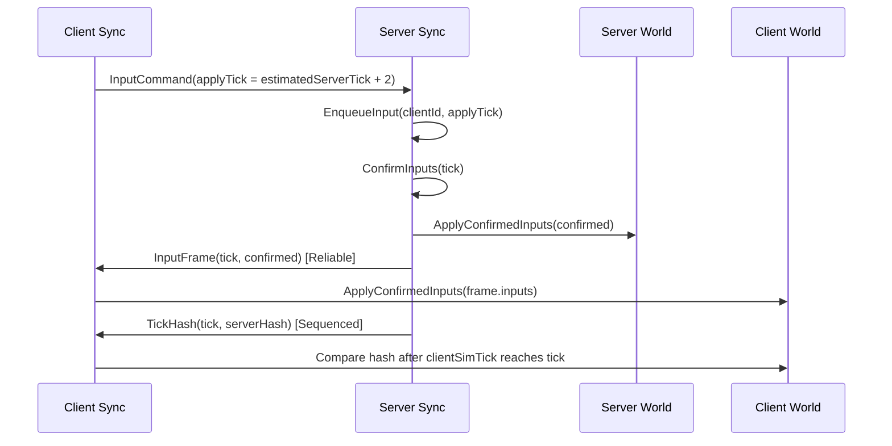
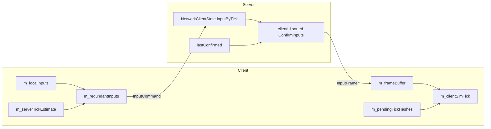

## 들어가며

07에서는 UDP 위에 endpoint 라우팅과 `ReliabilityChannel`을 올렸다. 이제 패킷은 손실, 중복, 재정렬을 어느 정도 견딘다. 하지만 전송 계층이 안정됐다고 게임 시뮬레이션이 자동으로 맞아지는 것은 아니다.

이번 단계에서는 상태를 계속 내려주는 대신 **입력을 릴레이해서 모두가 같은 시뮬레이션을 돌리는 방식**을 목표로 한다. 이 엔진은 `Fixed64`, `World::ComputeHash()`, `TickHash`를 이미 갖고 있으므로 lockstep이 자연스럽다.

핵심은 하나다.

> 서버가 tick T의 입력 묶음을 확정하고, 서버와 모든 클라이언트가 그 확정 묶음으로 tick T를 적용한다.

---

## 전체 흐름



`InputCommand`는 클라이언트가 서버에 제출하는 입력이다. 이 패킷은 저지연이 중요하므로 unreliable로 간다. 대신 같은 입력을 최대 3번 보낸다.

`InputFrame`은 서버가 확정한 입력 묶음이다. 이건 lockstep의 커맨드 스트림이므로 reliable이다. 빠지면 클라이언트는 그 tick을 시뮬레이션하면 안 된다.

---

## 서버 입력 저장소

예전에는 입력을 `pendingInputs` 큐에 쌓고 sequence로 중복을 걸렀다. 이제는 tick 슬롯으로 저장한다.

```cpp
std::map<uint64_t, InputCommand> inputByTick;
InputCommand lastConfirmed;
bool hasConfirmed;
uint64_t lastConfirmedTick;
```

서버는 `ConfirmInputs(tick)`에서 모든 client를 `clientId` 순서로 돌며 확정 입력을 만든다.

```text
if inputByTick[tick] exists:
    use it
else if lastConfirmed exists:
    hold lastConfirmed with tick updated
else:
    neutral input
```

이 방식의 장점은 결정론이다. `unordered_map` 순회 순서에 의존하지 않고, 결측 입력도 서버가 확정해서 전파하므로 모든 peer가 같은 결정을 적용한다.

---

## 클라이언트는 뒤따라 시뮬레이션한다

클라이언트는 snapshot을 받으면 `clientSimTick = snapshot.tick`으로 시작한다. 이후에는 `InputFrame`을 버퍼에 쌓는다.

```text
frameBuffer[tick] = inputs

while frameBuffer has clientSimTick + 1:
    ApplyConfirmedInputs(clientWorld, inputs)
    clientSimTick++
```

즉 클라이언트의 엔진 fixed tick 번호와 시뮬레이션 tick은 다를 수 있다. 클라이언트는 서버 확정 프레임을 받은 만큼만 전진한다. 아직 prediction/rollback은 없으므로 체감 지연은 있지만, 구조는 단순하고 검증하기 쉽다.

---

## TickHash 검증도 미룬다

서버가 확정 입력셋을 릴레이하기 전까지는 `TickHash`를 받자마자 현재 클라이언트 hash와 비교했다. 클라이언트가 `InputFrame`을 받은 만큼만 전진하게 된 지금은 그러면 안 된다. 클라이언트는 서버보다 뒤따라 시뮬레이션하기 때문이다.

그래서 `TickHash`도 pending map에 저장한다.

```text
pendingTickHashes[tick] = serverHash

if tick <= clientSimTick:
    compare client hash
```

이제 hash 비교는 클라이언트가 그 tick까지 `InputFrame`을 적용하기 **전에는** 수행되지 않는다. mismatch가 나면 기존처럼 `ResyncRequest`를 보내고 서버 snapshot을 다시 적용한다.

> **이 절의 수정은 절반짜리였다. 미루기만 했고, 비교 대상은 못 고쳤다.**
> 이번 편의 코드 커밋(`8f50934`)의 `VerifyPendingTickHashes`는 `tick > clientSimTick`이면 멈추는 **대기 조건**만 넣었고, 실제로 대조하는 값은 여전히 그 자리에서 부른 `world.ComputeHash()`, 즉 **"지금"의 월드 해시**였다.
> `tick <= clientSimTick`이 뜻하는 건 *작거나 같다*다. *같다*로 읽으면 틀린다. 그리고 바로 위 절의 `while` 루프는 밀린 프레임을 한 `FixedUpdate`에 몰아 적용하므로 `clientSimTick`이 여러 칸 점프할 수 있다. 그러면 tick T의 원격 해시가 tick T+n 상태와 비교되어, 아무 문제 없는 세션이 불일치로 판정되고 resync가 연쇄한다.
> 이번 편의 테스트가 이걸 못 잡은 이유는 `ClientAppliesRelayedInputFramesInOrder`가 클라와 서버를 **번갈아 한 tick씩** 돌리기 때문이다. 프레임이 항상 하나씩 오니 `tick == clientSimTick`이 늘 성립해서, "지금 해시"와 "그 tick의 해시"가 우연히 같았다.
> 제대로 된 처방은 **각 tick을 시뮬레이션한 그 순간의 해시를 `m_localHashByTick`에 기록해 두고 tick으로 짝을 맞춰 대조**하는 것이고, 그건 후속 커밋 `3d25a1d`에서 들어갔다(기록이 없는 tick은 판정 근거가 없으므로 조용히 버리고, 기록은 128 tick으로 상한을 둔다). 회귀 테스트는 `BatchedInputFramesDoNotCauseFalseHashMismatch`다.

---

## 입력 지연과 이중화

클라이언트는 서버 tick을 추정한다.

```text
WorldSnapshot 수신: serverTickEstimate = snapshot.tick     (+ hasServerTickEstimate = true)
TickHash 수신:      serverTickEstimate = tickHash.tick     (+ hasServerTickEstimate = true)
매 FixedUpdate:     if (hasServerTickEstimate) serverTickEstimate++
```

세 번째 줄의 조건이 중요하다. 추정을 **한 번이라도 서버 패킷으로 초기화한 뒤에만** 자유주행으로 굴린다. 아직 아무것도 못 받았다면 `serverTickEstimate`는 0에 머문 채 손대지 않는다. 근거 없는 숫자를 키워 봐야 서버 tick과 아무 관계가 없기 때문이다.

입력 tick은 현재 로컬 tick 대신 `serverTickEstimate + kInputDelayTicks`(=2)로 잡는다. 이렇게 해야 입력이 서버에 도착했을 때 이미 지나간 tick이 되는 일을 줄일 수 있다. 다만 추정이 아직 없으면 기댈 것이 없으므로 **엔진의 로컬 tick으로 폴백**한다.

```cpp
command.tick = (m_hasServerTickEstimate ? m_serverTickEstimate : tick) + kInputDelayTicks;
```

입력은 `RedundantInput` 큐에 들어간다.

```cpp
struct RedundantInput {
    InputCommand command;
    uint32_t remainingSends = 0;
};
```

구조체 기본값이 **0**이라는 데 주의. 3을 기대하면 틀린다. 전송 횟수 3은 **큐에 넣는 지점**에서 채워진다.

```cpp
m_redundantInputs.push_back(RedundantInput{
    .command = command,
    .remainingSends = kInputRedundancySends   // kInputRedundancySends = 3
});
```

즉 값 3의 출처는 구조체를 읽어서는 알 수 없고, 이름 붙은 상수 `kInputRedundancySends`와 그것을 쓰는 `SendQueuedLocalInputs`를 봐야 한다. 결과는 같은 `InputCommand`를 최대 3번 보내는 것이고, 서버는 `clientId + tick` 슬롯으로 dedup하므로 중복 전송은 안전하다.

---

## 현재 한 tick의 내부 저장소



이 그림이 말하는 것은 하나다. **정상 진행 중(steady state)에 서버 월드를 전진시키는 것은 `ConfirmInputs`의 결과 하나이고, 클라이언트 월드를 전진시키는 것은 `InputFrame` 하나다.** 이 둘이 같은 입력 배열을 쓰기 때문에 `Fixed64` 시뮬레이션 결과가 맞아야 한다.

다만 이걸 "월드를 건드리는 코드가 이것뿐"으로 읽으면 틀린다. 이번 편 시점에도 바깥 입구가 둘 있다.

- **설계상 허용된 입구는 클라이언트의 `ApplySnapshot`이다.** `WorldSnapshot`을 받으면 클라이언트는 `world.ApplySnapshot()`으로 월드를 통째로 갈아끼운다. 이건 의도한 동작이다. 스냅샷은 *조인과 resync 전용*이고, 그 순간의 클라이언트는 서버를 "따라가는" 게 아니라 "다시 줄을 서는" 중이다. 대신 그 직후 `clientSimTick`·`serverTickEstimate`·`frameBuffer`를 전부 새 기준점으로 리셋해야 하고, 코드가 그렇게 한다.
- **아직 정리되지 않은 입구는 서버의 `Hello` 처리다.** `HandlePacketOnServer`가 확정 입력 밖에서 `world.CreateEntity()`를 부른다. 새 클라이언트가 붙으면 서버 월드에만 엔티티가 하나 생기는 것이다. 지금은 곧이어 스냅샷을 보내 클라이언트를 맞추므로 드러나지 않지만, 원칙으로는 스폰도 확정 입력 경로를 타야 한다. 그래서 **스폰·디스폰이 확정 입력 경로에서만 일어나게 하는 정리**가 할 일로 남아 있고, 건설처럼 실제로 엔티티를 만드는 기능을 넣기 전에 이걸 끝내야 한다.

---

## 테스트로 확인한 것

이번 단계에서 추가된 핵심 테스트는 세 가지다.

- `ClientAppliesRelayedInputFramesInOrder`: 클라이언트가 `InputFrame`을 순서대로 적용해 서버 상태를 따라잡는지 확인한다.
- `ClientQueuesInputForEstimatedServerTickPlusDelay`: queued input이 `serverTickEstimate + 2` tick으로 예약되는지 확인한다.
- `LockstepConvergesTwoClientsOverLossyReorderingLink`: 손실, 중복, 재정렬이 있는 `SimulatedNetwork`에서 두 클라이언트가 입력을 보내도 최종 hash가 서버와 수렴하는지 확인한다.

세 번째 테스트가 무엇을 보장하고 무엇을 보장하지 않는지는 갈라 두는 게 좋다. 이 테스트는 루프를 다 돌린 뒤 `HasHashMismatch()`가 `false`인 것과 해시가 같은 것을 단언한다. 그런데 `m_hasHashMismatch`는 **스냅샷을 성공적으로 적용하면 다시 `false`로 리셋된다.** 불일치는 곧바로 `ResyncRequest`를 부르고 서버는 스냅샷으로 답하므로, "불일치 → resync → 스냅샷 → 플래그 리셋"이 한 세트로 굴러간다. 즉 이 단언이 실제로 말하는 것은 **"마지막으로 줄을 다시 선 이후로는 자력으로 따라왔다"**까지고, 중간에 resync가 몇 번 있었는지는 말하지 않는다. 그걸 증명하려면 resync 횟수를 세는 카운터가 있어야 하는데 지금 코드에는 없다.

---

## 남은 일

지금 구조는 lockstep의 최소판이다. 정확하지만 클라이언트는 서버 확정을 기다리므로 늦다. 다음 큰 주제는 prediction/rollback이다. 또 하나의 주의점은 입력 hold 정책이다. 이동과 aim은 직전 입력 hold가 자연스럽지만, 발사 같은 edge 입력은 hold하면 매 tick 반복 발사될 수 있다. 행동 입력 비트가 생기면 hold 대상에서 분리해야 한다.
