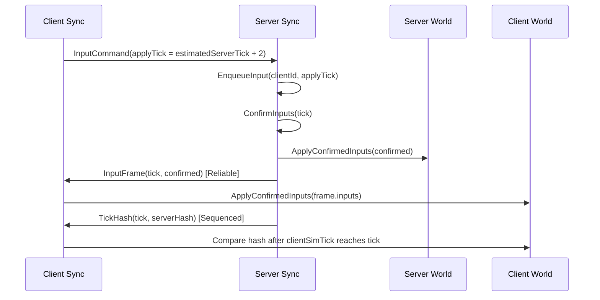
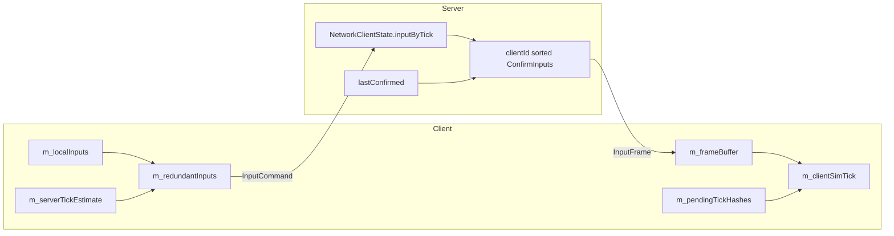

## 들어가며

07에서는 UDP 위에 endpoint 라우팅과 `ReliabilityChannel`을 올렸다. 이제 패킷은 손실, 중복, 재정렬을 어느 정도 견딘다. 하지만 전송 계층이 안정됐다고 게임 시뮬레이션이 자동으로 맞아지는 것은 아니다.

이번 단계의 목표는 **상태를 계속 내려주는 방식**이 아니라 **입력을 릴레이해서 모두가 같은 시뮬레이션을 돌리는 방식**이다. 이 엔진은 `Fixed64`, `World::ComputeHash()`, `TickHash`를 이미 갖고 있으므로 lockstep이 자연스럽다.

핵심은 하나다.

> 서버가 tick T의 입력 묶음을 확정하고, 서버와 모든 클라이언트가 그 확정 묶음으로 tick T를 적용한다.

---

## 전체 흐름



`InputCommand`는 클라이언트가 서버에 제출하는 입력이다. 이 패킷은 저지연이 중요하므로 unreliable로 간다. 대신 같은 입력을 최대 3번 보낸다.

`InputFrame`은 서버가 확정한 입력 묶음이다. 이건 lockstep의 커맨드 스트림이므로 reliable이다. 빠지면 클라이언트는 그 tick을 시뮬레이션하면 안 된다.

---

## 서버 입력 저장소

예전에는 입력을 `pendingInputs` 큐에 쌓고 sequence로 중복을 걸렀다. 이제는 tick 슬롯으로 저장한다.

```cpp
std::map<uint64_t, InputCommand> inputByTick;
InputCommand lastConfirmed;
bool hasConfirmed;
uint64_t lastConfirmedTick;
```

서버는 `ConfirmInputs(tick)`에서 모든 client를 `clientId` 순서로 돌며 확정 입력을 만든다.

```text
if inputByTick[tick] exists:
    use it
else if lastConfirmed exists:
    hold lastConfirmed with tick updated
else:
    neutral input
```

이 방식의 장점은 결정론이다. `unordered_map` 순회 순서에 의존하지 않고, 결측 입력도 서버가 확정해서 전파하므로 모든 peer가 같은 결정을 적용한다.

---

## 클라이언트는 뒤따라 시뮬레이션한다

클라이언트는 snapshot을 받으면 `clientSimTick = snapshot.tick`으로 시작한다. 이후에는 `InputFrame`을 버퍼에 쌓는다.

```text
frameBuffer[tick] = inputs

while frameBuffer has clientSimTick + 1:
    ApplyConfirmedInputs(clientWorld, inputs)
    clientSimTick++
```

즉 클라이언트의 엔진 fixed tick 번호와 시뮬레이션 tick은 다를 수 있다. 클라이언트는 서버 확정 프레임을 받은 만큼만 전진한다. 아직 prediction/rollback은 없으므로 체감 지연은 있지만, 구조는 단순하고 검증하기 쉽다.

---

## TickHash 검증도 미룬다

M2까지는 `TickHash`를 받자마자 현재 클라이언트 hash와 비교했다. M3 이후에는 그러면 안 된다. 클라이언트는 서버보다 뒤따라 시뮬레이션하기 때문이다.

그래서 `TickHash`도 pending map에 저장한다.

```text
pendingTickHashes[tick] = serverHash

if tick <= clientSimTick:
    compare client hash
```

이제 hash 비교는 클라이언트가 해당 tick까지 `InputFrame`을 적용한 뒤에만 수행된다. mismatch가 나면 기존처럼 `ResyncRequest`를 보내고 서버 snapshot을 다시 적용한다.

---

## 입력 지연과 이중화

클라이언트는 서버 tick을 추정한다.

```text
WorldSnapshot 수신: serverTickEstimate = snapshot.tick
TickHash 수신:      serverTickEstimate = tickHash.tick
매 FixedUpdate:     serverTickEstimate++
```

입력 tick은 현재 로컬 tick이 아니라 `serverTickEstimate + 2`로 잡는다. 이렇게 해야 입력이 서버에 도착했을 때 이미 지나간 tick이 되는 일을 줄일 수 있다.

입력은 `RedundantInput` 큐에 들어간다.

```cpp
struct RedundantInput {
    InputCommand command;
    uint32_t remainingSends = 3;
};
```

같은 `InputCommand`를 최대 3번 보낸다. 서버는 `clientId + tick` 슬롯으로 dedup하므로 중복 전송은 안전하다.

---

## 현재 한 tick의 내부 저장소



서버의 상태 변화는 `ConfirmInputs` 결과 하나로만 만들어진다. 클라이언트의 상태 변화도 `InputFrame` 하나로만 만들어진다. 이 둘이 같은 입력 배열을 쓰기 때문에 `Fixed64` 시뮬레이션 결과가 맞아야 한다.

---

## 테스트로 확인한 것

이번 단계에서 추가된 핵심 테스트는 세 가지다.

- `ClientAppliesRelayedInputFramesInOrder`: 클라이언트가 `InputFrame`을 순서대로 적용해 서버 상태를 따라잡는지 확인한다.
- `ClientQueuesInputForEstimatedServerTickPlusDelay`: queued input이 `serverTickEstimate + 2` tick으로 예약되는지 확인한다.
- `LockstepConvergesTwoClientsOverLossyReorderingLink`: 손실, 중복, 재정렬이 있는 `SimulatedNetwork`에서 두 클라이언트가 입력을 보내도 최종 hash가 서버와 수렴하는지 확인한다.

---

## 남은 일

지금 구조는 lockstep의 최소판이다. 정확하지만 클라이언트는 서버 확정을 기다리므로 늦다. 다음 큰 주제는 prediction/rollback이다. 또 하나의 주의점은 입력 hold 정책이다. 이동과 aim은 직전 입력 hold가 자연스럽지만, 발사 같은 edge 입력은 hold하면 매 tick 반복 발사될 수 있다. 행동 입력 비트가 생기면 hold 대상에서 분리해야 한다.
