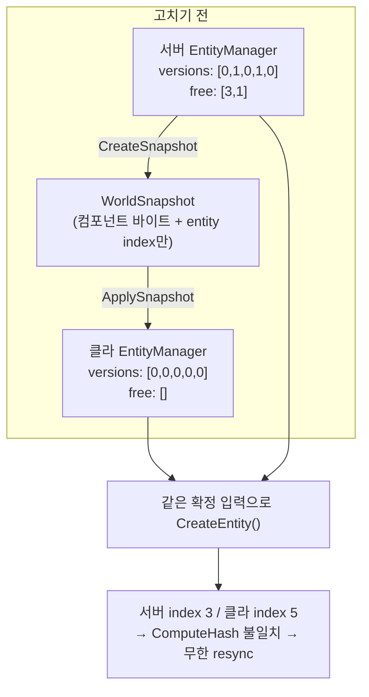

## 들어가며

08에서 결정론 입력 lockstep을 만들었다. 서버가 tick T의 입력을 확정하고, 서버와 모든 클라이언트가 그 확정 묶음으로 tick T를 적용한다. 그리고 이렇게 끝맺었다.

> 지금 구조는 lockstep의 최소판이다. 정확하지만 클라이언트는 서버 확정을 기다리므로 늦다. 다음 큰 주제는 prediction/rollback이다.

그런데 prediction보다 먼저 걸린 게 있었다. 이 엔진 위에 올릴 게임은 공장(팩토리) 게임이고, 공장 게임의 근본 동작은 **건물을 짓는 것**이다. 그리고 건물을 짓는다는 건 결국 **엔티티를 만드는 것**이다.

"lockstep에서 스폰은 어떻게 복제하지?"를 따라가다가, 답이 예상과 정반대라는 걸 알았다. **복제할 필요가 없었다.** 대신 그게 성립하기 위한 전제가 깨져 있었다.

이번 글은 그 이야기다. 설계 문서를 쓰다가 코드를 따라 내려가서 발견한 것이라, "만들었다"보다 **"어떻게 찾았고 왜 그렇게 고쳤는가"** 에 무게가 있다.

---

## 1. 좋은 소식 — lockstep에서 스폰은 복제 대상이 아니다

처음에는 당연히 새 패킷이 필요하다고 생각했다. `SpawnEntity` 같은 것을 만들어서 "서버가 엔티티를 만들었다"고 알려주는 그림이었다.

그런데 lockstep의 정의를 다시 보면 그럴 이유가 없다.

> 서버와 모든 클라이언트가 **같은 확정 입력**을 **같은 tick**에 적용한다.

스폰이 확정 입력의 순수 함수라면 — 즉 "tick T에 clientId 1이 건설 버튼을 눌렀다"에서 결정되는 것이라면 — 모든 peer가 그 입력을 받았을 때 **각자 알아서 똑같은 엔티티를 만든다.** 서버가 알려줄 필요가 없다. 이미 알려줬기 때문이다(입력으로).

이게 lockstep이 대역폭에서 이기는 이유이기도 하다. 벨트 위에 아이템이 수만 개 떠다니는 공장 게임에서 그걸 전부 상태로 스트리밍하는 건 불가능하다. 하지만 입력만 중계하면 전부 각자 계산한다.

단, 이 그림에는 조건이 하나 붙는다.

> 양쪽 `EntityManager` 가 **같은 상태**여야 한다.

`CreateEntity()`가 어떤 index를 뽑을지는 그 관리자의 내부 상태에 달렸기 때문이다.

```cpp
// EngineCore/ECS/EntitiyManager.hpp
EntityId EntityManager::CreateEntity() {
    if (!m_freeIndices.empty()) {
        index = m_freeIndices.back();   // 재사용 대기 중인 index를 뒤에서 꺼낸다 (LIFO)
        m_freeIndices.pop_back();
        version = m_versions[index];    // 그 index의 현재 version
    } else {
        index = m_nextEntityIndex++;    // 없으면 새 index
        m_versions.push_back(0);
        version = 0;
    }
    return CreateEntityId(index, version);
}
```

`m_freeIndices` 와 `m_versions` 와 `m_nextEntityIndex`. 이 셋이 다르면 같은 호출이 다른 id를 낸다.

---

## 2. 나쁜 소식 — 그 전제가 깨져 있었다

클라이언트는 접속할 때 `WorldSnapshot` 을 받아 월드를 통째로 맞춘다. 그러면 `EntityManager` 도 같이 맞춰질까? 코드를 따라 내려가 봤다.

```cpp
// 고치기 전 World::ApplySnapshot
bool ApplySnapshot(const WorldSnapshot& snapshot) {
    Registry newRegistry;                         // ← 완전히 새 Registry (= 새 EntityManager)

    for (const ComponentSnapshot& cs : snapshot.components) {
        ...
        applier(newRegistry, cs);                 // ← 컴포넌트 데이터만 채운다
    }

    m_registry = std::move(newRegistry);
    return true;
}
```

그 `applier` 안쪽은 이렇게 간다.

```cpp
// Registry::AddComponentRaw
T& AddComponentRaw(EntityIndex entityIndex, const void* componentData) {
    EnsureEntityExists(entityIndex);   // ← 여기
    ...
}

// Registry::EnsureEntityExists
void EnsureEntityExists(EntityIndex index) {
    while (m_entityManager.EntityCapacity() <= index) {
        m_entityManager.CreateEntity();   // capacity가 찰 때까지 새로 뽑는다
    }
}
```

즉 클라이언트의 `EntityManager` 는 **0번부터 순서대로 새로 만들어진다.** 결과:

- `m_versions` 가 **전부 0** — 서버는 파괴가 있었으면 0이 아니다
- `m_freeIndices` 가 **비어 있음** — 서버는 재사용 대기 index를 들고 있을 수 있다
- 스냅샷 컴포넌트가 하나도 없는 엔티티는 **아예 존재하지 않음**

스냅샷이 나르는 건 `ComponentSnapshot.entities` 의 `EntityIndex` 목록뿐이었다. 엔티티가 "있다"는 사실 자체도, version도, free list도 실리지 않았다.

이 상태에서 양쪽이 같은 확정 입력으로 엔티티를 만들면:

```
서버:  free list에서 3번 회수  →  index 3, version 1
클라:  free list가 비었으니     →  index 5, version 0
```

**서로 다른 엔티티가 생긴다.** 그리고 `World::ComputeHash()` 는 각 풀의 dense entity index를 해시에 섞는다.

```cpp
for (EntityIndex entity : pool->GetDenseEntities()) {
    mixUInt64(entity);
}
```

그러니 index가 갈라지는 순간 해시가 어긋나고, 06에서 만든 resync가 발동하고, 스냅샷을 다시 받아도 같은 이유로 또 갈라진다. **무한 리싱크.**

지금 이게 안 보였던 이유는 단순하다. 시뮬레이션 도중에 스폰을 한 적이 없어서다. 테스트는 전부 초기 스냅샷에 담긴 엔티티만 쓴다. 건설을 넣는 순간 터졌을 것이다.



---

## 3. 무엇을 실어야 하나

"살아 있는 엔티티 목록을 실으면 되지 않나"가 첫 생각이었다. 그런데 그걸로는 부족하고, 동시에 과하다.

**부족한 이유 — 죽은 index의 version이 필요하다.** free list에서 회수된 index의 version은 `m_versions[index]` 를 그대로 읽어 쓴다. 죽어 있는 index의 version을 모르면 그 index가 재사용되는 순간 id가 갈라진다. 살아 있는 것만 실어서는 알 수 없다.

**또 부족한 이유 — free list는 순서가 의미를 가진다.** `CreateEntity()` 가 뒤에서 pop하므로 LIFO다. 살아 있는 집합만으로는 "3 다음에 1"이라는 순서를 복원할 수 없다.

**과한 이유 — 살아 있는 목록은 유도된다.** `[0, nextEntityIndex)` 에서 `freeIndices` 를 빼면 살아 있는 index이고, version은 `versions[index]` 다. 굳이 따로 실을 필요가 없다.

그래서 내부 상태 3필드를 그대로 싣기로 했다.

```cpp
// EngineCore/ECS/EntitiyManager.hpp
struct EntitySnapshot {
    /// 다음에 새로 뽑을 index(= 지금까지 존재한 적 있는 index의 개수).
    EntityIndex nextEntityIndex = 0;
    /// index 0..nextEntityIndex-1 각각의 현재 version. 죽은 index의 것도 포함한다.
    std::vector<EntityVersion> versions;
    /// 재사용 대기 중인 index. **순서가 의미를 가진다**(LIFO).
    std::vector<EntityIndex> freeIndices;
};
```

`nextEntityIndex` 는 사실 `versions.size()` 와 항상 같다(둘이 함께만 자란다). 중복인데도 실어 보내는 이유는 **와이어에서 온 값을 믿지 않기 위해서**다. 받는 쪽이 이 불변식을 검사할 수 있게 된다.

---

## 4. 복원은 "재생"이 아니라 "대입"이다

여기서 한 번 더 걸렸다. 복원을 `Clear()` 후 `CreateEntity()` 반복으로 하려고 했는데, 그건 안 된다.

`CreateEntity()` 를 아무리 반복해도 **free list의 순서를 만들어낼 수 없다.** free list는 파괴가 일어난 순서의 기록이지, 생성 횟수의 함수가 아니기 때문이다. 서버에서 3번, 1번 순으로 파괴됐다는 사실은 생성 API로는 재현할 수 없다.

그래서 3필드를 직접 대입한다.

```cpp
/// @brief 스냅샷으로 상태를 통째로 되돌린다.
///
/// `Clear()` 후 재구성하는 게 아니라 3필드를 직접 대입한다 — `CreateEntity()`를
/// 반복 호출해서는 free list의 순서를 재현할 수 없기 때문이다.
[[nodiscard]] bool RestoreFrom(const EntitySnapshot& snapshot);
```

"상태를 복원한다"고 하면 반사적으로 "같은 연산을 다시 실행한다"를 떠올리게 되는데, 여기서는 그 접근이 원리적으로 안 되는 경우였다.

---

## 5. 받는 쪽은 스냅샷을 믿으면 안 된다

`ApplySnapshot` 은 네트워크에서 온 데이터를 다룬다. 손상됐거나 조작됐을 수 있다. 그래서 순서가 이렇게 된다.

```cpp
bool ApplySnapshot(const WorldSnapshot& snapshot) {
    Registry newRegistry;

    if (!newRegistry.RestoreEntities(snapshot.entities)) {
        return false;                    // ① 엔티티 상태부터 복원 + 검증
    }

    // ② 살아 있는 index 판정용 비트맵
    std::vector<bool> isAlive(snapshot.entities.versions.size(), true);
    for (EntityIndex freeIndex : snapshot.entities.freeIndices) {
        isAlive[freeIndex] = false;
    }

    for (const ComponentSnapshot& cs : snapshot.components) {
        // ③ 죽었거나 없는 index에 컴포넌트가 붙어 있으면 자기모순 → 거부
        for (EntityIndex entityIndex : cs.entities) {
            if (entityIndex >= isAlive.size() || !isAlive[entityIndex]) {
                return false;
            }
        }

        auto applierIt = m_snapshotAppliers.find(cs.type.hash);
        if (applierIt == m_snapshotAppliers.end()) {
            continue;                    // ④ 모르는 타입은 무시(거부는 아님)
        }
        if (!applierIt->second(newRegistry, cs)) {
            return false;
        }
    }

    m_registry = std::move(newRegistry);  // ⑤ 여기까지 와야 실제 반영
    return true;
}
```

**③이 ④보다 앞에 있는 게 중요하다.** 처음에는 반대로 썼었다. "모르는 타입은 어차피 적용도 안 하는데 검사할 이유가 있나" 싶었기 때문이다.

그런데 그러면 미등록 타입에 실린 잘못된 index가 검사되지 않고, **자기모순인 스냅샷을 정상으로 받아들이게 된다.** 게다가 등록 목록은 클라이언트마다 다를 수 있어서, 같은 스냅샷의 수용/거부 판정이 peer마다 갈리게 된다. 그건 그 자체로 곤란하다.

⑤도 의도적이다. 검증에 실패하면 `newRegistry` 가 통째로 버려지고 기존 월드는 손도 안 댄 상태로 남는다. 반쯤 적용된 월드가 제일 나쁘다.

`RestoreFrom` 이 거부하는 것들:

| 조건 | 왜 자기모순인가 |
|---|---|
| `nextEntityIndex != versions.size()` | 둘은 함께만 자란다 |
| free index가 범위 밖 | 존재한 적 없는 index를 재사용 대기로 둘 수 없다 |
| free index 중복 | 같은 index가 두 번 살아나면 엔티티가 겹친다 |

---

## 6. 테스트 — 빨간불부터 만들었다

이 작업은 **테스트가 곧 산출물**이다. 고친 코드보다 "무엇이 보장되는가"가 중요하다.

네 개를 추가했고, 전부 구조체를 직접 넘기지 않고 `EncodeWorldSnapshot` → `DecodeWorldSnapshot` **와이어 왕복을 태운다.** 구조체만 복사하면 인코더가 새 필드를 통째로 빠뜨려도 테스트가 통과하기 때문이다.

| 테스트 | 무엇을 보장하나 |
|---|---|
| `SnapshotRestoresEntityAllocationStateAcrossDestroys` | 파괴 이력이 있어도 왕복 후 양쪽이 같은 `EntityId`를 뽑는다 |
| `WorldHashStaysEqualWhenBothSidesSpawnAfterSnapshot` | 왕복 후 같은 스폰을 하면 `ComputeHash()`가 일치한다 |
| `SnapshotKeepsEntityWithoutSnapshotComponents` | 컴포넌트가 하나도 없는 엔티티도 살아남는다 |
| `SnapshotRejectsInconsistentEntityState` | 모순된 스냅샷을 거부한다 |

첫 번째가 이 작업의 핵심이라 값을 하드코딩했다.

```cpp
// free list는 LIFO라 3 → 1 순으로 회수되고, 그 뒤에야 새 index 5가 나온다.
// 회수된 index의 version은 파괴 때 1 올라가 있어야 한다.
EXPECT_EQ(EF::GetEntityIndex(serverFirst),   3);
EXPECT_EQ(EF::GetEntityVersion(serverFirst), 1);
EXPECT_EQ(clientFirst, serverFirst);
// ... 두 번째는 index 1 version 1, 세 번째는 index 5 version 0
```

index만이 아니라 **version까지** 같은지 본다. index만 맞고 version이 다르면 `IsAlive` 판정이 갈라진다.

그리고 **수정을 넣기 전에 빨간불을 확인했다.** `RestoreEntities` 호출을 잠깐 빼고 빌드하니 네 개가 전부 실패했고, 실패 양상이 예측과 정확히 일치했다 — 클라가 5를 뽑을 때 서버는 `4294967299`(= index 3, version 1)를 뽑았다. 이걸 안 해보면 "테스트가 통과했다"가 "테스트가 아무것도 안 본다"와 구별되지 않는다.

---

## 7. 남은 일

이 작업으로 스폰의 **전제조건**이 갖춰졌을 뿐, 결정론 스폰 자체는 아직이다.

**스폰/디스폰은 확정 입력 경로에서만 일어나야 한다.** 서버가 혼자 판단해서 스폰하거나 클라가 로컬 예측으로 스폰하면 그 즉시 갈라진다. 지금 접속 처리(`Hello`)가 확정 입력 밖에서 `CreateEntity()` 를 부르고 있어서, 이걸 정리하는 게 다음 일이다.

**`ComputeHash()` 에 엔티티 상태를 아직 넣지 않았다.** 넣으면 디싱크를 더 빨리 잡을 수 있고 개념적으로도 맞다. 그런데 지금 넣으면 위의 이유로 정상 세션이 불일치로 판정된다 — 클라 A가 스냅샷을 받은 뒤 클라 B가 접속하면 A의 `EntityManager` 가 서버와 정당하게 어긋나기 때문이다. 순서상 위의 정리가 먼저다.

그리고 이번에 코드를 다른 벤더의 모델에게 읽기 전용으로 교차검증시켰더니, 내가 못 본 것 두 개가 더 나왔다.

- **`ComputeHash()` 가 풀을 프로세스 로컬 타입 인덱스 순서로 순회한다.** 이 엔진은 "`TypeInfo::index` 는 프로세스 로컬이라 클라·서버 간 안정적이지 않고, `hash` 만 안정적"이라는 규칙을 문서에 못박아 뒀는데, 정작 해시 함수 자신이 그 함정을 밟고 있었다. 지금은 양쪽이 같은 순서로 타입을 등록해서 안 드러날 뿐이다.
- **`EntityManager::IsAlive` 가 free list를 보지 않는다.** version만 비교하므로, 파괴됐지만 아직 재사용되지 않은 index로 만든 id를 살아 있다고 판정한다. 현재는 `View` 가 dense 풀에서만 id를 뽑아 물리지 않는다.

둘 다 동작을 바꾸는 수정이라 이번엔 손대지 않고, 코드에 함정으로 표시만 해뒀다.

마지막으로 정직하게 하나. 와이어 포맷이 바뀌었으니 `kProtocolVersion` 을 1에서 2로 올렸는데, **이 상수는 저장소 어디에서도 읽히지 않는다.** 선언만 있고 검사하는 코드가 없어서 이 bump는 순수하게 문서적이다. 실제로 와이어에 실려 검사되는 버전은 전송 계층의 `kReliabilityVersion` 뿐이다. 앱 계층 버전 검사는 `Hello`/`Welcome` handshake에 붙이는 게 자연스럽고, 그건 아직 안 했다.
