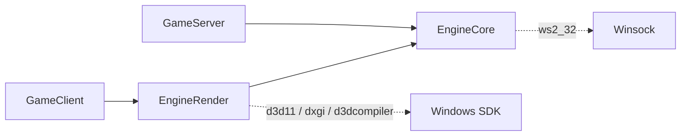
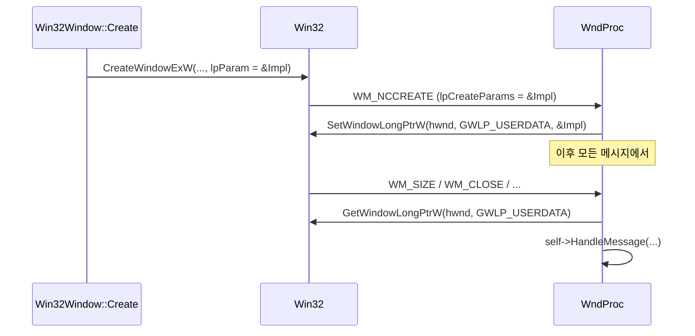

## 들어가며

09편은 결정론 스폰의 전제조건을 갖추고 이렇게 끝났다.

> 이 작업으로 스폰의 **전제조건**이 갖춰졌을 뿐, 결정론 스폰 자체는 아직이다.

계획대로라면 다음은 "스폰을 확정 입력 경로 안으로 밀어넣기"였다. 그런데 거기로 가기 전에 한 번 멈췄다.

아홉 편 동안 쌓은 것을 세어 보면 ECS, 고정소수점 수학, 스냅샷, 신뢰성 UDP, 입력 lockstep이다. 그리고 이 중 **눈으로 본 것이 하나도 없다.** 검증은 전부 테스트 하네스가 했다. tick 해시가 두 프로세스에서 같다는 것을 숫자로 확인했고, 손실 링크에서 수렴한다는 것도 숫자로 확인했다. 숫자는 맞는데 화면이 없다.

이게 위험한 진짜 이유는 따로 있다. **틀렸을 때 알아채는 경로가 하나뿐**이라는 것이다. 테스트가 보지 않는 축으로 틀리면 영영 모른다. 그리고 앞으로 만들 것(카메라, 보간, UI, 실제 키보드 입력)은 전부 "화면을 보면 5초, 안 보면 한나절"인 종류다.

이번 글은 창을 띄우는 이야기다. 그런데 창보다 먼저 한 일이 있다. **빌드 타깃을 갈랐다.**

---

## 1. 렌더 코드를 엔진 코어에 넣지 않기로 했다

이 엔진의 실행 형태는 셋이다. dedicated server, remote client, host/singleplayer. 셋이 같은 로직을 공유하도록 거의 모든 코드를 `EngineCore`라는 정적 라이브러리 하나에 넣어 왔다.

렌더링은 그 안에 들어가면 안 되는 첫 코드였다. dedicated server에는 창도 GPU도 없다.

"안 부르면 그만"으로 넘어갈 수도 있었다. 실제로 그래도 동작은 한다. 정적 라이브러리를 링크한다고 쓰지 않는 코드가 실행되지는 않으니까. 문제는 실행이 아니라 **링크**다. `Dx11Renderer.cpp`가 `EngineCore` 안에 있으면 `EngineCore`가 `d3d11`, `dxgi`, `d3dcompiler`를 링크해야 하고, 그러면 `GameServer.exe`의 임포트 테이블에 그 DLL들이 박힌 채로 배포된다. GPU 드라이버가 없는 서버 머신에서는 프로그램이 시작조차 못 한다. 한 줄도 부르지 않는 코드 때문에.

그래서 타깃을 하나 더 만들었다.

```cmake
add_library(EngineRender STATIC)

target_sources(EngineRender
    PRIVATE
        Platform/Win32Window.cpp
        Render/Dx11/Dx11Renderer.cpp
        UI/AnchorLayout.cpp
    PUBLIC
        FILE_SET HEADERS
        ...
)

target_link_libraries(EngineRender PUBLIC EngineCore)

if(WIN32)
    target_link_libraries(EngineRender PRIVATE d3d11 dxgi d3dcompiler)
endif()
```

의존 방향은 한쪽으로만 간다.



`d3d11`을 `PRIVATE`으로 링크한 것에도 의도가 있다. `PUBLIC`이면 `EngineRender`를 링크하는 쪽까지 그 라이브러리들이 전파된다. 지금은 `GameClient` 하나뿐이라 결과가 같지만, 나중에 에디터나 도구가 붙었을 때 "왜 이게 DX11을 요구하지"를 다시 추적하게 된다.

로드맵에서 이 분리 작업은 원래 렌더 트랙 **뒤**에 있었다. 일단 DX11을 `EngineCore`에 넣고 굴려본 다음, 돌아가는 걸 확인하고 나서 쪼개는 순서였다. 그 순서를 앞으로 당겼다. 이유는 하나다. 의존이 얽힌 뒤에 쪼개는 비용이 처음부터 나누는 비용보다 훨씬 크다. 지금 `EngineRender`에 든 `.cpp`는 세 개고, 이 시점에 가르는 작업은 CMake 블록 하나를 더 쓰는 일이었다.

### UI가 왜 렌더 타깃에 들어갔나

`UI/AnchorLayout.cpp`가 여기 있는 것은 처음 보면 어색하다. 앵커 레이아웃은 사각형 하나를 부모 사각형 안 어디에 놓을지 계산하는 순수 함수다. GPU도 창도 필요 없고 단위 테스트도 된다. 기준만 놓고 보면 `EngineCore`에 있어도 된다.

그래도 렌더 쪽에 뒀다. UI 전체가 ClientPresentation 전용이고 서버 빌드는 링크조차 하면 안 되는 물건인데, 레이아웃만 코어로 내려두면 나머지 UI(드로우 목록, 폰트 아틀라스, 히트테스트)가 "레이아웃이 저기 있으니 옆에 두자"라는 구실을 얻는다. 경계는 처음 그을 때 긋는 편이 싸다.

---

## 2. 문서에만 적힌 규칙은 깨진다

여기까지가 설계다. 그리고 이 설계에는 문제가 있다. **아무것도 강제하지 않는다.**

누군가 `GameServer/CMakeLists.txt`에 `EngineRender`를 한 줄 더 적어도 빌드는 통과한다. 테스트도 전부 통과한다. 서버 실행 파일이 `d3d11.dll`을 물게 되지만, 개발 기계에는 그 DLL이 있으니 실행도 잘 된다. GPU 없는 기계에 배포하는 날까지 아무도 모른다.

그래서 CI 검사를 붙였다.

```bash
imports="$(objdump -p "$SERVER_EXE" | grep -i 'DLL Name' || true)"

if echo "$imports" | grep -qiE 'd3d11|dxgi|d3dcompiler|d3d12'; then
    echo "::error::GameServer가 렌더 계층 DLL에 의존한다."
    exit 1
fi
```

CMake 파일을 읽어서 판정하지 않고 **빌드 산출물의 임포트 테이블**을 본다. CMake를 파싱하면 생성기(Ninja / MinGW Makefiles)와 작성 방식에 묶이고, 무엇보다 실제로 배포되는 물건을 보지 못한다. `objdump -p`는 최종 exe가 어떤 DLL을 요구하는지 그대로 찍어준다.

작은 것 하나. 대상 파일이 없으면 실패로 처리한다.

```bash
if [[ ! -f "$SERVER_EXE" ]]; then
    echo "::error::GameServer 실행 파일을 찾을 수 없다: $SERVER_EXE"
    exit 1
fi
```

출력 경로가 바뀌었을 때 조용히 초록불을 켜는 검사는 없느니만 못하다. 그런 검사는 사람에게 "확인했다"는 잘못된 신호를 준다.

### 이 시점에서 이 검사는 약했다

정직하게 적어둘 값어치가 있는 부분이다.

이 편의 범위에서 `Dx11Renderer`는 아직 스텁이었다. DX11 함수를 한 번도 호출하지 않는다. 그러면 링커는 쓰이지 않는 임포트 라이브러리를 그냥 떨어뜨린다. 즉 이 시점의 검사는 **"규칙이 지켜져서 통과"와 "아직 물어뜯을 게 없어서 통과"를 구별하지 못했다.**

진짜로 이빨이 생기는 건 device와 swapchain을 실제로 만드는 다음 편부터다. 그때까지는 회귀 방지 그물을 미리 쳐둔 상태로 읽는 것이 맞고, 스크립트 주석에도 그렇게 적어뒀다.

---

## 3. 무엇을 추상화하고 무엇을 안 했나

타깃을 갈랐으니 코어가 렌더를 부르지 않으면서도 클라가 둘을 이어붙일 수 있는 인터페이스가 필요하다. 두 개를 만들었다.

```cpp
class IWindow {
public:
    virtual bool Create(const char* title, uint32_t width, uint32_t height) = 0;
    virtual void Destroy() = 0;

    // 쌓인 창 메시지를 전부 처리한다. 창이 닫혔으면 false.
    virtual bool PumpMessages() = 0;

    [[nodiscard]] virtual void* NativeHandle() const = 0;
    [[nodiscard]] virtual uint32_t Width() const = 0;
    [[nodiscard]] virtual uint32_t Height() const = 0;

    virtual bool ConsumeResized() = 0;
};
```

```cpp
class IRenderer {
public:
    virtual bool Initialize(IWindow& window) = 0;
    virtual void Shutdown() = 0;
    virtual void Resize(uint32_t width, uint32_t height) = 0;

    virtual void BeginFrame(const Color& clearColor) = 0;
    virtual void SetCamera(const Mat4& viewProjection) = 0;
    virtual void Submit(const RenderContext& context) = 0;
    virtual void EndFrame() = 0;
};
```

`IWindow::NativeHandle()`이 `void*`를 돌려주는 것이 이 설계의 타협점이다.

창을 끝까지 추상화하려면 "렌더 표면"이라는 개념을 하나 더 만들고 창 구현과 렌더 백엔드가 그것을 통해서만 만나게 해야 한다. 구현체가 각각 하나씩(Win32 / DX11)인 지금 그건 쓰이지 않을 추상화다. 대신 캐스팅을 **한 곳에만** 허용했다. `Dx11Renderer::Initialize` 안의 `static_cast<HWND>(window.NativeHandle())` 한 줄이다. 그 줄이 Win32와 DX11이 서로를 아는 유일한 지점이고, 나머지 코드는 둘 다 모른다.

`Color`, `Mat4`, `RenderContext` 같은 값 타입만 인터페이스를 넘나든다. 여기에 대해서는 짚어둘 것이 있는데 11편 끝에서 다시 다룬다. 값 타입만 오간다고 해서 백엔드 교체가 공짜가 되지는 않는다.

### 렌더 타입이 전부 float인 이유

`RenderTypes.hpp`에 있는 `Float2`, `Float3`, `Color`, `Mat4`는 전부 float다. 시뮬레이션 타입인 `Fixed64`와 `Vector3`는 여기 없다.

이 구분이 이 엔진의 결정론을 떠받친다. `Fixed64`에서 float으로 가는 변환은 렌더 경계에서 한 방향으로만 일어나야 하고, 그 결과가 시뮬레이션으로 되돌아가면 그 순간 클라마다 값이 갈린다. 타입을 갈라두면 실수로 되돌아가는 코드가 **컴파일되지 않는다.** 규칙을 주석에 적는 것보다 타입으로 막는 쪽이 강하다.

한편 `Float3`는 지금 목표(2D 탑다운)에는 과하다. y를 쓰지 않으니까. 그래도 3차원으로 뒀다. 게임플레이의 `Transform.position`이 이미 3차원이라 여기서 납작하게 만들면 나중에 3D로 갈 때 렌더 시스템을 통째로 다시 써야 한다. 지금 y 하나를 비워두는 비용은 0에 가깝다.

---

## 4. windows.h를 헤더에 들이지 않기

이제 창을 만든다. 그런데 `Win32Window.hpp`에는 `HWND`가 없다.

```cpp
class Win32Window final : public IWindow {
public:
    // ...
private:
    struct Impl;
    std::unique_ptr<Impl> m_impl;
};
```

Win32 상태를 전부 `.cpp` 안의 `Impl`에 가뒀다. PIMPL이다. 이렇게 한 이유는 `windows.h`가 헤더에 들어오면 그것을 include하는 **모든 번역 단위**로 번지기 때문이다.

| `windows.h`가 뿌리는 것 | 무엇이 깨지나 |
|---|---|
| `min` / `max` 매크로 | `std::min` / `std::max` 호출이 토큰 단위로 깨진다 |
| `Rectangle`, `CreateWindow`, `GetMessage` 등 | 흔한 이름을 매크로가 선점한다 |
| 방대한 하위 헤더 | 컴파일 시간이 늘어난다 |

`.cpp` 맨 위에서는 이렇게 막는다.

```cpp
#ifndef WIN32_LEAN_AND_MEAN
#define WIN32_LEAN_AND_MEAN
#endif
#ifndef NOMINMAX
#define NOMINMAX
#endif
#include <windows.h>
```

두 매크로는 `windows.h`를 include하기 **전에** 정의해야 효과가 있다. 순서를 뒤집으면 아무 일도 일어나지 않는다.

`UNICODE` / `_UNICODE`도 같은 자리에서 켰다. 이 파일은 W계열 API(`CreateWindowExW` 등)만 부르는데, `IDC_ARROW` 같은 리소스 매크로는 이 정의가 없으면 A계열(`char*`)로 전개되어 타입이 어긋난다. "W만 쓴다"는 결정을 매크로 수준까지 일관되게 만드는 스위치다.

### void* 하나로 끝내지 않은 이유

PIMPL 대신 `void* m_hwnd` 멤버 하나만 두는 방법도 있었다. 그러지 않았다.

숨겨야 할 Win32 상태가 `HWND` 말고도 있기 때문이다. `HINSTANCE`, 창 스타일(`DWORD`), 그리고 `WndProc`이 갱신하는 크기와 종료 플래그가 함께 있다. 이걸 `void*`와 원시 타입으로 흩어 두면 `.cpp`가 캐스팅 범벅이 되고, 더 큰 문제로 `WndProc`이 "인스턴스 상태"를 한 덩어리로 되찾을 방법이 없어진다. 다음 절이 그 이야기다.

---

## 5. WndProc과 인스턴스를 잇는 다리

Win32에서 창 메시지는 `WndProc`이라는 콜백으로 온다. 이 함수는 OS가 직접 호출하는 C 함수 포인터여서 **비정적 멤버 함수일 수 없다.** `this`가 없다는 뜻이다.

그런데 메시지를 처리하려면 인스턴스 상태에 닿아야 한다. 크기가 바뀌었으면 `width`/`height`를 갱신해야 하고, 창이 닫혔으면 `closed`를 세워야 한다. `HWND`는 인자로 오지만, `HWND`에서 우리 객체로 건너갈 다리가 필요하다.

Win32의 표준 해법은 창 하나에 포인터 하나를 붙여두는 것이다.



코드로는 이렇다.

```cpp
LRESULT CALLBACK Win32Window::Impl::WndProc(HWND hwnd, UINT message, WPARAM wParam, LPARAM lParam) {
    if (message == WM_NCCREATE) {
        auto* create = reinterpret_cast<CREATESTRUCTW*>(lParam);
        auto* self = static_cast<Impl*>(create->lpCreateParams);

        SetWindowLongPtrW(hwnd, GWLP_USERDATA, reinterpret_cast<LONG_PTR>(self));

        // CreateWindowEx가 아직 반환하지 않았으므로 Create()는 HWND를 모른다.
        self->hwnd = hwnd;

        return DefWindowProcW(hwnd, message, wParam, lParam);
    }

    auto* self = reinterpret_cast<Impl*>(GetWindowLongPtrW(hwnd, GWLP_USERDATA));
    if (self == nullptr) {
        return DefWindowProcW(hwnd, message, wParam, lParam);
    }

    return self->HandleMessage(hwnd, message, wParam, lParam);
}
```

**버린 대안: 전역 `std::map<HWND, Impl*>`.** 처음 떠올린 방법이었고 실제로 흔히 보인다. 쓰지 않은 이유는 `GWLP_USERDATA`가 더 싸기 때문이다. 그건 커널이 창마다 하나씩 주는 포인터 크기 슬롯이라 조회가 상수 시간이고, 전역 상태도 잠금도 정리 코드도 필요 없다. 창이 여러 개가 되어도 코드가 그대로다.

**함정 하나.** `WM_NCCREATE`보다 **먼저** 오는 메시지가 있다(`WM_GETMINMAXINFO` 등). 그때는 USERDATA가 아직 비어 있다. 그래서 위 코드의 null 검사는 방어용 군더더기가 아닌 정상 경로다. 이걸 빠뜨리면 창을 만들 때마다 null을 역참조한다.

그리고 붙여두는 포인터는 `Win32Window*`가 아닌 `Impl*`이다. `WndProc`이 `Win32Window`의 static 멤버가 되려면 헤더에 `LRESULT`, `WPARAM` 같은 Win32 타입이 새어 나가야 하는데, 그러면 4절에서 한 일이 무의미해진다. `Impl`은 어차피 `.cpp` 안에서 정의되므로 그런 문제가 없다.

---

## 6. 메시지 펌프: PeekMessage와 스레드 큐

```cpp
bool Win32Window::PumpMessages() {
    MSG message = {};

    while (PeekMessageW(&message, nullptr, 0, 0, PM_REMOVE) != 0) {
        if (message.message == WM_QUIT) {
            m_impl->closed = true;
            return false;
        }

        TranslateMessage(&message);
        DispatchMessageW(&message);
    }

    return !m_impl->closed;
}
```

세 줄짜리 함수에 결정이 셋 들어 있다.

**`GetMessage`를 쓰지 않았다.** `GetMessage`는 메시지가 올 때까지 블록한다. 문서 편집기라면 맞는 선택이지만, 게임 루프는 입력이 하나도 없어도 계속 돌아야 한다. `PeekMessage(PM_REMOVE)`는 큐가 비어 있으면 즉시 0을 돌려주므로 루프가 멈추지 않는다.

**첫 인자를 `nullptr`로 뒀다.** 여기에 `HWND`를 지정하면 그 창의 메시지만 받는다. 자연스러워 보이는데, 그러면 종료를 영영 못 본다. `WM_QUIT`은 창이 아닌 **스레드 큐**에 들어가기 때문이다. 창을 지정한 필터에는 걸리지 않는다.

**`TranslateMessage`를 넣어뒀다.** 키 메시지를 문자 메시지(`WM_CHAR`)로 번역하는 함수다. 지금은 `WM_CHAR`을 아무도 받지 않으니 없어도 동작에 차이가 없다. 그래도 넣은 이유는, 나중에 콘솔이나 주소 입력창을 만들 때 이게 빠져 있으면 "왜 `WM_CHAR`이 안 오지"로 한참을 헤매게 되기 때문이다. 키 상태 폴링으로는 Shift 조합, 키보드 레이아웃, 키 반복을 다룰 수 없어서 문자 입력에는 결국 이 경로가 필요하다.

### 닫힘 처리와 멱등성

```cpp
case WM_CLOSE:
    DestroyWindow(windowHandle);
    return 0;

case WM_DESTROY:
    closed = true;
    hwnd = nullptr;
    PostQuitMessage(0);
    return 0;
```

`WM_CLOSE`의 기본 동작이 이미 `DestroyWindow`인데도 명시적으로 부른다. 나중에 "정말 종료할까요?" 확인을 넣게 되면 끼워 넣을 자리가 여기라서, 빈자리로 두는 대신 눈에 보이게 뒀다.

`WM_DESTROY`에서 `hwnd`를 비우는 것이 `Destroy()` 멱등성의 한쪽 절반이다. 나머지 절반은 `Destroy()` 자신에 있다.

```cpp
void Win32Window::Destroy() {
    if (m_impl->hwnd != nullptr) {
        const HWND hwnd = m_impl->hwnd;
        m_impl->hwnd = nullptr;   // 먼저 지우고 부른다
        DestroyWindow(hwnd);
    }
    m_impl->closed = true;
}
```

먼저 지우고 부르는 순서에 이유가 있다. `DestroyWindow`는 같은 스레드의 `WndProc`으로 `WM_DESTROY`를 **동기적으로** 보내고, 그 핸들러도 `hwnd`를 비운다. 순서를 뒤집어도 결과는 같지만, 이렇게 두면 "핸들이 비어 있다 = 더 파괴할 것이 없다"가 항상 참이 된다. 소멸자가 `Destroy()`를 부르므로, 사용자가 X를 눌러 이미 닫은 뒤에 다시 불려도 안전해야 한다.

---

## 7. 요청한 크기와 실제로 그림이 들어가는 크기

`Create("ECSFactory", 1280, 720)`을 부르면 무엇이 1280x720이어야 할까.

`CreateWindowEx`가 받는 크기는 테두리와 타이틀바를 **포함한** 창 전체 크기다. 요청값을 그대로 넘기면 실제로 그림이 들어가는 영역은 그만큼 작아진다. 1280x720을 요청했는데 스왑체인은 1264x681 같은 값이 된다. 렌더 해상도가 창 장식에 따라 달라진다.

```cpp
RECT rect = { 0, 0, static_cast<LONG>(width), static_cast<LONG>(height) };
AdjustWindowRectEx(&rect, kWindowStyle, FALSE /* 메뉴 없음 */, kWindowExStyle);

const int outerWidth  = static_cast<int>(rect.right - rect.left);
const int outerHeight = static_cast<int>(rect.bottom - rect.top);
```

`AdjustWindowRectEx`는 "이 스타일이 클라이언트 영역 밖에 얼마를 더 먹는가"를 역산해준다. 그래서 스타일 상수와 이 계산은 반드시 같은 값을 써야 하고, 그래서 `kWindowStyle`을 상수로 묶어뒀다. 둘이 어긋나면 계산이 조용히 틀린다.

창을 만든 뒤에는 요청값을 버리고 OS가 실제로 준 값을 읽는다.

```cpp
RECT clientRect = {};
GetClientRect(hwnd, &clientRect);
m_impl->width  = static_cast<uint32_t>(clientRect.right - clientRect.left);
m_impl->height = static_cast<uint32_t>(clientRect.bottom - clientRect.top);
```

**여기에 알려진 한계가 있다.** `AdjustWindowRectEx`는 DPI를 모른다. 이 프로세스는 per-monitor DPI 인식을 켜지 않았으므로, 배율이 걸린 디스플레이에서는 OS가 창을 통째로 확대하고 클라이언트 영역의 실제 픽셀 수가 요청과 달라질 수 있다. 픽셀 단위 정확도가 필요해지면 `SetProcessDpiAwarenessContext`와 `AdjustWindowRectExForDpi`로 바꿔야 한다. 지금은 `GetClientRect`로 실측한 값을 진실로 삼는 것으로 넘어간다.

### 소비형 리사이즈 플래그

크기 변경은 `WM_SIZE`로 온다. 이걸 렌더러에게 전달하는 방식으로 "소비형 플래그"를 골랐다.

```cpp
bool Win32Window::ConsumeResized() {
    const bool wasResized = m_impl->resized;
    m_impl->resized = false;
    return wasResized;
}
```

읽으면 내려간다. 상태를 남겨두는 형태(`WasResized()`)로 만들면 호출부마다 언제 지울지를 따로 관리해야 하고, 지우는 걸 잊으면 매 프레임 스왑체인을 재생성한다. 읽는 쪽이 하나뿐인 지금은 소비형이 실수가 적다.

`WM_SIZE` 핸들러에는 걸러내는 조건이 둘 있다.

```cpp
if (wParam == SIZE_MINIMIZED) {
    return 0;                 // 최소화는 0x0으로 온다
}
// ...
if (newWidth != width || newHeight != height) {
    width = newWidth;
    height = newHeight;
    resized = true;           // 같은 크기로 여러 번 오는 경우를 거른다
}
```

최소화하면 크기가 0x0으로 들어온다. 그대로 반영하면 `Width()`가 0이 되어 종횡비 계산에서 0으로 나누고, 스왑체인 재생성도 실패한다. 복원되면 `WM_SIZE`가 다시 오므로 무시하는 편이 안전하다.

같은 크기로 여러 번 오는 경우도 있다(포커스 변화, 최대화 해제 등). 그때마다 플래그를 세우면 렌더러가 의미 없는 재생성을 반복한다.

마지막으로 `Create()` 끝에서 플래그를 한 번 내린다. 창을 만드는 도중에도 `WM_SIZE`가 오기 때문에 이 시점에 이미 서 있을 수 있는데, 렌더러는 아직 초기화되지도 않았고 초기화할 때 어차피 같은 크기를 읽는다. 첫 프레임에 무의미한 `Resize`를 시키지 않으려는 정리다.

---

## 8. 설계서가 시킨 것 중 하지 않은 것

설계 문서는 엔진에 seam 세 개를 추가하라고 적어뒀다.

```cpp
void StepFixed(float dt);
void StepFrame(float dt);
[[nodiscard]] float GetInterpolationAlpha() const noexcept;
```

앱 루프가 이 셋을 순서대로 부르는 그림이었다. 시뮬을 먼저 전진시키고, 보간 비율을 확정하고, 그 비율로 렌더한다.

**셋 다 만들지 않았다.** 실제 루프는 이렇다.

```cpp
while (window.PumpMessages()) {
    if (window.ConsumeResized()) {
        renderer.Resize(window.Width(), window.Height());
    }

    const auto now = std::chrono::steady_clock::now();
    const auto deltaUs = std::chrono::duration_cast<std::chrono::microseconds>(now - previous).count();
    previous = now;
    engine.ManualStepFrame(static_cast<uint64_t>(deltaUs));

    // ... 렌더 제출 ...
}
```

`ManualStepFrame` 하나만 부른다. 이걸로 충분한 이유는 그 함수가 이미 두 박자를 다 돌리고 있어서다.

```cpp
void GameEngine::ManualStepFrame(uint64_t deltaTimeUs, FrameStepMode mode) {
    if (mode == FrameStepMode::SimulateRealTime) {
        m_accumulatedTimeUs += deltaTimeUs;
        CallFixedUpdates();          // 누산기가 허락하는 만큼 0~n회 FixedUpdate
    }
    const float deltaTimeSeconds = /* ... */;
    FrameUpdateUpdatingWorlds(deltaTimeSeconds);   // 그리고 FrameUpdate 1회
}
```

seam을 쪼개서 얻는 것은 그 **사이에 끼어들 자리**이고, 거기 끼워 넣을 것은 보간 비율 하나다. 그런데 보간은 뒤쪽 마일스톤이고, 그전까지는 매 프레임 현재 위치를 그대로 그린다. 지금 쪼개면 쓰이지 않는 API가 셋 생긴다. 그리고 쓰이지 않는 API는 처음 쓰일 때가 되어서야 모양이 틀렸다는 게 밝혀진다.

설계 문서는 계획이고, 계획은 코드보다 먼저 쓰인다. 코드에 닿았을 때 필요 없어지는 항목이 나오는 것은 정상이다. 그때 문서를 고치거나, 이 글처럼 왜 다르게 갔는지를 남기면 된다.

---

## 9. 확인한 것과 확인하지 못한 것

이번 편에는 **새 자동 테스트가 없다.**

창은 단위 테스트로 확인하기 어려운 물건이다. `CreateWindowEx`가 성공했는지는 볼 수 있지만, 정말 확인하고 싶은 것("창이 화면에 뜨는가", "X를 누르면 닫히는가")은 사람의 눈과 손을 요구한다. 헤드리스 환경에서 이걸 흉내 내는 장치를 만들 수도 있지만, 지금은 그 장치가 검증할 코드보다 커진다.

그래서 이 편의 완료 기준은 로드맵에 적힌 그대로다. **빈 창이 뜨고 X로 닫힌다.** 눈으로 확인했다.

기계가 확인해주는 것은 둘이다.

| 검사 | 무엇을 보장하나 |
|---|---|
| 빌드(Debug / Release, MSYS2 UCRT64) | `EngineRender` 분리가 실제로 링크된다 |
| `check-server-no-dx11.sh` | `GameServer.exe`가 렌더 DLL을 임포트하지 않는다 |

그리고 앞서 적었듯 두 번째 검사는 이 시점에 약하다. 다음 편에서야 이빨이 생긴다.

---

## 마무리

이번 편에서 한 일을 정리하면 이렇다.

| 한 일 | 왜 |
|---|---|
| `EngineRender` 타깃 분리 | 서버 실행 파일이 DX11을 링크조차 하지 않게 |
| 임포트 DLL CI 검사 | 문서에만 있는 규칙은 지켜지지 않으므로 |
| `IWindow` / `IRenderer` | 코어가 Win32와 DX11을 모르게 |
| PIMPL로 `windows.h` 격리 | 매크로 오염이 번지지 않게 |
| `Win32Window` 메시지 펌프 | 창이 뜨고, 닫히고, 크기 변경을 알린다 |

지금 상태는 이렇다. **창은 떴는데 아무것도 그려지지 않는다.** `Dx11Renderer`는 스텁이라 `Initialize`가 true를 돌려주고 아무 일도 하지 않는다. 창 안쪽은 배경 브러시조차 없어서(그건 의도적이다. GDI가 먼저 칠하면 리사이즈 도중에 그 색이 한 프레임 비친다) 뒤에 있던 화면이 그대로 남는다.

다음 편에서 device와 swapchain을 만들고, 셰이더를 컴파일하고, 쿼드 하나를 그린다. 그리고 사람이 화면을 볼 수 없는 환경에서 "정말 그려졌는지"를 어떻게 확인했는지도 거기서 쓴다.
