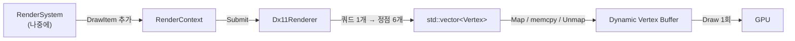

## 들어가며

10편은 창을 띄우고 이렇게 끝났다.

> 지금 상태는 이렇다. **창은 떴는데 아무것도 그려지지 않는다.**

`Dx11Renderer`는 껍데기였다. `Initialize`가 true를 돌려주고 아무 일도 하지 않았고, 창 안쪽에는 뒤에 있던 화면이 그대로 남아 있었다.

이번 편에서 그 껍데기를 채운다. device와 swapchain을 만들고, 셰이더를 런타임에 컴파일하고, 파란 쿼드 하나를 화면 가운데 그린다. 로드맵 기준으로 두 마일스톤(R2, R3)이고, 실제로는 하나의 흐름이라 한 편에 담는다.

그리고 이 편에는 앞의 열 편에 없던 문제가 하나 붙는다. **결과를 어떻게 검증하는가.** 네트워크 코드는 tick 해시를 비교하면 됐다. 렌더링의 결과물은 화면에 뜬 색이고, 그건 테스트 하네스가 볼 수 없다. 7절이 그 이야기다.

---

## 1. device와 swapchain, 그리고 두 겹의 폴백

DX11 초기화의 첫 단추는 device(GPU와 대화하는 객체), context(명령을 쌓는 객체), swapchain(화면에 내보낼 버퍼 묶음)이다. DX11에는 이 셋을 한 번에 만드는 함수가 있다.

```cpp
DXGI_SWAP_CHAIN_DESC swapDesc = {};
swapDesc.BufferCount = 2;
swapDesc.BufferDesc.Width  = m_impl->width;
swapDesc.BufferDesc.Height = m_impl->height;
swapDesc.BufferDesc.Format = DXGI_FORMAT_R8G8B8A8_UNORM;
swapDesc.BufferUsage = DXGI_USAGE_RENDER_TARGET_OUTPUT;
swapDesc.OutputWindow = hwnd;          // 10편의 NativeHandle()이 여기로 들어온다
swapDesc.SampleDesc.Count = 1;
swapDesc.Windowed = TRUE;
swapDesc.SwapEffect = DXGI_SWAP_EFFECT_DISCARD;
```

`D3D11CreateDeviceAndSwapChain` 한 번이면 끝난다. 문제는 이 호출이 **실패할 수 있는 이유가 여러 개**라는 것이다. 그래서 시도를 두 축으로 나눴다.

```cpp
const D3D_DRIVER_TYPE driverTypes[] = { D3D_DRIVER_TYPE_HARDWARE, D3D_DRIVER_TYPE_WARP };

for (D3D_DRIVER_TYPE driverType : driverTypes) {
    hr = D3D11CreateDeviceAndSwapChain(/* ... deviceFlags ... */);
    if (SUCCEEDED(hr)) { break; }

    // 디버그 레이어가 없어서 실패했을 수 있다. 플래그를 빼고 같은 드라이버로 한 번 더.
    if (deviceFlags != 0) {
        deviceFlags = 0;
        hr = D3D11CreateDeviceAndSwapChain(/* ... 0 ... */);
        if (SUCCEEDED(hr)) { break; }
    }
}
```

**바깥 축: 하드웨어에서 WARP로.** WARP는 마이크로소프트가 제공하는 소프트웨어 래스터라이저다. GPU를 CPU로 흉내 낸다. 느리지만 결과 픽셀은 같다. GPU가 없는 CI 러너나 원격 데스크톱 세션에서도 렌더 경로 자체는 돌아가야 하므로 폴백으로 뒀다. 7절에서 만들 캡처 검증이 이 폴백 덕에 GPU 없는 환경에서도 의미를 가진다.

**안쪽 축: 디버그 레이어 유무.** 디버그 빌드에서는 `D3D11_CREATE_DEVICE_DEBUG`를 켠다. 이걸 켜면 잘못된 API 사용을 런타임이 잡아서 로그로 알려준다. 셰이더 상수 버퍼 크기가 안 맞는다든가, 리소스가 여전히 바인딩된 채로 파괴된다든가 하는 것들이다. 값어치가 큰 기능인데, **이 레이어는 Windows SDK가 설치된 기계에만 있다.** 없는 기계에서는 device 생성 자체가 실패한다. 그래서 실패하면 플래그를 빼고 한 번 더 시도한다.

이 두 겹이 없으면 "다른 기계에서 실행하니 그냥 안 켜진다"는 종류의 문제가 생긴다. 원인 메시지도 `hr=0x887A0004` 같은 숫자 하나뿐이라 추적이 오래 걸린다.

---

## 2. ComPtr을 직접 만들었다

DX11의 모든 객체는 COM이다. 참조 카운트로 수명을 관리하고, 다 쓰면 `Release()`를 불러야 한다. MSVC 환경에서는 보통 `Microsoft::WRL::ComPtr`을 쓴다.

이 저장소의 툴체인은 MSYS2의 MinGW g++다. WRL은 MSVC 계열 헤더라 여기서 기대대로 잡히지 않는 경우가 있다. 선택지는 셋이었다.

| 선택지 | 문제 |
|---|---|
| WRL을 어떻게든 쓰기 | MinGW에서 동작이 보장되지 않고, 실패하면 원인 추적이 길다 |
| raw 포인터 + 수동 `Release()` | 이른 return이 열 개 넘는 `Initialize`에서 누수가 확정적이다 |
| 최소 RAII 포인터 직접 작성 | 60줄 |

세 번째를 골랐다. 필요한 기능이 "소유하고, 놓을 때 Release" 하나여서 60줄이면 충분했다.

```cpp
template<typename T>
class ComPtr {
public:
    ~ComPtr() { Reset(); }

    void Reset() {
        if (m_ptr) { m_ptr->Release(); m_ptr = nullptr; }
    }

    // 생성 API에 넘길 출력 슬롯. 기존 소유는 여기서 놓는다.
    T** PutRef() { Reset(); return &m_ptr; }

private:
    T* m_ptr = nullptr;
};
```

`PutRef()`가 이 타입의 핵심이다. `D3D11CreateDeviceAndSwapChain`처럼 "여기에 새 객체를 써 넣겠다"는 API에 넘기는 자리다. 넘기기 전에 `Reset()`을 부르므로, 같은 슬롯에 두 번 만들어도 앞의 것이 새지 않는다. 1절의 폴백 루프가 최대 네 번까지 생성을 시도하기 때문에 이 성질이 실제로 필요했다.

한 군데는 순서가 중요해서 주석을 남겼다.

```cpp
ComPtr& operator=(const ComPtr& other) {
    if (this != &other) {
        // 자기 대입이 아니어도 먼저 AddRef 한 뒤 Release 해야 안전하다.
        T* incoming = other.m_ptr;
        if (incoming) { incoming->AddRef(); }
        Reset();
        m_ptr = incoming;
    }
    return *this;
}
```

`this != &other` 검사를 통과해도 **두 ComPtr이 같은 객체를 가리키고 있을 수 있다.** 그 상태에서 `Reset()`을 먼저 하면 참조 카운트가 0이 되어 객체가 죽고, 그 뒤에 죽은 포인터를 다시 잡는다. AddRef를 먼저 하면 카운트가 1 이상으로 유지된 채 지나간다. COM 참조 카운팅에서 반복해서 나오는 함정이다.

---

## 3. 렌더 타깃 뷰와 리사이즈의 순서

swapchain은 버퍼를 들고 있을 뿐, GPU가 "여기에 그려라"라고 지목할 대상은 따로 만들어야 한다. 그게 렌더 타깃 뷰(RTV)다.

```cpp
bool CreateBackBufferView() {
    ComPtr<ID3D11Texture2D> backBuffer;
    swapChain->GetBuffer(0, __uuidof(ID3D11Texture2D), backBuffer.PutVoid());
    device->CreateRenderTargetView(backBuffer.Get(), nullptr, backBufferView.PutRef());

    D3D11_VIEWPORT viewport = {};
    viewport.Width  = static_cast<float>(width);
    viewport.Height = static_cast<float>(height);
    viewport.MaxDepth = 1.0f;
    context->RSSetViewports(1, &viewport);
    return true;
}
```

`__uuidof(T)`를 직접 쓴 것은 MinGW 사정이다. MSVC 쪽 자료가 흔히 쓰는 `IID_PPV_ARGS` 매크로가 여기서는 까다롭게 걸린다.

이 함수를 초기화와 리사이즈가 공유한다. 그리고 리사이즈 쪽에는 순서 함정이 있다.

```cpp
void Dx11Renderer::Resize(uint32_t width, uint32_t height) {
    if (width == 0 || height == 0) { return; }
    if (width == m_impl->width && height == m_impl->height) { return; }
    // ...
    // ⚠️ 백버퍼를 가리키는 뷰가 살아 있으면 ResizeBuffers가 실패한다.
    m_impl->context->OMSetRenderTargets(0, nullptr, nullptr);
    m_impl->backBufferView.Reset();

    swapChain->ResizeBuffers(0, width, height, DXGI_FORMAT_UNKNOWN, 0);
    m_impl->CreateBackBufferView();
}
```

`ResizeBuffers`는 기존 버퍼를 참조하는 것이 하나라도 남아 있으면 실패한다. RTV를 놓는 것만으로는 부족하고, **컨텍스트에 바인딩된 상태도 풀어야 한다.** `OMSetRenderTargets(0, nullptr, nullptr)`가 그 일을 한다. 이 두 줄의 순서를 지키지 않으면 창 크기를 바꿀 때마다 실패 로그가 쌓이고 화면이 늘어난 채로 남는다.

앞의 두 early return은 10편의 창 쪽 처리와 짝이다. 최소화하면 0x0이 들어오고, 같은 크기로 여러 번 불릴 수 있다. 창 쪽에서도 거르고 렌더러 쪽에서도 거른다. 두 계층 모두 자기 전제를 스스로 지키는 편이 낫다.

---

## 4. 미뤄뒀던 결정 하나를 여기서 닫았다

10편에서 `Mat4`를 만들면서 주석에 이렇게 적어뒀다.

> 저장은 행 우선(row-major): m[0..3]이 첫 행이다. HLSL 기본은 열 우선이라 셰이더에 넘길 때 전치하거나 `row_major`를 명시해야 하는데, 어느 쪽으로 갈지는 실제로 셰이더를 붙이는 R3에서 확정한다. (지금 정해봐야 검증할 방법이 없다.)

그 R3가 이번 편이다. 결정은 `row_major` 명시 쪽으로 갔다.

```hlsl
cbuffer CameraBuffer : register(b0)
{
    row_major float4x4 uViewProj;
};

struct VSIn  { float3 pos : POSITION; float4 col : COLOR; };
struct VSOut { float4 pos : SV_POSITION; float4 col : COLOR; };

VSOut VSMain(VSIn input)
{
    VSOut output;
    output.pos = mul(float4(input.pos, 1.0f), uViewProj);
    output.col = input.col;
    return output;
}

float4 PSMain(VSOut input) : SV_TARGET
{
    return input.col;
}
```

C++ 쪽에서 전치해서 넘기는 방법도 있었다. `row_major`를 고른 이유는 전치가 **런타임 비용이면서 동시에 눈에 안 보이는 규약**이기 때문이다. 행렬을 넘기는 자리가 늘어날 때마다 "여기서도 전치했던가"를 확인해야 하고, 빠뜨리면 화면이 이상해지는데 원인이 행렬 어딘가에 있어서 찾기가 나쁘다. 셰이더에 한 단어를 적어두면 규약이 셰이더 소스에 남는다.

지금은 카메라가 항등 행렬이라 이 결정의 효과가 화면에 드러나지 않는다. 다음 마일스톤에서 직교 투영 행렬이 들어가면 그때 전치 여부가 즉시 보인다. 미뤄둔 결정을 검증 가능한 시점에 닫는 것이 이 순서의 목적이었다.

### 셰이더를 런타임에 컴파일한다

셰이더 소스는 `.cpp` 안의 문자열 상수이고, `D3DCompile`로 실행할 때 컴파일한다. 사전 컴파일해서 바이트코드를 파일로 두는 방법과 비교하면 이렇다.

| | 런타임 컴파일 | 사전 컴파일 |
|---|---|---|
| 빌드 의존 | 없음 | 빌드 스텝 + 산출물 관리 |
| 시작 시간 | 셰이더 개수만큼 느려짐 | 빠름 |
| 배포 | `d3dcompiler` DLL 필요 | 불필요 |
| 셰이더 오류 | 실행할 때 발견 | 빌드할 때 발견 |

셰이더가 둘뿐인 지금은 왼쪽이 낫다. 컴파일 실패 메시지를 반드시 찍도록 한 것은 그 대가를 줄이려는 장치다.

```cpp
if (FAILED(hr)) {
    const char* message = errors ? static_cast<const char*>(errors->GetBufferPointer())
                                 : "(컴파일러 메시지 없음)";
    LOG_ERROR("Dx11Renderer: 셰이더 컴파일 실패 ({}): {}", entryPoint, message);
    return false;
}
```

셰이더 오류는 메시지를 보지 않으면 원인을 알 방법이 없다. 반환 코드만 로그에 남기면 `0x80004005`를 보면서 HLSL을 눈으로 읽게 된다.

---

## 5. DrawItem에서 정점까지

렌더 계층의 자료 흐름은 이렇다.



`RenderContext`는 `DrawItem`(위치, 크기, 회전, 색)의 목록이다. `Submit`이 이걸 정점으로 편다.

```cpp
const float hw = item.size.x * 0.5f;
const float hh = item.size.y * 0.5f;
const float cosR = std::cos(item.rotation);
const float sinR = std::sin(item.rotation);

auto corner = [&](float ox, float oy) {
    Vertex v;
    v.x = item.position.x + (ox * cosR - oy * sinR);
    v.y = item.position.y + (ox * sinR + oy * cosR);
    v.z = item.position.z;
    // 색은 네 모서리 모두 같다
    return v;
};
```

`std::cos`가 여기 있는 것이 처음에는 규칙 위반처럼 보인다. 이 엔진의 시뮬레이션은 `Fixed64`만 쓰고 float을 금지한다. 그런데 이 코드는 시뮬레이션이 아니라 표현 계층이고, `DrawItem`은 이미 float으로 넘어온 값이다. 결정론이 요구하는 범위는 "모든 peer가 같은 시뮬레이션 결과를 낸다"까지다. 같은 픽셀까지 요구하지는 않는다. 화면 표현이 기계마다 반올림 한 비트 다른 것은 아무 영향이 없다. 경계가 어디인지를 알고 있는 것이 중요하다.

쿼드 하나는 삼각형 두 개, 정점 여섯 개가 된다. 인덱스 버퍼를 쓰지 않았다. 정점 여섯 개짜리 도형에서 인덱스로 아끼는 양은 정점 두 개고, 버퍼를 하나 더 만들고 바인딩하고 수명을 관리하는 비용이 그보다 크다. 텍스처 아틀라스와 본격적인 배칭이 들어오면 그때 넣는 것이 맞다.

### Dynamic 버퍼와 WRITE_DISCARD

정점 데이터는 매 프레임 통째로 바뀐다. GPU 버퍼에 이걸 올리는 방식이 성능을 가른다.

```cpp
D3D11_MAPPED_SUBRESOURCE mapped = {};
context->Map(vertexBuffer.Get(), 0, D3D11_MAP_WRITE_DISCARD, 0, &mapped);
std::memcpy(mapped.pData, vertices.data(), sizeof(Vertex) * vertices.size());
context->Unmap(vertexBuffer.Get(), 0);
```

`D3D11_MAP_WRITE_DISCARD`는 드라이버에게 **"이전 내용은 버려도 된다"**고 약속하는 플래그다. 이 약속이 있으면 드라이버는 GPU가 아직 그 버퍼를 읽고 있더라도 기다리지 않고 새 메모리 블록을 준다. 약속이 없으면 GPU가 끝날 때까지 CPU가 멈춘다. 매 프레임 전체를 덮어쓰는 패턴에는 이 플래그가 맞다.

버퍼는 시작할 때 한 번 크게 잡는다.

```cpp
constexpr std::size_t kMaxQuadsPerFrame = 4096;
constexpr std::size_t kVerticesPerQuad  = 6;
constexpr std::size_t kMaxVertices = kMaxQuadsPerFrame * kVerticesPerQuad;
```

매 프레임 버퍼를 다시 만들면 드라이버가 매번 할당과 해제를 한다. 한 번 넉넉히 잡고 Map/Unmap으로 덮어쓰는 것이 DX11의 표준 패턴이다.

한도를 넘으면 그 프레임을 잘라서 그린다. 그리고 **잘랐다는 사실을 로그로 남긴다.**

```cpp
if (drawn >= kMaxQuadsPerFrame) {
    LOG_WARN("Dx11Renderer: 한 프레임 쿼드 한도({})를 넘겨 나머지를 건너뛴다.", kMaxQuadsPerFrame);
    break;
}
```

조용히 자르면 "일부가 안 그려진다"는 증상만 남고 원인은 코드 어딘가의 상수에 숨는다. 자를 거면 말은 해야 한다.

---

## 6. "안 보인다"의 원인을 미리 줄여두기

렌더링 작업에서 제일 많이 겪는 상태는 검은 화면이다. 그리고 그 원인 후보가 아주 많다. 카메라가 엉뚱한 곳을 보거나, 정점 순서가 뒤집혔거나, 알파가 0이거나, 깊이 테스트에 걸렸거나, 셰이더가 조용히 실패했거나.

이 단계에서는 후보를 줄이는 쪽으로 상태를 잡았다.

```cpp
// 컬링을 끈다. 2D 쿼드는 정점 감김 방향을 신경 쓸 이유가 없고,
// 켜 두면 "왜 안 보이지"의 원인이 하나 더 늘어난다.
D3D11_RASTERIZER_DESC rasterDesc = {};
rasterDesc.FillMode = D3D11_FILL_SOLID;
rasterDesc.CullMode = D3D11_CULL_NONE;
rasterDesc.DepthClipEnable = TRUE;
```

후면 컬링은 3D에서 뒤통수를 안 그려 성능을 아끼는 기능이다. 2D 쿼드에서는 아끼는 것이 거의 없고, 대신 정점 순서를 잘못 넣으면 도형이 통째로 사라진다. 사라진 도형과 안 그려진 도형은 화면에서 구별되지 않는다. 켜는 것은 3D로 갈 때 하면 된다.

알파 블렌딩은 반대로 미리 켰다. UI와 반투명 쿼드가 곧 필요하고, 블렌딩 상태는 한 번 설정하면 그만이라 나중에 켜서 얻는 것이 없다.

그리고 clear 색을 검정으로 두지 않았다.

```cpp
renderer.BeginFrame(Color{ 0.09f, 0.10f, 0.13f, 1.0f });
```

어두운 남색이다. 이유가 있다. clear가 검정이면 "clear는 됐는데 쿼드가 안 그려진 상태"와 "아무것도 안 된 상태"가 똑같이 보인다. 색을 하나 넣어두면 그 색이 보이는 순간 device, swapchain, RTV, Present까지가 전부 살아 있다는 뜻이 된다. 실패를 두 구간으로 쪼개는 값싼 방법이다.

---

## 7. 화면을 볼 수 없을 때 무엇으로 확인하나

여기가 이번 편에서 제일 오래 붙든 부분이다.

앞의 열 편은 검증이 쉬웠다. tick 해시를 비교하거나, 스냅샷을 왕복시켜 값이 같은지 보면 됐다. 렌더링의 결과물은 화면의 픽셀이고, 테스트 하네스는 그걸 볼 수 없다.

"창을 띄우고 내가 본다"는 이 편까지는 통한다. 하지만 그 방식은 확인이 사람 손에 묶인다는 뜻이라, 리팩터링할 때마다 매번 창을 띄워 눈으로 봐야 한다. 그리고 실행 환경이 원격이거나 자동화된 경우에는 아예 쓸 수 없다.

그래서 백버퍼를 파일로 뽑는 경로를 만들었다.

```cpp
// 현재 백버퍼를 PPM(P6) 파일로 덤프한다.
bool CaptureBackBuffer(const char* path);
```

`IRenderer`에 넣지 않고 `Dx11Renderer`에만 뒀다. 백엔드 추상화에 넣을 만큼 일반적인 기능이 아니고, 이건 렌더 결과를 눈으로 확인하려는 도구다.

**형식은 PPM(P6).** 헤더가 세 줄이라 인코더가 필요 없다.

```cpp
std::fprintf(file, "P6\n%u %u\n255\n", desc.Width, desc.Height);
```

PNG를 쓰려면 압축 라이브러리를 들여야 하는데, 외부 의존을 최소화하는 저장소에서 "확인용 도구" 하나 때문에 그러기는 아깝다. PPM은 대부분의 이미지 뷰어가 읽는다.

### GPU 메모리는 CPU가 못 읽는다

여기에 DX11의 표준 절차가 하나 있다. 백버퍼를 그대로 `Map` 할 수 없다.

```cpp
D3D11_TEXTURE2D_DESC desc = {};
backBuffer->GetDesc(&desc);
desc.Usage = D3D11_USAGE_STAGING;      // CPU가 읽을 수 있는 종류로 바꿔서
desc.BindFlags = 0;
desc.CPUAccessFlags = D3D11_CPU_ACCESS_READ;
desc.MiscFlags = 0;

ComPtr<ID3D11Texture2D> staging;
device->CreateTexture2D(&desc, nullptr, staging.PutRef());
context->CopyResource(staging.Get(), backBuffer.Get());   // 복사한 다음에야 Map
```

백버퍼는 GPU가 쓰기 좋은 형태로 GPU 메모리에 있다. CPU가 읽으려면 `STAGING` 텍스처를 하나 만들어 복사한 뒤 그것을 Map해야 한다. GPU에서 데이터를 되가져오는 모든 경우에 같은 절차를 밟는다.

**함정 하나.** 픽셀 데이터를 읽을 때 줄 간격을 직접 계산하면 안 된다.

```cpp
const auto* base = static_cast<const uint8_t*>(mapped.pData);
for (uint32_t y = 0; y < desc.Height; ++y) {
    const uint8_t* src = base + static_cast<std::size_t>(y) * mapped.RowPitch;
    // ...
}
```

`RowPitch`는 가로 픽셀 수 곱하기 4보다 클 수 있다. 드라이버가 줄마다 정렬 패딩을 넣기 때문이다. `width * 4`로 계산하면 어떤 해상도에서는 맞고 어떤 해상도에서는 그림이 대각선으로 밀린다. 재현 조건이 해상도에 달려 있어서 원인을 찾기 나쁜 종류의 버그다.

### 언제 찍느냐도 정해져 있다

```cpp
// Present 전에 찍어야 한다. SWAP_EFFECT_DISCARD라 Present 후 내용은 보장되지 않는다.
const bool lastFrame = (m_frameLimit != 0 && frames + 1 >= m_frameLimit);
if (lastFrame && !m_capturePath.empty()) {
    renderer.CaptureBackBuffer(m_capturePath.c_str());
}

renderer.EndFrame();   // 여기서 Present
```

1절에서 `DXGI_SWAP_EFFECT_DISCARD`를 골랐다. 이건 "Present 후에 백버퍼 내용을 버려도 된다"고 드라이버에게 허락하는 설정이다. 그래서 Present 뒤에 찍으면 무엇이 나올지 보장이 없다. 드라이버에 따라 잘 나오다가 다른 기계에서 검은 이미지가 나온다.

### 실행 인자 두 개

```cpp
// --frames N : N프레임만 돌고 끝낸다. 사람이 창을 닫아줄 수 없는 환경에서 쓴다.
for (int i = 1; i + 1 < argc; ++i) {
    if (std::string(argv[i]) == "--frames") {
        app.SetFrameLimit(std::strtoull(argv[i + 1], nullptr, 10));
    } else if (std::string(argv[i]) == "--capture") {
        app.SetCapturePath(argv[i + 1]);
    }
}
```

이렇게 하면 확인이 명령 한 줄이 된다.

```
GameClient.exe --frames 60 --capture shot.ppm
```

60프레임을 돌고, 마지막 프레임의 백버퍼를 파일로 남기고, 스스로 종료한다. 사람이 창을 닫아줄 필요가 없다. R3의 완료 기준을 "화면에 쿼드가 보인다"에서 "캡처한 픽셀이 기대한 색이다"로 옮긴 것이 이번 편의 실질적인 소득이다.

**아직 안 한 것도 적어둔다.** 이 캡처는 지금 사람이 열어 보는 용도이고, CI가 자동으로 비교하지는 않는다. 기준 이미지를 저장소에 넣고 픽셀 차이를 재는 회귀 테스트까지 가면 그때부터 자동 검증이 된다. 지금은 그 경로를 열어두기만 했다.

---

## 8. Present와 vsync

```cpp
void Dx11Renderer::EndFrame() {
    // 첫 인자 1 = vsync 켬(모니터 주사율에 맞춰 대기).
    m_impl->swapChain->Present(1, 0);
}
```

vsync를 끄면(첫 인자 0) 루프가 수천 fps로 돌면서 CPU를 태운다. 게임에 따라서는 입력 지연을 줄이려고 끄기도 하는데, 이 엔진에서는 얻을 것이 없다. 시뮬레이션 속도는 고정 timestep 누산기가 잡고 있어서 프레임을 더 뽑아도 게임 상태가 더 자주 갱신되지 않는다. 같은 그림을 더 여러 번 그리게 된다.

---

## 9. 10편의 CI 검사에 이빨이 생겼다

10편에서 서버 실행 파일의 임포트 DLL을 검사하는 스크립트를 붙이면서 이렇게 적었다.

> 즉 이 시점의 검사는 **"규칙이 지켜져서 통과"와 "아직 물어뜯을 게 없어서 통과"를 구별하지 못했다.**

이번 편으로 그 조건이 바뀌었다. `Dx11Renderer`가 `D3D11CreateDeviceAndSwapChain`, `D3DCompile`을 실제로 호출하므로, 링커가 `d3d11.dll`과 `d3dcompiler_47.dll`을 임포트 테이블에 넣는다. 이제 누군가 `GameServer`에 `EngineRender`를 링크하면 검사가 실제로 잡는다.

미리 쳐둔 그물이 뒤늦게 유효해지는 이 패턴은 기록해둘 값어치가 있다. 검사를 먼저 만들면 그 검사가 언제부터 유효한지를 사람이 알고 있어야 한다. 그래서 스크립트 주석에 "R2부터 진짜 검사가 된다"고 적어뒀고, 그 시점이 이번 편이다.

---

## 10. 값 타입만 오간다고 백엔드 교체가 공짜는 아니다

10편에서 `IRenderer`를 만들면서 넘겨둔 이야기가 있다. 이걸 여기서 닫는다.

작업 중에 나온 질문이 하나 있었다. "Vulkan을 쓰면 안드로이드나 맥에서도 되나?"

플랫폼 답부터 적으면 이렇다.

| 플랫폼 | Vulkan |
|---|---|
| Windows / Linux | 네이티브 지원 |
| Android | 네이티브 지원 (API 24 이상) |
| macOS / iOS | 지원 없음. MoltenVK(Vulkan을 Metal로 변환하는 계층)를 거쳐야 한다 |

Apple은 Vulkan을 지원하지 않고 Metal만 공식 API로 둔다. MoltenVK는 Khronos가 관리하고 상용 게임에도 쓰이지만, Metal에 대응물이 없는 기능은 빠지고 최신 확장 지원이 늦다.

그런데 이 표는 질문의 절반만 답한다. **렌더 API는 포팅 비용의 일부다.** 안드로이드로 옮기려면 창 계층을 다시 짜야 하고(`HWND`가 없고 앱이 백그라운드로 가면 서피스가 파괴된다), 마우스 드래그와 휠 줌을 전제한 조작을 터치로 다시 설계해야 하고, 빌드 툴체인이 갈라진다. 이 저장소에서 창 구현은 10편에서 만든 `Win32Window` 하나다.

렌더 API들의 차이는 벤더보다 **세대**로 갈린다.

| 세대 | API | 특징 |
|---|---|---|
| 암묵적 | DX11, OpenGL | 드라이버가 동기화, 메모리, 리소스 수명을 관리한다 |
| 명시적 | Vulkan, DX12, Metal | 커맨드 버퍼, 메모리 할당, 배리어 동기화를 앱이 직접 한다 |

삼각형 하나를 띄우는 코드가 DX11에서 300줄 정도, Vulkan에서 1,000줄이 넘는 이유가 이 차이다. 명시적 API가 얻는 것은 멀티스레드 커맨드 기록과 드라이버 오버헤드 제거인데, 그 이득은 드로우콜을 수만 개 쏘는 상황에서 나온다. 인디 규모에서는 Vulkan이 DX11보다 느린 경우도 흔하다. 배리어와 메모리 관리를 어설프게 짜면 드라이버가 수년간 다듬은 휴리스틱보다 못하기 때문이다.

그리고 정직하게 짚어야 할 것이 있다. **지금 `IRenderer`의 모양은 DX11식 사고를 반영한다.**

```
BeginFrame → SetCamera → Submit(RenderContext) → EndFrame
```

값 타입만 주고받으니 위쪽 코드는 백엔드가 바뀌어도 그대로다. 그건 맞다. 하지만 Vulkan 백엔드를 이 인터페이스 뒤에 끼우면, 백엔드가 매 프레임 `RenderContext`를 보고 파이프라인과 디스크립터와 스테이징 업로드를 알아서 맞춰야 한다. DX11 드라이버가 해주던 일을 내가 다시 구현하게 된다.

실무에서는 이 시점에 인터페이스가 리소스 핸들, in-flight 프레임 개수, 명시적 업로드 API를 노출하는 쪽으로 다시 설계된다. 추상화가 새는 것은 설계 실패의 징후가 아니라 명시적 API의 성질이다. 그러니 "인터페이스가 있으니 백엔드 교체는 공짜"라고 읽으면 안 된다. 교체는 가능하고, 인터페이스도 같이 바뀐다.

결론은 DX11 유지다. 이 엔진에서 렌더링의 자리는 결정론 시뮬레이션을 눈으로 보기 위한 관측 장비이고, 지금 갈아엎는 비용이 얻는 것보다 크다. 대신 값싼 대비를 하나 정해뒀다. 셰이더를 사전 컴파일로 옮기게 되면 구형 `d3dcompiler` 대신 DXC를 쓴다. 같은 HLSL이 플래그 하나로 Vulkan용 SPIR-V가 되므로, 그때 셰이더를 다시 쓰지 않아도 된다. 자세한 근거는 설계 문서에 절을 하나 만들어 남겼다.

---

## 11. 확인한 것

```
GameClient.exe --frames 60 --capture shot.ppm
```

를 돌리고 나온 `shot.ppm`을 열어, 어두운 남색 배경 가운데에 하늘색 쿼드가 있는 것을 확인했다. 배경색이 나왔다는 것으로 device / swapchain / RTV / Present가 살아 있음이 확인되고, 쿼드가 나왔다는 것으로 셰이더 / 입력 레이아웃 / 정점 버퍼 / Draw가 확인된다.

자동 테스트는 이번에도 추가하지 않았다. 이유는 10편과 같다. 이 경로를 단위 테스트로 감싸려면 device를 만들어야 하고, 그건 테스트 환경에 GPU나 WARP를 요구한다. 대신 캡처 파일이 있으므로 나중에 기준 이미지 비교를 붙일 자리는 열려 있다.

---

## 마무리와 남은 일

이번 편에서 채운 것.

| | 내용 |
|---|---|
| device / swapchain | 하드웨어에서 WARP로, 디버그 레이어 유무로 두 겹 폴백 |
| ComPtr | MinGW에서 쓰려고 60줄짜리를 직접 |
| RTV / 리사이즈 | 뷰를 놓고 바인딩을 푼 다음 `ResizeBuffers` |
| 셰이더 | 런타임 컴파일, `row_major`로 행렬 규약 확정 |
| 정점 | 쿼드 하나 = 삼각형 둘, Dynamic VB에 `WRITE_DISCARD` |
| 검증 | `--frames` / `--capture`, STAGING 복사, PPM 출력 |

남은 것은 셋이다.

**카메라가 없다.** 지금 화면에 그려지는 쿼드의 좌표는 NDC다. 화면 전체가 -1에서 1 사이인 좌표계라, 게임 세계의 위치를 그대로 넣을 수 없다. 클라이언트 코드에 임시 장면을 하드코딩해 둔 상태다.

```cpp
// R3 확인용 임시 장면. RenderSystem이 ECS를 순회해 채우게 되면 사라진다.
context.Add(DrawItem{
    .position = Float3{ 0.0f, 0.0f, 0.0f },
    .size = Float2{ 0.5f, 0.5f },
    .rotation = 0.0f,
    .color = Color{ 0.35f, 0.75f, 1.0f, 1.0f }
});
```

직교 투영 행렬을 만들어 `SetCamera`로 넘기면 월드 좌표가 화면에 매핑된다. 4절에서 `row_major`로 정해둔 규약이 처음으로 시험받는 지점이기도 하다.

**ECS와 아직 연결되지 않았다.** `RenderContext`를 채우는 주체가 `RenderSystem`이 되어야 하는데, 지금은 클라이언트 `main.cpp`의 임시 함수다. `View<Transform, Renderable>`을 순회해서 `DrawItem`을 만드는 시스템이 들어가면, 열 편 동안 만든 lockstep 시뮬레이션의 결과가 처음으로 화면에 나온다.

**50Hz 시뮬레이션을 그대로 그리면 끊겨 보인다.** 고정 timestep은 초당 50번 갱신되는데 모니터는 보통 60Hz 이상이다. 이전 위치와 현재 위치를 누산기 비율로 섞어 그려야 부드러워진다. 10편에서 만들지 않기로 한 `GetInterpolationAlpha`가 그때 필요해진다.

이 셋이 끝나면 실제 키보드 입력을 붙일 차례고, 그 지점이 이 프로젝트의 중간 결승선이다. 내가 누른 키가 서버 확정을 거쳐 화면 속 엔티티를 움직이는 것을 눈으로 보는 것. 열한 편 동안 만든 것이 전부 그 한 장면을 위한 부품이었다.
