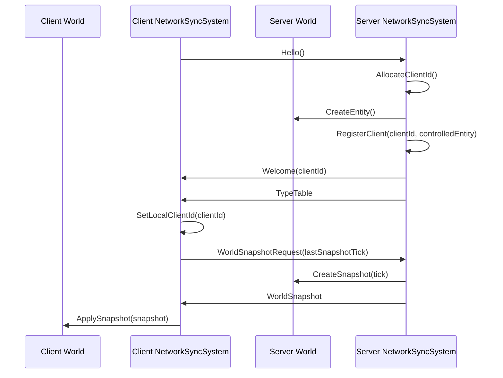
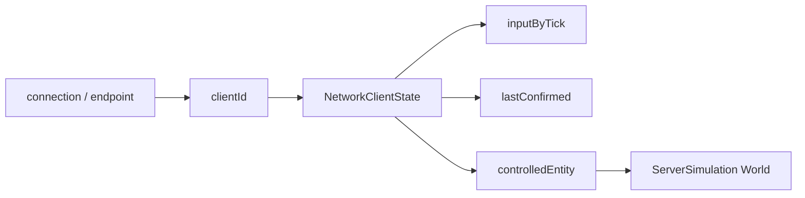
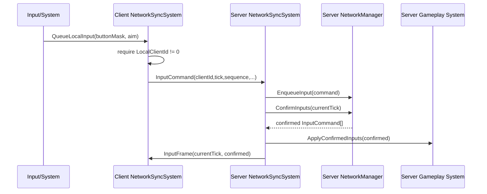
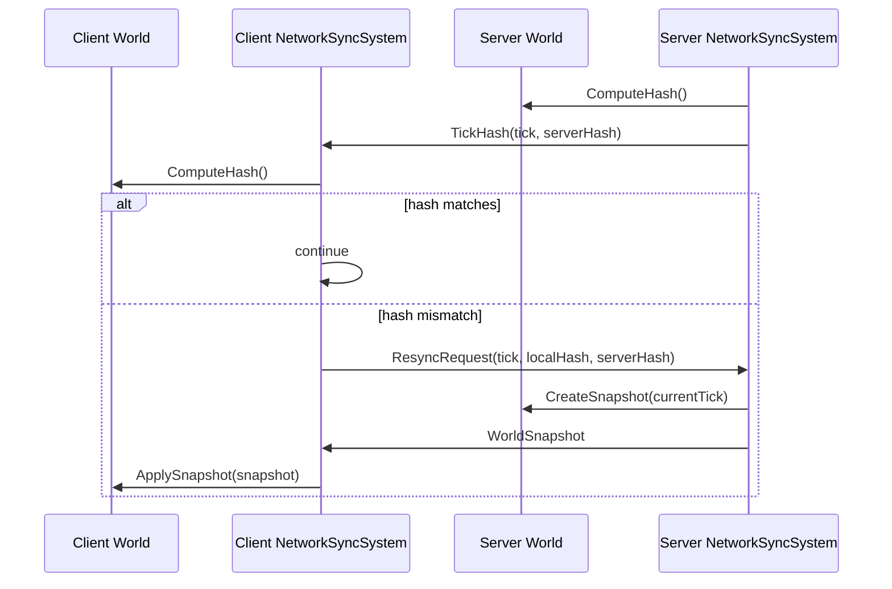

# 네트워크 동기화 시스템 기술 문서

이 문서는 `NetworkSyncSystem` 도입 이후 현재 동기화와 연결 흐름을 설명한다. 목표는 `NetworkManager`를 패킷 도구로 유지하고, 월드 tick에서 어떤 순서로 패킷을 처리할지는 `NetworkSyncSystem`이 담당하게 하는 것이다.

## 변경된 구성

### `NetworkManager`

`NetworkManager`는 여전히 전송/직렬화 계층이다.

- `SendHello`, `SendWelcome`, `SendTypeTable`, `SendWorldSnapshotRequest`, `SendWorldSnapshot`
- `SendInputCommand`, `SendInputFrame`, `SendTickHash`, `SendResyncRequest`
- `TryReceive()` / `TryReceivePacket()`
- `Encode/Decode*` helpers
- `ConfirmInputs(tick)`

내부 저장소:

```cpp
std::shared_ptr<Network::INetworkConnection> m_connection;
Network::Endpoint m_defaultTarget;
uint32_t m_localClientId;
uint32_t m_nextClientId;
std::unordered_map<uint32_t, NetworkClientState> m_clients;
std::unordered_map<Network::Endpoint, uint32_t> m_endpointToClient;
std::unordered_map<Network::Endpoint, Network::ReliabilityChannel> m_channels;
std::deque<ReceivedPacket> m_delivered;
```

`m_endpointToClient`는 패킷 출처 endpoint를 서버가 발급한 `clientId`로 바꾸는 라우팅 테이블이다.
`m_channels`는 endpoint별 reliable/sequenced/unreliable 전송 상태를 들고, `m_delivered`는 채널에서 복원된 패킷을 `{from, packet}` 형태로 보관한다.
`m_localClientId`는 클라이언트가 `Welcome`으로 받은 자기 id이고, 서버에서는 `m_nextClientId`로 새 접속자 id를 발급한다.

### `NetworkClientState`

서버가 client별 상태를 저장한다.

```cpp
uint32_t clientId;
EntityId controlledEntity;
bool hasControlledEntity;
uint64_t lastReceivedTick;
bool hasTypeTable;
bool hasSnapshot;
std::vector<ComponentTypeDescriptor> remoteTypes;
std::map<uint64_t, InputCommand> inputByTick;
InputCommand lastConfirmed;
bool hasConfirmed;
uint64_t lastConfirmedTick;
```

`inputByTick`은 아직 확정되지 않은 입력 슬롯이다. 서버가 `ConfirmInputs(tick)`을 호출하면 clientId 정렬 순서로 해당 tick의 입력을 확정한다. 입력이 없으면 직전 확정 입력을 hold하고, 직전 입력도 없으면 neutral 입력을 만든다. 확정된 tick 이하의 입력 슬롯은 제거된다.
`controlledEntity`는 해당 클라이언트가 서버 월드에서 조종할 entity다. 현재는 `Hello` 수신 시 서버가 entity를 생성하고 `clientId`와 연결한다.

### `NetworkSyncSystem`

`NetworkSyncSystem`은 fixed tick에서 동기화 상태 머신을 실행한다. `FrameUpdate`는 현재 아무 일도 하지 않는다.

```cpp
NetworkSyncMode m_mode;
bool m_sentHello;
bool m_hasWelcome;
bool m_requestedSnapshot;
bool m_hasTypeTable;
bool m_hasSnapshot;
bool m_hasHashMismatch;
uint64_t m_lastSnapshotTick;
uint32_t m_nextInputSequence;
TickHash m_lastRemoteTickHash;
std::deque<InputCommand> m_localInputs;
std::vector<ComponentTypeDescriptor> m_remoteTypes;
```

클라이언트 입력은 `QueueLocalInput()`으로 `m_localInputs`에 넣는다. 다음 fixed tick에서 `clientId`, `sequence`가 비어 있으면 자동으로 채워진다. `tick == 0`이면 `serverTickEstimate + 2`로 예약한다. 전송된 입력은 `RedundantInput` 큐에 들어가 같은 `InputCommand`로 최대 3번 재전송된다. 단, 서버가 `Welcome`으로 발급한 `LocalClientId`가 아직 0이면 입력은 전송하지 않는다.

## 월드 연결

월드는 `NetworkManager`를 resource로 들고, `NetworkSyncSystem`을 system으로 등록한다.

```cpp
world.AddResource<NetworkManager>(connection);
world.RegisterSystem<NetworkSyncSystem>(NetworkSyncMode::Client);
```

서버 월드는 `NetworkSyncMode::Server`, 클라이언트 월드는 `NetworkSyncMode::Client`를 사용한다. 클라이언트 id는 system 등록 시 넘기지 않는다. 클라이언트는 `Hello`를 보내고, 서버가 `Welcome`으로 발급한 id를 `NetworkManager::LocalClientId()`에 저장한다. snapshot 적용 대상 component는 양쪽 월드에 등록해야 한다.

```cpp
world.RegisterSnapshotComponent<Transform>();
world.RegisterSnapshotComponent<Velocity>();
```

현재 `GameClient`는 local server/client world 생성 시 위 구성을 붙이고, `GameServer`는 dedicated server world 생성 시 같은 구성을 붙인다.

## 한 Tick에서 일어나는 일

동기화는 `FixedUpdate`에서만 진행된다. 따라서 동기화 기준은 frame이 아니라 fixed tick이다.

### Client Tick

```text
NetworkSyncSystem::FixedUpdate
  1. serverTickEstimate가 있으면 +1
  2. 아직 Hello를 보내지 않았으면 SendHello
  3. TryReceivePacket 반복
     - 각 packet은 HandlePacketOnClient에서 처리
     - Welcome 수신: LocalClientId 저장
     - TypeTable 수신: remote type table 저장, snapshot 요청
     - WorldSnapshot 수신: Decode 후 World::ApplySnapshot
     - InputFrame 수신: frameBuffer[tick]에 저장
     - TickHash 수신: serverTickEstimate 보정, tick hash 보류
  4. frameBuffer에 clientSimTick+1이 있으면 순서대로 ApplyConfirmedInputs
  5. clientSimTick 이하 TickHash를 local hash와 비교
     - 다르면 SendResyncRequest
  6. QueueLocalInput에 쌓인 입력을 InputCommand로 전송/재전송
```

입력 전송 시 비어 있는 값은 자동 보정된다.

- `clientId == 0`이면 `NetworkManager::LocalClientId()`
- `tick == 0`이면 `serverTickEstimate + 2`
- `sequence == 0`이면 `m_nextInputSequence`

`LocalClientId() == 0`이면 아직 서버가 인정한 접속자가 아니므로 queued input을 보류한다.

### Server Tick

```text
NetworkSyncSystem::FixedUpdate
  1. TryReceivePacket 반복
     - 각 packet은 HandlePacketOnServer에서 처리
     - Hello 수신: clientId 발급, controlled entity 생성, Welcome/TypeTable 전송
     - WorldSnapshotRequest 수신: 현재 WorldSnapshot 전송
     - InputCommand 수신: NetworkManager::EnqueueInput
     - ResyncRequest 수신: 현재 WorldSnapshot 전송
  2. NetworkManager::ConfirmInputs(tick)
     - clientId 정렬
     - 없으면 직전 입력 hold, 직전도 없으면 neutral
  3. ApplyConfirmedInputs(world, confirmed)
  4. InputFrame(tick, confirmed) reliable 전송
  5. TickHash(tick, world.ComputeHash()) sequenced 전송
```

서버는 입력을 받자마자 적용하지 않는다. 먼저 tick별 슬롯에 저장하고, 서버 tick에서 `ConfirmInputs()`로 모든 클라이언트의 같은 tick 입력 묶음을 확정한 뒤 gameplay에 적용한다. 그 확정 묶음이 `InputFrame`으로 모든 클라이언트에 다시 전파된다. 클라이언트는 `InputFrame`을 순서대로 적용하고, 해당 tick까지 도달한 뒤 `TickHash`를 검증한다.

## 초기 동기화 흐름



이 흐름이 끝나면 클라이언트 월드의 hash가 서버 월드 hash와 같아진다.

## 접속자 식별 구조



현재 host/singleplayer는 `MemoryConnection` 한 쌍으로 이 흐름을 탄다. dedicated UDP는 마지막 sender를 peer로 기억하는 단일 peer 구조다. 다중 remote client를 위해서는 endpoint table이 추가로 필요하다.

## 입력 흐름



`EnqueueInput`은 `clientId == 0` 입력, 이미 확정된 과거 tick 입력, 같은 tick 슬롯의 중복 입력을 버린다. 중복 판단 기준은 이제 sequence가 아니라 `clientId + tick` 슬롯이다. sequence는 클라이언트 입력 순서를 관찰하기 위한 값으로 남아 있다.

## TickHash와 Resync



클라이언트는 snapshot 적용 성공 시 `m_hasHashMismatch`를 false로 되돌린다.

## Frame과 Tick의 관계

현재 네트워크 동기화는 fixed tick 전용이다.

```text
Frame N
  GameEngine accumulator 증가
  while accumulator >= fixedStep:
    World::FixedUpdate(dt, tick)
      NetworkSyncSystem::FixedUpdate
      Gameplay systems
    tick++
  World::FrameUpdate(frameDt)
    NetworkSyncSystem::FrameUpdate  // 현재 no-op
    Render/update-only systems
```

즉 렌더 프레임이 60Hz든 144Hz든, 네트워크 동기화와 입력 sequence는 fixed tick 흐름을 기준으로 움직인다.

## UDP 연결의 현재 한계

`UDPConnection::Receive()`는 마지막으로 받은 sender 주소를 peer로 저장한다. 그래서 dedicated server도 받은 client에게 답장할 수 있다.

현재 한계:

- action성 입력과 이동/aim 입력의 hold 정책이 아직 분리되지 않았다.
- 클라이언트 예측/rollback은 아직 없다. 클라이언트는 서버 확정 프레임을 기다린 뒤 뒤따라 시뮬레이션한다.
- endpoint timeout/연결 종료는 구현됐다(250 tick, `Network.VanishedClientIsCleanedUpAfterTimeout`). resync 때의 delta는 **부분 resync**(어긋난 풀만 전송)로 구현됐다 — [partial-resync.md](partial-resync.md). 매 tick delta 스트리밍은 lockstep과 맞지 않아 하지 않는다(그 문서 §3.1). tick 단위 배칭은 아직 별도 과제다.

## 링크 열화 주입 — `LossyConnection`

`SimulatedNetwork`는 손실·중복·재정렬을 결정론적으로 넣지만 **자기 자신이 전송 구현**이다. 그래서 이미 열려 있는 `UDPConnection`이나 `MemoryConnection` 위에는 씌울 수 없고, 실행 파일로 띄운 서버·클라이언트 사이에서는 못 쓴다.

`LossyConnection`([EngineCore/Network/LossyConnection.hpp](../../EngineCore/Network/LossyConnection.hpp))은 그 빈칸을 메우는 **`INetworkConnection` 데코레이터**다. 아무 전송 구현이나 하나 감싸서 같은 인터페이스를 다시 내놓는다.

```cpp
EF::Network::LossyLinkSettings link;
link.lossRate = 0.2f;       // 20% 손실
link.duplicateRate = 0.05f; // 5% 중복
link.minDelayTicks = 1;     // 1~4틱 지연(= 20~80ms @50Hz). min != max면 지터
link.maxDelayTicks = 4;
link.seed = 20260823;       // 같은 시드 = 같은 패턴

auto socket = std::make_shared<EF::Network::UDPConnection>();
socket->Connect("127.0.0.1", 6780);
auto lossy = std::make_shared<EF::Network::LossyConnection>(socket, link);
world.AddResource<EF::NetworkManager>(lossy); // NetworkManager는 감싼 쪽만 본다

// 매 fixed tick: NetworkManager::Update(tick) 옆에서 같이 굴린다.
lossy->Advance(tick);
```

설계 판단 셋:

1. **기본값은 무해하다.** `LossyLinkSettings{}`는 손실·중복·지연이 전부 0이고, 그때 `SendTo`는 난수도 큐도 건드리지 않고 곧장 통과한다. 실수로 켜둔 채 배포되는 사고를 코드로 막는다.
2. **지연은 시간이 아니라 tick이다.** 버린 대안은 (a) wall-clock — 테스트가 실제로 sleep해야 하고 스케줄러에 따라 결과가 흔들려 재현성이라는 목적 자체를 깬다, (b) `ReceiveFrom()` 호출 횟수를 논리 시계로 쓰기 — 외부 펌프가 필요 없어 편하지만 "폴링 횟수"는 단위로서 의미가 없고 수신을 안 하는 tick에는 시계가 멈춘다. 채택한 것은 `Advance(tick)`으로 논리 tick을 주입하는 방식이다. 엔진의 네트워크 펌프가 이미 전부 tick을 받는 형태라 새 개념이 늘지 않고, 고정 timestep(20ms) 위에서 "N틱 지연"이 곧 "N × 20ms"로 읽힌다. **함정: 지연을 켜고 `Advance`를 안 부르면 지연 큐가 영원히 안 풀린다.**
3. **송신 경로에만 주입한다.** 수신 경로에서 버리면 "이미 받은 것을 버리는" 셈이라 실제 링크 모델과 어긋나고, 한쪽만 감싸도 양방향이 죽어 방향별 손실률을 줄 수 없다. 양방향을 열화시키려면 양 끝을 각각 감싼다 — 비대칭 회선을 재현할 수 있어 표현력이 더 좋다.

여기 쓰이는 `std::mt19937_64`와 `float` 확률은 **결정론 규칙(§Fixed64 전용)의 예외가 아니라 대상 밖**이다. 이 난수는 시뮬레이션 상태를 만들지 않고 "패킷이 도착했는가"만 정한다 — 그건 원래 네트워크가 마음대로 정하는 것이다. `std::uniform_real_distribution` 대신 엔진 raw 출력을 직접 비교하는 이유도 재현성이다(표준이 distribution의 수열은 구현 간에 못 박지 않는다).

## 현재 완료된 범위

- 초기 handshake와 snapshot 적용
- 서버 발급 clientId와 Welcome 패킷
- clientId -> controlledEntity 매핑
- client queued input 전송
- server tick별 input slot 저장
- `ConfirmInputs(tick)`로 확정 입력 생성
- server `ApplyConfirmedInputs()` 적용
- `InputFrame` reliable 릴레이
- client `InputFrame` 버퍼링 및 `clientSimTick` 순차 적용
- server tick 추정, 입력 지연 2tick, 입력 3회 재전송
- server `TickHash` sequenced 전송
- client hash mismatch 감지
- ResyncRequest 후 snapshot 재적용
- 손실/중복/재정렬 링크에서 2 클라이언트 lockstep 수렴 테스트
- 실제 전송 구현 위에 씌우는 `LossyConnection`(손실/중복/tick 지연 주입, 시드 재현)

## 다음 단계

1. action성 입력 hold 정책을 이동/aim 입력과 분리한다.
2. prediction/rollback을 붙여 클라이언트 체감 지연을 줄인다.
3. ~~delta snapshot, endpoint timeout/연결 종료~~(부분 resync·타임아웃으로 완료), tick 단위 배칭을 별도 계층으로 추가한다.
