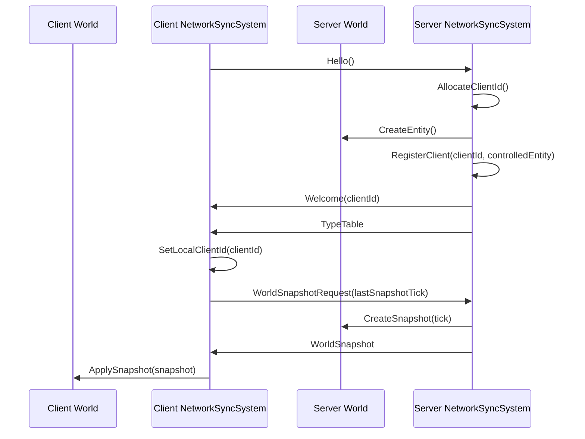
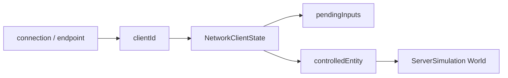
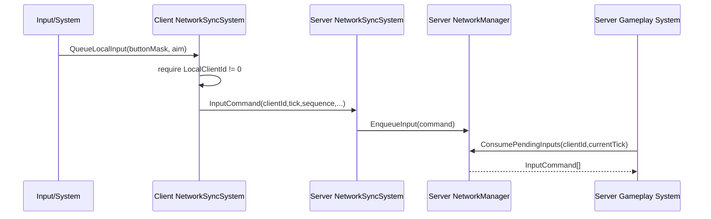
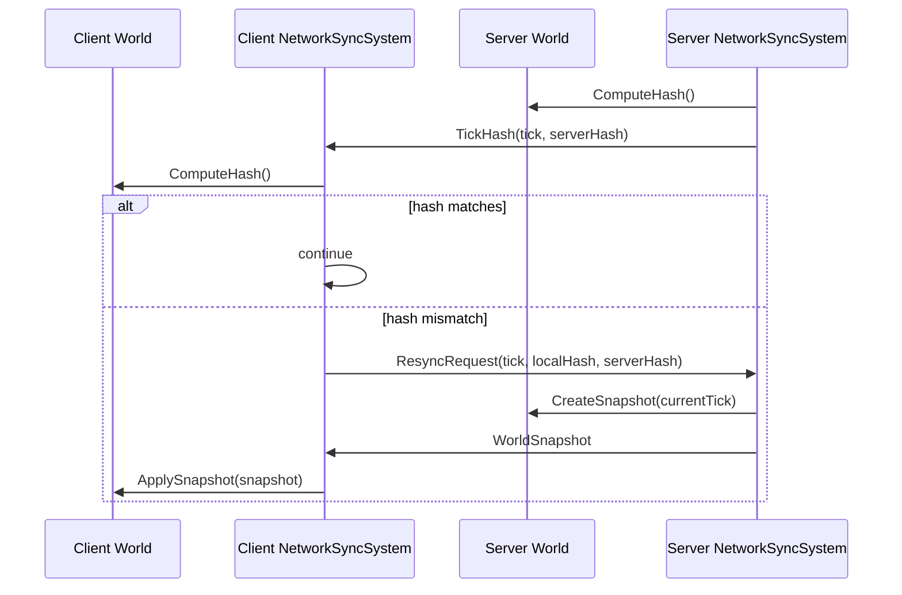

# 네트워크 동기화 시스템 기술 문서

이 문서는 `NetworkSyncSystem` 도입 이후 현재 동기화와 연결 흐름을 설명한다. 목표는 `NetworkManager`를 패킷 도구로 유지하고, 월드 tick에서 어떤 순서로 패킷을 처리할지는 `NetworkSyncSystem`이 담당하게 하는 것이다.

## 변경된 구성

### `NetworkManager`

`NetworkManager`는 여전히 전송/직렬화 계층이다.

- `SendHello`, `SendWelcome`, `SendTypeTable`, `SendWorldSnapshotRequest`, `SendWorldSnapshot`
- `SendInputCommand`, `SendTickHash`, `SendResyncRequest`
- `TryReceivePacket`
- `Encode/Decode*` helpers
- `ConsumePendingInputs(clientId, upToTick)`

내부 저장소:

```cpp
std::shared_ptr<Network::INetworkConnection> m_connection;
uint32_t m_localClientId;
uint32_t m_nextClientId;
std::unordered_map<uint32_t, NetworkClientState> m_clients;
std::vector<uint8_t> m_currentFrame;
std::size_t m_frameOffset;
```

`m_currentFrame`과 `m_frameOffset`은 한 transport message 안에 여러 packet record가 들어올 수 있는 포맷을 읽기 위한 수신 버퍼다.
`m_localClientId`는 클라이언트가 `Welcome`으로 받은 자기 id이고, 서버에서는 `m_nextClientId`로 새 접속자 id를 발급한다.

### `NetworkClientState`

서버가 client별 상태를 저장한다.

```cpp
uint32_t clientId;
EntityId controlledEntity;
bool hasControlledEntity;
uint64_t lastReceivedTick;
bool hasTypeTable;
bool hasSnapshot;
std::vector<ComponentTypeDescriptor> remoteTypes;
std::deque<InputCommand> pendingInputs;
uint32_t lastInputSequence;
bool hasInput;
```

`pendingInputs`는 아직 시뮬레이션에 소비되지 않은 입력 큐다. `ConsumePendingInputs(clientId, tick)`을 호출하면 `tick` 이하 입력을 반환하고 큐에서 제거한다.
`controlledEntity`는 해당 클라이언트가 서버 월드에서 조종할 entity다. 현재는 `Hello` 수신 시 서버가 entity를 생성하고 `clientId`와 연결한다.

### `NetworkSyncSystem`

`NetworkSyncSystem`은 fixed tick에서 동기화 상태 머신을 실행한다. `FrameUpdate`는 현재 아무 일도 하지 않는다.

```cpp
NetworkSyncMode m_mode;
bool m_sentHello;
bool m_hasWelcome;
bool m_requestedSnapshot;
bool m_hasTypeTable;
bool m_hasSnapshot;
bool m_hasHashMismatch;
uint64_t m_lastSnapshotTick;
uint32_t m_nextInputSequence;
TickHash m_lastRemoteTickHash;
std::deque<InputCommand> m_localInputs;
std::vector<ComponentTypeDescriptor> m_remoteTypes;
```

클라이언트 입력은 `QueueLocalInput()`으로 `m_localInputs`에 넣는다. 다음 fixed tick에서 tick, sequence가 비어 있으면 자동으로 채워진다. 단, 서버가 `Welcome`으로 발급한 `LocalClientId`가 아직 0이면 입력은 전송하지 않는다.

## 월드 연결

월드는 `NetworkManager`를 resource로 들고, `NetworkSyncSystem`을 system으로 등록한다.

```cpp
world.AddResource<NetworkManager>(connection);
world.RegisterSystem<NetworkSyncSystem>(NetworkSyncMode::Client);
```

서버 월드는 `NetworkSyncMode::Server`, 클라이언트 월드는 `NetworkSyncMode::Client`를 사용한다. 클라이언트 id는 system 등록 시 넘기지 않는다. 클라이언트는 `Hello`를 보내고, 서버가 `Welcome`으로 발급한 id를 `NetworkManager::LocalClientId()`에 저장한다. snapshot 적용 대상 component는 양쪽 월드에 등록해야 한다.

```cpp
world.RegisterSnapshotComponent<Transform>();
world.RegisterSnapshotComponent<Velocity>();
```

현재 `GameClient`는 local server/client world 생성 시 위 구성을 붙이고, `GameServer`는 dedicated server world 생성 시 같은 구성을 붙인다.

## 한 Tick에서 일어나는 일

동기화는 `FixedUpdate`에서만 진행된다. 따라서 동기화 기준은 frame이 아니라 fixed tick이다.

### Client Tick

```text
NetworkSyncSystem::FixedUpdate
  1. 아직 Hello를 보내지 않았으면 SendHello
  2. TryReceivePacket 반복
     - 각 packet은 HandlePacketOnClient에서 처리
     - Welcome 수신: LocalClientId 저장
     - TypeTable 수신: remote type table 저장, snapshot 요청
     - WorldSnapshot 수신: Decode 후 World::ApplySnapshot
     - TickHash 수신: local hash와 비교
       - 다르면 SendResyncRequest
  3. QueueLocalInput에 쌓인 입력을 InputCommand로 전송
```

입력 전송 시 비어 있는 값은 자동 보정된다.

- `clientId == 0`이면 `NetworkManager::LocalClientId()`
- `tick == 0`이면 현재 fixed tick
- `sequence == 0`이면 `m_nextInputSequence`

`LocalClientId() == 0`이면 아직 서버가 인정한 접속자가 아니므로 queued input을 보류한다.

### Server Tick

```text
NetworkSyncSystem::FixedUpdate
  1. TryReceivePacket 반복
     - 각 packet은 HandlePacketOnServer에서 처리
     - Hello 수신: clientId 발급, controlled entity 생성, Welcome/TypeTable 전송
     - WorldSnapshotRequest 수신: 현재 WorldSnapshot 전송
     - InputCommand 수신: NetworkManager::EnqueueInput
     - ResyncRequest 수신: 현재 WorldSnapshot 전송
  2. TickHash(tick, world.ComputeHash()) 전송
```

서버는 입력을 받기만 하고 직접 gameplay에 적용하지 않는다. gameplay system은 별도로 `ConsumePendingInputs()`를 호출해 자기 tick에 맞는 입력만 꺼내 써야 한다.

## 초기 동기화 흐름



이 흐름이 끝나면 클라이언트 월드의 hash가 서버 월드 hash와 같아진다.

## 접속자 식별 구조



현재 host/singleplayer는 `MemoryConnection` 한 쌍으로 이 흐름을 탄다. dedicated UDP는 마지막 sender를 peer로 기억하는 단일 peer 구조다. 다중 remote client를 위해서는 endpoint table이 추가로 필요하다.

## 입력 흐름



`EnqueueInput`은 client별 마지막 sequence를 기억한다. 같은 sequence 또는 과거 sequence는 중복/구식 입력으로 버린다.

## TickHash와 Resync



클라이언트는 snapshot 적용 성공 시 `m_hasHashMismatch`를 false로 되돌린다.

## Frame과 Tick의 관계

현재 네트워크 동기화는 fixed tick 전용이다.

```text
Frame N
  GameEngine accumulator 증가
  while accumulator >= fixedStep:
    World::FixedUpdate(dt, tick)
      NetworkSyncSystem::FixedUpdate
      Gameplay systems
    tick++
  World::FrameUpdate(frameDt)
    NetworkSyncSystem::FrameUpdate  // 현재 no-op
    Render/update-only systems
```

즉 렌더 프레임이 60Hz든 144Hz든, 네트워크 동기화와 입력 sequence는 fixed tick 흐름을 기준으로 움직인다.

## UDP 연결의 현재 한계

`UDPConnection::Receive()`는 마지막으로 받은 sender 주소를 peer로 저장한다. 그래서 dedicated server도 받은 client에게 답장할 수 있다.

현재 한계:

- UDP server connection 하나가 마지막 sender 하나만 기억한다.
- 여러 원격 client를 동시에 지원하려면 address별 connection 또는 endpoint table이 필요하다.
- reliable ack/retry, packet loss 처리, snapshot 분할/재조립은 아직 없다.

## 현재 완료된 범위

- 초기 handshake와 snapshot 적용
- 서버 발급 clientId와 Welcome 패킷
- clientId -> controlledEntity 매핑
- client queued input 전송
- server pending input queue 저장
- tick 기준 input consume API
- server TickHash 전송
- client hash mismatch 감지
- ResyncRequest 후 snapshot 재적용

## 다음 단계

1. `InputManager` 상태를 `QueueLocalInput()`에 연결한다.
2. 서버 gameplay system에서 `ConsumePendingInputs()` 결과를 실제 simulation에 적용한다.
3. UDP 다중 client endpoint 관리를 설계한다.
4. reliable packet, snapshot fragmentation, prediction/rollback을 별도 계층으로 추가한다.
