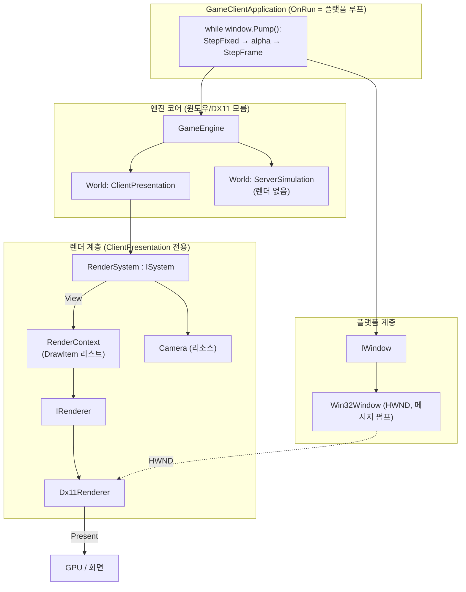
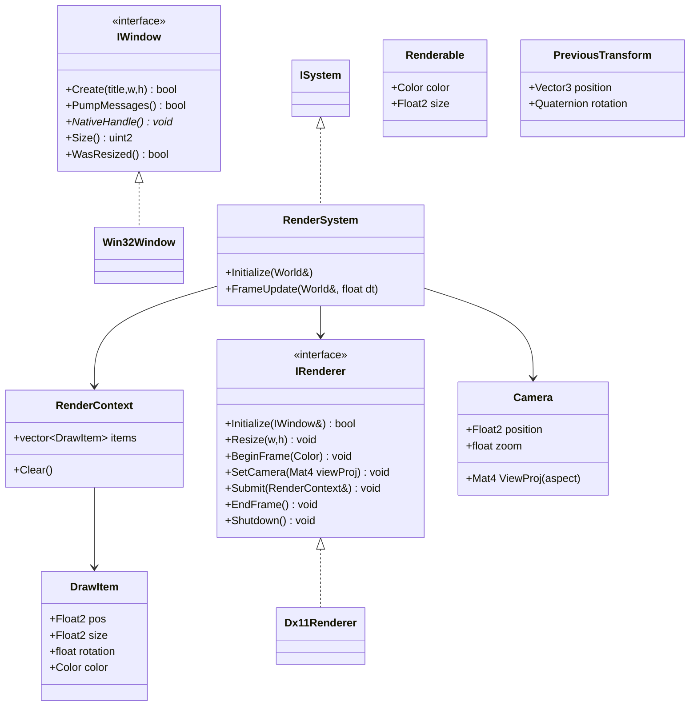
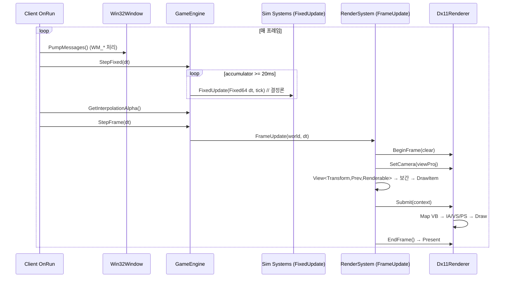
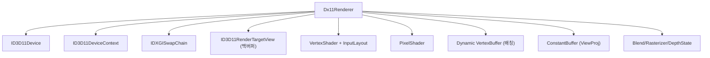
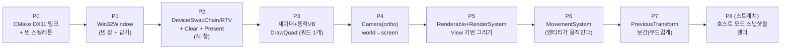

# 렌더링 계층 설계서 — DX11 백엔드

> 목표: **결정론 시뮬레이션을 화면으로 본다.** 렌더링은 이 엔진의 *주제*가 아니라 *관측 장비*다.
> 그래서 "가장 빠르고 방해 적은 길"인 DX11을, `IRenderer` 추상화 뒤에 둔다.

---

## 0. 원칙 (절대 안 깨는 것)

1. **결정론 분리** — 게임플레이는 `FixedUpdate` + `Fixed64`만. 렌더링은 read-only 표현. `Fixed64 → float` 변환은 **렌더 경계에서만**, 시뮬로 절대 역류 금지.
2. **서버는 렌더하지 않는다** — 렌더링 컴포넌트/시스템/리소스는 **ClientPresentation 월드 전용**. ServerSimulation 월드엔 안 붙는다.
3. **렌더 데이터는 스냅샷 대상이 아니다** — `Renderable`/`Camera`/`PreviousTransform`은 `RegisterSnapshotComponent` 하지 않는다. 스냅샷은 순수 시뮬 데이터만.
4. **백엔드는 인터페이스 뒤에** — `IRenderer`. DX11은 첫 구현일 뿐. 엔진 코어는 DX11을 모른다.
5. **최소 의존** — DX11/DXGI/d3dcompiler는 Windows SDK 기본 포함. `ws2_32` 링크하듯 링크만 한다.

---

## 1. 전체 아키텍처 (레이어)



리소스로 월드에 붙는 것(= `NetworkManager`와 같은 패턴): **`IWindow`, `IRenderer`, `Camera`, `FrameContext`**.

---

## 2. 모듈 설계 (인터페이스 & 컴포넌트)



**컴포넌트 (전부 클라 전용, 스냅샷 비대상):**
- `Renderable` — 무엇을 그릴지(색·크기, 나중에 sprite/mesh 핸들).
- `PreviousTransform` — 직전 틱의 Transform(보간용). 시뮬이 아니라 표현용.

**리소스:**
- `Camera` — 위치/줌, view-projection 행렬 계산(float).
- `FrameContext` — 이번 프레임의 보간 alpha와 frame dt(엔진 ↔ RenderSystem 채널).

---

## 3. 렌더 루프 — 엔진 루프와의 통합

엔진은 이미 **고정틱(sim) + 프레임(render)** 으로 갈라져 있다(`ManualStepFrame` → `CallFixedUpdates` + `FrameUpdateUpdatingWorlds`). 렌더링은 `FrameUpdate`에 산다. 창 메시지 펌프는 **엔진 코어가 아니라 클라 앱**이 소유한다(서버는 창이 없으니까).

### 권장 엔진 seam (작게)

```cpp
// GameEngine에 추가 — ManualStepFrame을 두 단계로 분리
void StepFixed(float dt);   // 누적 + 고정틱 sim 실행
void StepFrame(float dt);   // 프레임 업데이트(렌더) 실행
[[nodiscard]] float GetInterpolationAlpha() const noexcept; // accumulated / fixedStep (0..1)
```

### 클라 앱의 플랫폼 루프 (`GameClientApplication::OnRun` 재정의)

```cpp
int OnRun(GameEngine& engine) override {
    Timer timer;
    while (m_window->PumpMessages()) {        // WM_QUIT이면 false
        const float dt = timer.Tick();
        Input::Update();

        engine.StepFixed(dt);                 // ① 시뮬 전진 (0..n 틱)
        m_frameContext->alpha = engine.GetInterpolationAlpha();  // ② 보간 비율 확정
        engine.StepFrame(dt);                 // ③ RenderSystem이 alpha로 렌더
    }
    return 0;
}
```

### RenderSystem (ClientPresentation 월드)

```cpp
void RenderSystem::FrameUpdate(World& world, float /*dt*/) {
    auto& r   = world.GetResource<IRenderer>();
    auto& cam = world.GetResource<Camera>();
    const float alpha = world.GetResource<FrameContext>().alpha;

    r.BeginFrame(kClearColor);
    r.SetCamera(cam.ViewProj(m_aspect));

    m_context.Clear();
    world.CreateView<Transform, PreviousTransform, Renderable>()
         .ForEach([&](const Transform& cur, const PreviousTransform& prev, const Renderable& rd) {
            // Fixed64 → float 변환은 "여기서만"
            const Float2 p = WorldToScreen(Lerp(prev.position, cur.position, alpha));
            m_context.items.push_back({ p, rd.size, /*rot*/0.0f, rd.color });
         });

    r.Submit(m_context);   // 배칭은 렌더러가
    r.EndFrame();          // Present
}
```

### 한 프레임의 흐름



---

## 4. 고정틱 ↔ 프레임 보간

시뮬은 50Hz(20ms)인데 화면은 가변(60/144Hz…). 그냥 그리면 떨린다. **직전 틱(prev) ↔ 현재 틱(cur)** 사이를 `alpha`로 보간한다.

```
시뮬 틱:     ●────────●────────●────────●        (20ms 간격, 결정론)
             tick N   N+1      N+2      N+3
프레임:        ↑   ↑    ↑  ↑   ↑   ↑  ↑           (가변)
보간 alpha:    0.3 0.7  0.1 0.6 0.95 ...
렌더 위치 = lerp(prev_transform, cur_transform, alpha)

alpha = (남은 누적시간) / (고정 timestep)   ∈ [0, 1)
```

`PreviousTransform`은 **매 고정틱 끝에 `cur → prev`로 복사**하는 작은 시스템(`TransformHistorySystem`)이 채운다. 그래서 렌더는 항상 "한 틱 전 ~ 지금" 사이를 부드럽게 메운다(= 1틱 지연 대신 부드러움).

> **v1에선 보간을 생략**하고 `cur`만 그려도 된다(Phase 7에서 추가). 50Hz면 그럭저럭 보인다.

---

## 5. DX11 백엔드 내부 (`Dx11Renderer`)

### 5.1 객체 소유



### 5.2 초기화 (`Initialize(IWindow&)`)

1. `D3D11CreateDeviceAndSwapChain` — HWND, 포맷 `R8G8B8A8_UNORM`, windowed, 백버퍼 2개.
2. `swap->GetBuffer(0)` → `device->CreateRenderTargetView` (백버퍼 RTV).
3. 뷰포트 설정 (창 크기).
4. 셰이더 컴파일 (`D3DCompile`, 런타임) → VS/PS 생성.
5. `CreateInputLayout` (POSITION+COLOR).
6. **Dynamic VertexBuffer** (`USAGE_DYNAMIC`, `CPU_ACCESS_WRITE`, 최대 쿼드 수×6 vtx) + **ConstantBuffer** (4x4 viewProj).
7. Blend(알파) / Rasterizer(컬링 off, solid) / Depth(2D는 off) 상태.

### 5.3 한 프레임 (per-frame GPU 흐름)

```
RenderSystem이 모은 DrawItem[]
        │  (각 쿼드 → 6 정점: pos+color)
        ▼
[CPU 정점 배열] ──Map/Unmap──▶ [Dynamic VertexBuffer]
        │
        ▼  ── DX11 파이프라인 ──
   IA (VB, InputLayout, TRIANGLELIST)
        ▼
   VS  clip = mul(uViewProj, float4(pos,1))     ← ConstantBuffer(b0)
        ▼
   RS (뷰포트, 컬링 off)
        ▼
   PS  return color
        ▼
   OM → RTV(백버퍼)
        ▼
   Present(swapchain)
```

- **배칭**: 한 프레임의 모든 쿼드를 한 Dynamic VB에 쌓아 **Draw 한 번**(또는 텍스처별로 몇 번). 엔티티 수천 개도 거뜬.
- **정점 포맷 (v1)**: `struct Vertex { float x,y,z;  float r,g,b,a; }`. 텍스처 붙이면 `u,v` 추가.

### 5.4 셰이더 (최소, HLSL)

```hlsl
cbuffer CB : register(b0) { float4x4 uViewProj; };
struct VSIn  { float3 pos : POSITION; float4 col : COLOR; };
struct VSOut { float4 pos : SV_POSITION; float4 col : COLOR; };

VSOut VSMain(VSIn i){ VSOut o; o.pos = mul(uViewProj, float4(i.pos,1)); o.col = i.col; return o; }
float4 PSMain(VSOut i) : SV_TARGET { return i.col; }
```

### 5.5 리사이즈 / 종료

- **Resize**: RTV Release → `swap->ResizeBuffers` → RTV 재생성 → 뷰포트 갱신. (`WM_SIZE` → `IWindow::WasResized()` → `IRenderer::Resize`)
- **Shutdown**: 모든 COM 객체 역순 Release.

---

## 6. MinGW + DX11 실전 메모 ⚠️

대부분 자료가 MSVC 기준이라, 당신의 `msys64 ucrt64 g++`에선 한 꺼풀 벗긴다.

| 항목 | MinGW에서 |
|---|---|
| 링크 | `-ld3d11 -ldxgi -ld3dcompiler` (CMake `target_link_libraries`, `ws2_32`처럼) |
| 헤더 | `<d3d11.h> <dxgi.h> <d3dcompiler.h>` — ucrt64에 있음 |
| COM 포인터 | `Microsoft::WRL::ComPtr`(MSVC계) 대신 **raw 포인터 + 수동 `Release()`** 또는 직접 만든 소형 `ComPtr` |
| `IID_PPV_ARGS` | MinGW에서 까다로울 수 있음 → `__uuidof(T)` 명시 사용 |
| 셰이더 컴파일 | `D3DCompile` (런타임) — 동작함. 나중에 빌드타임 사전 컴파일로 전환 가능 |

CMake (예시):

```cmake
if(WIN32)
    target_link_libraries(EngineCore PUBLIC d3d11 dxgi d3dcompiler)
endif()
```

---

## 7. 결정론 · 스레딩 규칙

- **단일 스레드 먼저** — sim과 render 모두 메인 스레드. 렌더 스레드 분리는 *나중에(아마 안 함)*.
- **`Fixed64 → float`는 `RenderSystem`에서만** — `transform.position.x.ToFloat()`. 그 결과는 절대 시뮬로 안 돌아간다.
- **클라 전용 데이터는 스냅샷에서 제외** — `Renderable`/`Camera`/`PreviousTransform`은 `RegisterSnapshotComponent` 금지. 서버 월드엔 아예 없음.

---

## 8. 단계별 구현 로드맵



| Phase | 산출물 | "됐다"의 기준 |
|---|---|---|
| **P0** | CMake 링크, `Dx11Renderer` 스텁 | 빌드 통과 |
| **P1** | `IWindow`/`Win32Window` + 펌프 | 빈 창이 뜨고 X로 닫힌다 |
| **P2** | Device/SwapChain/RTV + BeginFrame/Present | 창이 단색으로 칠해진다 |
| **P3** | 셰이더 + Dynamic VB + `DrawQuad` | 화면에 쿼드 하나 |
| **P4** | `Camera` + ViewProj 상수버퍼 | 월드 좌표가 화면에 정확히 매핑 |
| **P5** | `Renderable` + `RenderSystem` + View | ECS 엔티티들이 그려짐 |
| **P6** | `MovementSystem`(Fixed64) | **엔티티가 움직인다 ← 핵심 마일스톤** |
| **P7** | `PreviousTransform` + 보간 | 50Hz인데 부드럽다 |
| **P8** | 호스트 모드 + 스냅샷 적용 | 렌더되는 클라가 **서버 권위 상태**를 표시 |

이후: 텍스처/스프라이트 → 3D 메시(같은 `IRenderer`, `DrawMesh` + 3D 카메라) → (정 필요하면) GPU 3D 심화.

---

## 9. 파일/모듈 배치 (`tools/Create-CppArtifact.ps1`로 생성)

```
EngineCore/
  Platform/
    IWindow.hpp
    Win32Window.{hpp,cpp}
  Render/
    Color.hpp            (Color, Float2, Mat4 등 표현용 POD)
    IRenderer.hpp
    RenderContext.hpp    (DrawItem)
    Camera.hpp
    RenderSystem.{hpp,cpp}
    Dx11/
      Dx11Renderer.{hpp,cpp}
      Shaders.hlsl  (또는 .cpp에 인라인 문자열)
  Components/
    Renderable.hpp
    PreviousTransform.hpp
```

> `EngineCore/Render/`를 별도 CMake 타깃(`Renderer`)으로 빼서 "엔진 코어 ↔ 렌더"를 물리적으로 분리하는 것도 좋다. 그러면 서버 빌드는 렌더를 링크조차 안 한다.

---

## 10. 미결 결정 / 트레이드오프

| 결정 | 옵션 | 1차 권장 |
|---|---|---|
| 2D vs 3D 먼저 | 2D 탑다운(XZ→화면) / 3D 원근 | **2D** (가장 빠른 "보인다") |
| 그리기 단위 | 쿼드/스프라이트 / 메시 | **컬러 쿼드** (텍스처·메시는 후속) |
| 셰이더 컴파일 | 런타임 `D3DCompile` / 사전 컴파일 | **런타임** (의존 0, 나중에 전환) |
| 렌더 스레드 | 단일 / 분리 | **단일** (분리는 거의 불필요) |
| 렌더 타깃 분리 | EngineCore에 포함 / 별도 `Renderer` 타깃 | **별도 타깃** (서버가 안 링크) |
| 보간 | v1부터 / 나중 | **나중(P7)** — v1은 cur만 |
| 다른 플랫폼 지원 | 지금 대비 / 필요할 때 | **지금은 DX11 유지**, 셰이더 툴체인만 대비 (§11) |

---

## 11. 백엔드 이식성 — 다른 렌더 API와 크로스플랫폼

> 이 절은 코드 계획이 아니라 **판단 근거의 보관소**다. "Vulkan 쓰면 안드로이드/맥도 되나?"는 질문이
> 반복해서 나오기 때문에, 답과 그 이유를 여기 남긴다. 현재 결론은 **§0 원칙 4를 유지한 채 DX11로 계속 간다**이다.

### 11.1 Vulkan은 어디서 도는가

| 플랫폼 | Vulkan | 비고 |
|---|---|---|
| Windows | ✅ 네이티브 | |
| Linux | ✅ 네이티브 | 가장 잘 맞는 곳 |
| Android | ✅ 네이티브 | API 24(7.0)+. 실무 기선은 보통 API 26~29 |
| macOS / iOS | ❌ 네이티브 아님 | **MoltenVK**(Vulkan → Metal 변환 레이어) 경유 |

Apple은 Vulkan을 지원하지 않고 Metal만 공식 API다. MoltenVK는 Khronos가 관리하고 Vulkan SDK에 번들되며
상용 게임에도 쓰이지만 공짜가 아니다 — Metal에 대응물이 없는 기능은 지원 목록에서 빠지고, 최신 확장 커버리지가
늦고, 문제가 나면 *내 코드 / Vulkan 로더 / MoltenVK / Metal 드라이버* 중 어디인지 가려내야 한다.

### 11.2 ⚠️ 렌더 API는 포팅 비용의 일부일 뿐이다

**"Vulkan 쓰면 크로스플랫폼"은 절반만 맞다.** 실제 안드로이드 포팅에서 시간을 먹는 건 대부분 렌더 API 바깥이다.

- **윈도우·플랫폼 계층** — 지금 `IWindow` 구현은 `Win32Window` 하나뿐이다(§1). 안드로이드엔 `HWND`가 없고
  `ANativeWindow` + Activity 생명주기다. 그리고 **앱이 백그라운드로 가면 서피스가 파괴된다** —
  §5.5의 Resize 경로보다 훨씬 강한 "스왑체인 전체 재생성" 경로가 필수가 된다.
- **입력 패러다임** — 팩토리 게임은 마우스 드래그·우클릭·휠 줌이 전제다. 터치로 옮기면 UI를 다시 설계해야 한다.
  이건 렌더러 문제가 아니라 게임 디자인 문제다.
- **빌드·툴체인** — MinGW g++ + CMake 프리셋(§6)이 NDK / Xcode로 갈라진다.
- **셰이더 파이프라인** — DX11은 런타임 `D3DCompile`이 가능하지만(§5.4, §10), Vulkan은 **SPIR-V 사전 컴파일**이
  강제다. 빌드 스텝이 하나 늘어난다.

즉 Vulkan은 크로스플랫폼의 **필요조건 하나**를 풀 뿐, 충분조건이 아니다.

### 11.3 API들의 실제 차이 — 축은 벤더가 아니라 세대다

**구세대(암묵적) — DX11 / OpenGL.** 드라이버가 다 해준다. 컨텍스트가 거대한 상태 머신이고, `Draw()`를 부르면
드라이버가 리소스 수명을 추적하고 GPU 동기화를 걸고 메모리를 할당하고 파이프라인을 뒤에서 컴파일한다.
편한 대신 그 마법이 CPU 시간을 먹고 언제 튈지 예측이 안 된다.

**신세대(명시적) — Vulkan / DX12 / Metal.** 앱이 직접 한다. 커맨드 버퍼 기록, GPU 메모리 힙 서브할당,
펜스·세마포어·**배리어** 동기화, 파이프라인 상태 객체(PSO) 사전 생성, 디스크립터 셋 관리,
스왑체인 이미지 획득·재생성까지 전부 내 책임이다.

```
화면에 삼각형 하나
  DX11    :  ~300줄
  Vulkan  :  ~1,000~1,500줄
             (검증 레이어, 물리 디바이스 선택, 큐 패밀리 탐색, 스왑체인 협상,
              렌더패스, 파이프라인, 커맨드풀, 세마포어 …)
```

명시적으로 간 이유는 셋이다: **멀티스레드 커맨드 기록**, 드라이버 오버헤드 제거로 인한 **드로우콜 CPU 비용 감소**,
예측 가능한 성능. 단 이 이득은 드로우콜 수만 개를 쏘는 CPU-bound 상황에서 나온다.
인디 규모 GPU-bound 씬에서는 **Vulkan이 DX11보다 느린 경우도 흔하다** — 배리어와 메모리 관리를 어설프게 짜면
드라이버가 수년간 튜닝한 휴리스틱보다 못하기 때문이다.

| API | 플랫폼 | 성격 | 셰이더 |
|---|---|---|---|
| **DX11** | Windows/Xbox | 암묵적, 성숙, 배우기 쉬움 | HLSL (런타임 컴파일 가능) |
| **DX12** | Windows/Xbox | 명시적. Vulkan보단 덜 장황 | HLSL → DXIL |
| **Vulkan** | Win/Linux/Android | 명시적, 가장 장황, 비-Apple 커버리지 최강 | GLSL·HLSL → **SPIR-V** |
| **Metal** | Apple 전용 | 명시적이지만 Vulkan보다 훨씬 부드럽다 (리소스 수명을 런타임이 상당 부분 관리) | MSL |
| **OpenGL / GLES** | 거의 전부 | 암묵적, 호환성 최강. **드라이버 품질 편차가 극심**, Apple은 4.1에서 동결·deprecated | GLSL |
| **WebGPU** (Dawn / wgpu) | 전부 (네이티브 사용 가능) | 현대 API들의 **안전한 공통분모**. 크로스플랫폼 추상화를 남이 대신 해준 것 | WGSL |

WebGPU를 표에 넣은 이유: "한 벌 짜서 Win/Mac/Linux/Android/웹"이 진짜 목표라면 백엔드 3개를 직접 유지하는 것보다
**Dawn이나 wgpu-native 하나를 `IRenderer` 뒤에 두는 게** 훨씬 싸다. 대가는 최신 GPU 기능(레이트레이싱, bindless)을
못 쓰는 것과, 큰 외부 의존이 하나 생긴다는 것 — 후자는 **§0 원칙 5(최소 의존)와 정면으로 부딪힌다.**

### 11.4 ⚠️ 현재 `IRenderer`는 명시적 API를 그대로 받아주지 못한다

§0 원칙 4("백엔드는 인터페이스 뒤에")는 옳지만, 지금 `IRenderer`의 모양은 **DX11식 즉시모드 사고를 반영한다.**

```
BeginFrame → SetCamera → Submit(RenderContext) → EndFrame
```

값 타입만 주고받으므로 위쪽 코드가 안 바뀐다는 건 사실이다. 하지만 Vulkan 백엔드를 이 인터페이스 뒤에 끼우면,
백엔드가 매 프레임 `RenderContext`를 보고 파이프라인·디스크립터·스테이징 업로드를 알아서 매칭해야 한다 —
**DX11 드라이버가 해주던 일을 내가 다시 구현하게 된다.**

실무에서는 이 시점에 인터페이스가 리소스 핸들(`BufferHandle`, `PipelineHandle`), in-flight 프레임 개수,
명시적 업로드 API를 노출하는 쪽으로 다시 설계된다. **추상화가 새는 건 설계 실패가 아니라 명시적 API의 본질이다.**
그러니 "IRenderer가 있으니 백엔드 교체는 공짜"라고 착각하지 말 것. 교체는 가능하지만, 인터페이스도 같이 바뀐다.

### 11.5 그래서 지금 하는 것 / 안 하는 것

1. **지금은 DX11로 계속 간다.** R2·R3(device/swapchain/쿼드)이 막 끝난 시점에 갈아엎는 비용이 크고,
   이 엔진에서 렌더링은 주제가 아니라 *결정론 시뮬을 보는 관측 장비*다(문서 맨 위 목표).
2. **크로스플랫폼이 진짜 목표가 되면, 먼저 정할 건 렌더 API가 아니라 플랫폼 계층이다.**
   `Win32Window` 단일 구현을 유지할지, SDL3처럼 창·입력·이벤트를 한 번에 걷어주는 것을 `IWindow` 뒤에 둘지.
   실제 포팅 비용의 대부분이 여기서 결정된다.
3. **셰이더만 미리 대비해두면 싸게 산다.** HLSL을 쓰되 `d3dcompiler`(구형, DX11 전용) 대신 **DXC**로 컴파일하면
   같은 HLSL이 나중에 `-spirv` 플래그 하나로 Vulkan용 SPIR-V가 된다. 지금 드는 비용은 거의 0이고,
   나중에 셰이더 전체를 다시 쓰는 일을 막아준다. (§10의 "런타임 컴파일" 권장을 뒤집자는 뜻은 아니다 —
   전환 시점이 오면 D3DCompile이 아니라 DXC로 가라는 메모다.)
4. **학습 목적이라면 Vulkan은 훌륭한 교재다.** 다만 "명시적 GPU API를 배운다"와 "팩토리 게임을 화면에 띄운다"는
   **별개 트랙으로 잡는다.** 한 마일스톤에 묶으면 설명 문서가 소화 불가능한 크기가 된다(CLAUDE.md 작업 리듬).

---

## 한 줄 요약

**Win32Window(HWND) → `IRenderer`(DX11: device/swapchain/RTV/셰이더/동적VB) → `RenderSystem`이 `View<Transform,Renderable>`를 보간해 DrawItem으로 → 배칭 Draw → Present.** 엔진 코어는 DX11을 모르고, 게임플레이는 Fixed64 결정론을 유지하며, 렌더는 경계에서만 float을 쓴다.
