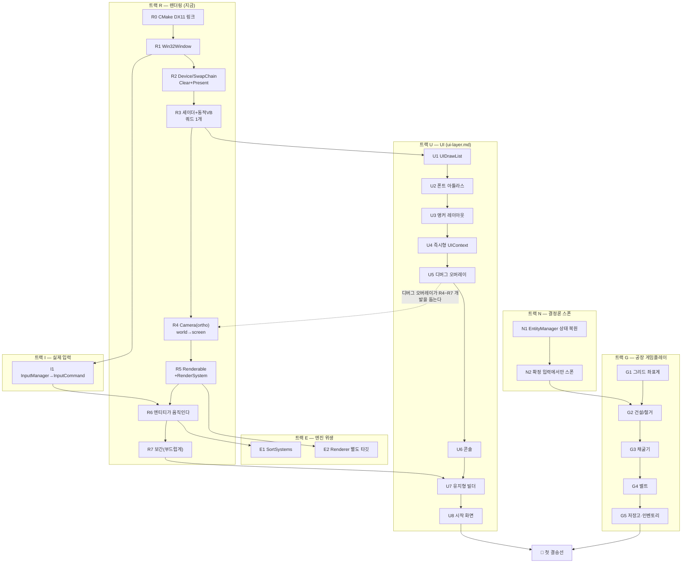

# 로드맵 — 마일스톤 정리

> 대상 독자: 이 프로젝트를 이어서 만드는 에이전트/개발자.
> 이 문서는 **무엇을 어떤 순서로 만들 것인가**를 정한다. 각 계층의 상세 설계는 옆 문서에 있다 —
> [deterministic-input-lockstep.md](deterministic-input-lockstep.md)(입력·시뮬), [rendering-dx11.md](rendering-dx11.md)(렌더링), [network-sync-system.md](network-sync-system.md)(동기화).
> 최종 목표: **결정론 엔진 위에 돌아가는 공장(팩토리) 게임.**

---

## 0. 지금 어디에 있나

| 영역 | 상태 |
|---|---|
| ECS (Registry / Pool / View / World) | ✅ 동작, 테스트 있음 |
| 결정론 수학 (`Fixed64` Q32.32, Vector, Quaternion) | ✅ |
| 월드 스냅샷 + `ComputeHash()` 검증 | ✅ |
| 신뢰성 UDP 전송 (`ReliabilityChannel`, 다중 peer, 조각화) | ✅ |
| 결정론 입력 lockstep (입력 확정 → `InputFrame` 릴레이 → 전 peer 동일 시뮬) | ✅ M1~M7 |
| **렌더링** | 📄 설계만 (`rendering-dx11.md` P0~P8), 코드 0줄 |
| **UI** | 📄 설계만 (`ui-layer.md` U1~U8), 코드 0줄 |
| **실제 키보드/마우스 입력 배선** | ❌ 테스트가 `QueueLocalInput`을 직접 호출 중 |
| **결정론 스폰/디스폰** | ❌ 미구현 — §6에 중요한 함정 있음 |
| **공장 게임 자체** | ❌ 설계도 코드도 없음 |
| 예측/롤백 | ❌ (의도적 후순위) |

한 줄로: **엔진은 서고 있고, 게임은 아직 없고, 아무것도 눈에 보이지 않는다.**

---

## 1. 확정된 방향

| 결정 | 선택 | 근거 |
|---|---|---|
| 2D vs 3D | **2D로 시작해 3D로 확장** | 게임플레이 데이터는 처음부터 3D 좌표(XZ 평면 + Y 높이)로 두고, 렌더링만 2D 탑다운 직교투영으로 먼저 만든다. 나중에 카메라만 갈아끼우면 3D가 된다. |
| 다음 트랙 | **렌더링 먼저** | 지금은 모든 검증이 테스트 해시로만 된다. 공장 게임은 공간 배치 장르라 눈 없이 설계 판단을 하기 어렵다. 덤으로 기존 네트워크 작업이 실물로 검증된다. |
| 첫 결승선 | **채굴기 → 벨트 → 저장고** | 아이템이 자동으로 흐르는 최소 루프. 레시피·조립기는 그다음. |

### 2D→3D 확장을 위해 지금 지킬 것

`Transform.position`은 **이미 `Vector3`**다. 즉 게임플레이는 이미 3D 좌표계에 있고, 2D는 *보는 방식*일 뿐이다. 이 성질을 깨지 않으려면:

- 게임플레이 코드는 절대 2D로 납작해지지 않는다. XZ가 평면, **Y는 높이로 살려둔다**(당장 0이더라도).
- `rendering-dx11.md` §2의 `DrawItem.pos`는 `Float2`로 적혀 있는데, **`Float3`로 바꾼다.** 지금 Y를 안 써도 자리를 비워두면 3D 전환 때 `RenderSystem`을 다시 쓸 필요가 없다.
- `IRenderer::SetCamera(Mat4 viewProj)`는 이미 행렬을 받으므로 **인터페이스는 그대로 둔다.** ortho→perspective 교체는 `Camera` 내부에서만 일어난다.
- 렌더 경계에서만 `Fixed64 → float`. 시뮬로 역류 금지(`rendering-dx11.md` §0 원칙 1).

---

## 2. 트랙과 의존 관계

### 시야 거리별 전체 그림

이 문서는 **가까운 미래부터 먼 미래까지 전부** 적어 둔다. 먼 쪽은 순서만 있고 시기는 없다 — 지금 확정하면 틀리기 때문이다. 다만 **먼 미래를 막지 않는 선택**을 지금 하기 위해 적어 둔다.

| 시야 | 무엇 | 어디에 |
|---|---|---|
| **지금** | 렌더링 · UI · 실제 입력 · 엔진 위생 | §3 ~ §5 |
| **첫 결승선까지** | 결정론 스폰 · 공장 게임플레이(채굴기→벨트→저장고) | §6 ~ §8 |
| **중간 미래** | 조립기·레시피 · 예측/롤백 · 대규모 비용 · 텍스처 · 세이브 · 3D 전환 | §9 |
| **먼 미래** | **EngineEditor** (인스펙터 · 배치 · UI 에디터 · 월드 저장) | §10 |




**권장 진행 순서:**
`R0`~`R3` → **`U1`~`U5`**(디버그 오버레이) → `R4`~`R7`(중간에 `I1` 합류) → `U6`~`U8` → `E1`,`E2` → `N1`,`N2` → `G1`~`G5` → 결승선.

UI를 렌더링 중간에 끼우는 이유: **UI는 카메라가 필요 없어서**(픽셀 직교 투영) 쿼드를 그릴 수 있게 되는 `R3` 직후면 만들 수 있고, 디버그 오버레이가 먼저 있으면 `R4`~`R7`을 만들 때 "무엇이 왜 안 보이는지"를 화면에서 볼 수 있다. 자세한 근거는 [ui-layer.md §8](ui-layer.md).

`N`(결정론 스폰)은 렌더링·UI와 완전히 독립이라 순서를 바꿔도 되지만, **`G` 전체의 전제조건**이라 `G` 앞에는 반드시 와야 한다.

---

## 2.5. 작업 리듬 — 마일스톤마다 문서를 누적한다

작은 마일스톤 하나를 끝낼 때마다 다음을 한다.

1. **빌드·테스트 green 확인.** 각 마일스톤은 독립 커밋으로 둔다.
2. **`explain-diff-html` 스킬로 그 변경의 설명 문서를 만든다.** 배경·직관·코드 워크스루·퀴즈 5문항이 나온다. 출력은 `C:\Users\macham\Documents\explanations\YYYY-MM-DD-explanation-<slug>.html`.
3. 설계 판단이 바뀌었으면 해당 설계 문서(`docs/design/*.md`)를 고친다. 근거를 채팅에만 남기지 않는다.

이건 학습용 프로젝트라서 넣은 절차다. 마일스톤이 작을수록(하루치 정도) 설명 문서가 소화 가능한 크기로 나온다 — 그래서 마일스톤을 크게 묶지 말 것.

---

## 3. 트랙 R — 렌더링

`rendering-dx11.md` §8의 P0~P8을 그대로 쓴다. 각 단계의 "됐다" 기준은 그 문서의 표를 따른다. 여기서는 순서와 합류점만 다시 적는다.

| # | 산출물 | "됐다"의 기준 |
|---|---|---|
| ✅ R0 | `EngineRender` 타깃 + DX11 링크, `IWindow`/`IRenderer`/`RenderTypes`/`RenderContext`, `Dx11Renderer` 스텁 | 빌드 통과 (완료) |
| R1 | `IWindow` / `Win32Window` + 메시지 펌프 | 빈 창이 뜨고 X로 닫힌다 |
| R2 | Device/SwapChain/RTV + BeginFrame/Present | 창이 단색으로 칠해진다 |
| R3 | 셰이더 + Dynamic VB + `DrawQuad` | 화면에 쿼드 하나 |
| R4 | `Camera`(ortho) + ViewProj 상수버퍼 | 월드 좌표가 화면에 정확히 매핑된다 |
| R5 | `Renderable` + `RenderSystem` + `View<Transform, Renderable>` | ECS 엔티티들이 그려진다 |
| **R6** | `I1`과 합류 | **내 키보드 입력이 서버 확정을 거쳐 화면 속 엔티티를 움직인다 ← 핵심 마일스톤** |
| R7 | `PreviousTransform` + alpha 보간 | 50Hz인데 부드럽다 |

> R6은 원래 설계서에서 "`MovementSystem`이 엔티티를 움직인다"였다. 하지만 이 엔진엔 이미 `ApplyConfirmedInputs`가 있으므로, 새 `MovementSystem`을 만들 게 아니라 **기존 lockstep 경로를 화면에 연결**하는 것이 R6이다. 그래야 `클라 입력 → 서버 확정 → InputFrame 릴레이 → 클라 적용 → 렌더`라는 전체 파이프라인이 한 번에 눈으로 검증된다.

**함정:** 창 메시지 펌프는 엔진 코어가 아니라 **클라 앱**이 소유한다(서버는 창이 없다). `GameClientApplication::OnRun`을 재정의해서 `while (window.Pump()) { StepFixed → alpha → StepFrame }` 루프를 돌린다. MinGW + DX11 조합의 실전 주의사항은 `rendering-dx11.md` §6에 정리되어 있다.

---

## 3.5. 트랙 U — UI

상세 설계는 [ui-layer.md](ui-layer.md)에 있다. 여기서는 요약만 둔다.

**모델:** 하이브리드. 게임 메뉴는 **유지형 위젯 트리 + `UIBuilder` + 앵커**(나중에 UI 에디터로 확장 가능), 디버그는 **즉시형**(매 프레임 값이 바뀌므로). 두 모드는 레이아웃 계산·드로우 목록·입력 라우팅을 **공유**한다 — UI 시스템 두 개를 만드는 게 아니다.

| # | 산출물 | "됐다"의 기준 |
|---|---|---|
| U1 | `UIDrawList`(사각형+클립) + UI 패스 | 화면 좌표에 사각형이 정확히 그려진다 |
| U2 | `IFontAtlas` + `UnifontAtlas` + UTF-8 디코더 + `DrawText` | 화면에 **한글까지** 안 깨지고 나온다 |
| U3 | 앵커 레이아웃 코어 | **순수 함수 단위 테스트** — 프리셋 9개 + stretch |
| U4 | 즉시형 `UIContext` + 히트테스트 | 버튼 hover·클릭이 동작한다 |
| U5 | 디버그 오버레이(상태표시기 + 로그) | tick·hash·클라 수가 실시간으로 보인다 |
| U6 | 콘솔(명령 테이블 + 문자 입력) | `hash`를 치면 월드 해시가 출력된다 |
| U7 | 유지형 `Widget` + `UIBuilder` | 빌더로 지은 메뉴가 그려진다 |
| U8 | 시작 화면(싱글/호스트/참여) | **메뉴에서 "호스트"를 누르면 게임이 시작되고, 다른 창이 "참여"로 접속해 같은 월드를 본다** |

**⚠️ 이 트랙의 제일 중요한 불변식:** UI가 게임 상태를 바꾸는 유일한 경로는 `InputCommand`다. 버튼 콜백이나 콘솔 명령이 월드를 직접 건드리면 그 클라만 상태가 바뀌어 즉시 디싱크다. 디버그라고 예외를 두지 않는다.

**미리 알아둘 세 가지:**
- 폰트는 **GNU Unifont**(`.hex`). 순수 텍스트 포맷이라 **폰트 파서·외부 라이브러리가 필요 없고**, 유니코드 BMP 전체를 덮어 **한글이 그냥 된다**. 단 퍼블릭 도메인이 아니라 **OFL-1.1**이므로 `assets/fonts/LICENSE`를 함께 둔다. [ui-layer.md §5](ui-layer.md).
- `.hex`의 **행/비트 순서는 문서에 없다.** 구현 전에 실제 파일에서 `0041`(A) 한 줄을 찍어 확인하고 시작한다. 추측으로 쓰지 말 것.
- 기존 `Input`(전역 키 폴링)으로는 **문자 입력을 못 만든다.** 콘솔과 IP 입력 때문에 `Win32Window`에 `WM_CHAR` 경로가 필요하다. [ui-layer.md §6](ui-layer.md).

---

## 4. 트랙 I — 실제 입력

### I1. `InputManager` → `InputCommand` 변환

지금은 테스트가 `NetworkSyncSystem::QueueLocalInput`을 직접 호출해서 입력을 만든다. 실제 키보드가 그 자리에 들어가야 한다.

**왜 R1 다음인가:** 창이 없으면 키 입력을 받을 곳이 없다. Win32 메시지 펌프가 생긴 뒤에 하는 게 자연스럽다.

**할 일:** 눌린 키를 `kInputMove{Right,Left,Forward,Back}` 비트로 모아 `buttonMask`를 만들고, 마우스 이동을 `aimYaw`/`aimPitch`(`Fixed64`)로 바꿔 `QueueLocalInput`에 넣는다.

**함정 (결정론):** 마우스 델타는 화면 픽셀(float)이다. 이걸 **`Fixed64`로 바꾸는 지점이 시뮬레이션의 경계**다. 변환은 입력 수집 단계에서 딱 한 번 하고, 그 뒤로는 `Fixed64`만 흐르게 한다. `InputCommand.aimYaw`가 애초에 `Fixed64`인 이유가 이것이다. 그리고 float→Fixed64 변환 결과가 와이어에 실려 모든 peer가 같은 값을 쓰므로, 변환 자체가 클라마다 달라도 결정론은 깨지지 않는다 — **변환된 값이 입력으로 전파되기 때문**이다.

**완료 기준:** 창에서 WASD를 누르면 `InputCommand`가 서버로 나간다(R6에서 화면 움직임으로 확인).

---

## 5. 트랙 E — 엔진 위생

작지만 미루면 아픈 것들. 렌더링과 게임플레이 시스템이 늘어나기 직전에 해치운다.

### E1. `SystemRegistry::SortSystems()`

지금은 TODO이고 시스템이 **등록 순서대로** 실행된다. 시스템이 서너 개일 땐 괜찮지만, 공장 시뮬(채굴→벨트→저장)은 **실행 순서가 곧 결과**라 순서가 암묵적이면 안 된다.

**완료 기준:** 시스템이 선언한 순서 제약대로 정렬되어 실행되고, 순환 의존이면 실패한다. 등록 순서를 섞어도 결과 해시가 같아야 한다.

### ✅ E2. `Renderer`를 별도 CMake 타깃으로 — R0에서 함께 완료

`rendering-dx11.md` §9의 제안. 렌더를 `EngineCore`에서 분리하면 **서버 빌드가 DX11을 링크조차 하지 않는다.**

원래 R 트랙 뒤로 잡아뒀지만 **R0에서 같이 했다.** 의존이 얽힌 뒤에 쪼개는 것보다 처음부터 나누는 쪽이 훨씬 싸기 때문이다. `EngineRender` 타깃이 생겼고 방향은 `EngineRender → EngineCore` 한쪽뿐이다.

**완료 확인:** 링크 라인 기준 — `GameClient`는 `libEngineRender.a … -ld3d11 -ldxgi -ld3dcompiler`, `GameServer`는 `libEngineCore.a -lws2_32`뿐. 서버에 DX11이 들어가지 않는다.

---

## 6. 트랙 N — 결정론 스폰 ⚠️ 여기 함정이 있다

공장 게임에서 **건물을 짓는다 = 엔티티를 만든다**. 그래서 이 트랙은 `G` 전체의 전제조건이다.

### 좋은 소식: 스폰은 원래 "복제"할 필요가 없다

결정론 lockstep에서는 스폰을 네트워크로 복제할 필요가 **없다.** 모든 peer가 같은 tick에 같은 확정 입력을 적용하고, 스폰이 그 입력의 순수 함수라면, **각 peer가 알아서 똑같은 엔티티를 만든다.** `EntityManager`가 같은 순서로 같은 index를 할당하기 때문이다. 새 패킷 타입이 필요 없다.

이게 성립하려면 딱 하나가 필요하다: **양쪽 `EntityManager`의 상태가 같아야 한다.**

### 나쁜 소식: 지금은 그 전제가 깨져 있다

코드를 따라가면 이렇다.

```
World::ApplySnapshot()      → Registry newRegistry;   ← 완전히 새 Registry (새 EntityManager)
  → applier(newRegistry, componentSnapshot)
    → Registry::AddComponentRaw(entityIndex, ...)
      → EnsureEntityExists(entityIndex)
        → EntityManager::CreateEntity()를 capacity가 찰 때까지 반복
```

`EntityManager`의 상태는 `m_nextEntityIndex` / `m_freeIndices` / `m_versions` 세 가지인데, 스냅샷은 이 중 **아무것도 싣지 않는다.** 스냅샷이 나르는 건 `ComponentSnapshot.entities`의 `EntityIndex` 목록뿐이다. 그래서 `ApplySnapshot` 직후 클라이언트는:

- `m_versions`가 **전부 0** (서버는 엔티티를 파괴한 적이 있으면 0이 아니다)
- `m_freeIndices`가 **비어 있음** (서버는 재사용 대기 중인 index를 들고 있을 수 있다)
- 스냅샷 컴포넌트가 하나도 없는 엔티티는 **아예 존재하지 않음**

이 상태에서 서버와 클라가 같은 확정 입력으로 동시에 엔티티를 만들면:

```
서버:  m_freeIndices에서 7번 회수 → index 7, version 3
클라:  free list가 비었으니     → index 12, version 0
```

**서로 다른 `EntityIndex`가 나온다.** 그리고 `World::ComputeHash()`는 풀의 dense entity index를 해시에 섞으므로, 이건 **즉시 해시 불일치 → resync 요청 → 스냅샷 재적용 → 또 불일치**의 무한 리싱크로 이어진다.

> 지금 이 문제가 안 보이는 이유는, 현재 테스트가 **초기 스냅샷에 담긴 엔티티만** 쓰고 시뮬 도중에 스폰을 하지 않기 때문이다. 건설을 넣는 순간 터진다.

### N1. `EntityManager` 상태를 스냅샷에 포함

**할 일:** `WorldSnapshot`에 엔티티 목록 자체(살아 있는 index + 각 index의 version, free list, next index)를 싣고, `ApplySnapshot`이 그것으로 `EntityManager`를 복원한다. 컴포넌트 데이터와 별개로 **"엔티티가 존재한다"는 사실 자체가 복제 대상**이 되어야 한다.

**완료 기준(테스트):**
1. 서버에서 엔티티를 몇 개 만들고 일부를 파괴한 뒤 스냅샷 → 클라 적용 → **양쪽 `EntityManager`가 같은 index를 다음에 할당**한다.
2. 스냅샷 적용 후 서버·클라가 각자 같은 횟수만큼 `CreateEntity()` → 나온 `EntityId`가 완전히 일치한다.
3. 컴포넌트가 하나도 없는 엔티티도 스냅샷을 넘어 살아남는다.

### N2. 스폰/디스폰은 확정 입력에서만

**규칙:** 엔티티 생성·파괴는 **확정된 입력(또는 릴레이되는 결정론 이벤트)을 적용하는 경로에서만** 일어난다. 서버가 혼자 판단해서 스폰하거나, 클라가 로컬 예측으로 스폰하면 그 즉시 디싱크다.

이건 `deterministic-input-lockstep.md` §2 불변식 3·4의 자연스러운 확장이다. 같은 문서 §8이 지적한 "`Dormant` on/off도 릴레이되는 결정론 이벤트여야 한다"와 같은 이야기다.

**완료 기준:** 확정 입력의 버튼 비트로 엔티티를 스폰하는 테스트에서, 서버와 N개 클라의 `ComputeHash()`가 계속 일치한다(손실 링크 위에서도).

---

## 7. 트랙 G — 공장 게임플레이

여기부터가 진짜 게임이다. `N`이 끝난 뒤에 시작한다.

### G1. 그리드 좌표계

공장 게임의 배치 문법. **1차 권장:** `struct GridPos { int32_t x, z; }`를 별도 컴포넌트로 두고, `Transform.position`은 여기서 **유도**한다(렌더용).

**왜 `Fixed64` 위치가 아니라 정수인가:** 인접 판정("이 벨트 다음 칸에 뭐가 있나")이 정수 비교라 애매함이 없다. 고정소수점 나눗셈으로 타일을 계산하면 경계에서 반올림 사고가 난다. 그리고 정수는 결정론이 자명하다.

**완료 기준:** 그리드 칸 ↔ 월드 좌표 변환이 양방향으로 맞고, 한 칸에 건물 하나라는 점유 규칙이 지켜진다.

### G2. 건설 / 철거

확정 입력의 "이 칸에 이 건물을 지어라"를 받아 엔티티를 스폰한다(`N2` 의존). 점유된 칸이면 거부한다 — **거부 판정도 모든 peer에서 동일**해야 한다.

**완료 기준:** 두 클라이언트가 같은 칸에 동시에 지으려 하면 전 peer가 같은 쪽을 승자로 판정한다(확정 입력이 `clientId` 정렬이므로 자연히 결정된다).

### G3. 채굴기

자원 노드 위에 놓으면 N tick마다 아이템 하나를 만든다. **완료 기준:** 시간이 지나면 아이템이 쌓이고, 서버·클라 해시가 일치한다.

### G4. 벨트

아이템을 인접 칸으로 옮긴다. 공장 게임의 심장이고, 가장 어려운 부분이다.

**미결 (여기서 정하지 말 것, G4 시작할 때 정한다):** 벨트 위 아이템을 **개별 엔티티**로 둘 것인가, **벨트가 소유한 배열**로 둘 것인가. 개별 엔티티는 ECS답고 단순하지만 수만 개가 되면 스냅샷·해시 비용이 문제가 된다. 배열은 빠르지만 ECS 밖의 특수 구조가 된다. **판단 근거를 만들기 전에 고르지 말고**, G3까지 만든 뒤 실제 엔티티 수를 재보고 정한다.

**완료 기준:** 채굴기 → 벨트로 아이템이 흐르고, 벨트가 꽉 차면 뒤에서 밀리며, 전 peer 해시가 일치한다.

### G5. 저장고 + 인벤토리

벨트 끝에서 아이템을 받아 담는다. **완료 기준:** 아이템이 사라지거나 복제되지 않는다(총량 보존 테스트).

---

## 8. 🏁 첫 결승선의 정의

다음이 전부 동시에 참이면 "게임이 됐다"고 부른다.

1. 창이 뜨고, **메뉴에서 싱글/호스트/참여를 골라 게임에 들어간다**.
2. 그리드와 건물이 **보인다**.
3. 키보드·마우스로 **채굴기와 벨트와 저장고를 배치**할 수 있다.
4. 아무것도 안 해도 **아이템이 채굴기에서 저장고까지 자동으로 흐른다**.
5. 호스트 모드에서 클라이언트 월드가 **서버 권위 상태와 같은 해시**를 유지하고, 그게 **디버그 오버레이에 보인다**.
6. 위 전체가 손실 있는 링크에서도 **디싱크 없이** 돌아간다(`SimulatedNetwork` 테스트).

5·6번이 이 엔진을 이렇게 만든 이유다. 그래서 결승선에서 빼지 않는다.

---

## 9. 중간 미래 — 첫 결승선 이후

첫 결승선을 넘으면 "돌아가는 작은 공장 게임"이 생긴다. 그다음은 깊이를 더하는 구간이다.

| 트랙 | 내용 | 왜 이 시점인가 |
|---|---|---|
| **G6~** 조립기·레시피 | 재료 A+B→C 변환, 생산 체인 | 벨트가 돌아야 레시피가 의미를 가진다 |
| **N3** 예측/롤백 | 클라 로컬 예측 + 서버 확정과 어긋나면 재시뮬 | 공장 장르는 FPS만큼 입력 지연이 아프지 않다. **정말 필요한지부터 재고** 넣는다 |
| **N4** 대규모 월드 비용 | 영역별 해시, 스냅샷 분할, 관심 영역(AoI) | 엔티티가 수천을 넘을 때. 전체 해시가 매 tick 비싸진다 |
| **R9** 텍스처·스프라이트 | 컬러 쿼드 → 스프라이트 아틀라스 | 게임이 성립한 뒤. 그전에는 색만으로 충분하다 |
| **S1** 세이브(영속) | 스냅샷을 디스크로. 매치 범위 vs 계정 범위 2층 | `CreateSnapshot`이 이미 월드 직렬화기라 자연 확장이다. [deterministic-input-lockstep.md §8](deterministic-input-lockstep.md) |
| **R10** 3D 전환 | ortho 카메라 → perspective, 쿼드 → 메시 | 2D로 결승선을 통과한 뒤. `IRenderer`가 이미 `Mat4`를 받으므로 백엔드 교체가 아니라 카메라 교체다 |

---

## 10. 먼 미래 — 트랙 X: EngineEditor

**목표:** 상용 엔진처럼 **월드에 엔티티를 배치하고, UI를 짜고, 실행 중인 상태를 들여다보는** 도구. 별도 실행 파일 `EngineEditor`로 두되, **클라이언트에서도 같은 행동을 할 수 있게** 한다.

### 핵심 원칙 — 에디터는 별도 코드가 아니다

이 프로젝트에서 에디터가 하는 일은 대부분 **이미 만들 것들과 같은 문제**다. 그래서 새 시스템을 짓는 게 아니라 기존 것을 노출한다.

| 에디터 기능 | 실은 무엇과 같은가 |
|---|---|
| 월드에 엔티티 배치 | **공장 게임의 건설(G2)과 같은 문제다.** 그리드 스냅, 점유 판정, 스폰 — 전부 동일 |
| 실행 중 ECS 들여다보기 | 디버그 오버레이(U5)의 확장 |
| 명령으로 월드 조작 | 콘솔(U6)의 확장 |
| UI 레이아웃 편집 | U7의 유지형 위젯 트리를 **직렬화**하면 그게 UI 에디터의 문서 포맷이다 |
| 월드 저장/불러오기 | `CreateSnapshot`/`ApplySnapshot`이 이미 월드 직렬화기다 |

> 그래서 **U7(유지형 위젯 트리)와 G2(건설)를 만들 때 이 미래를 염두에 둔다.** 위젯 트리는 직렬화 가능한 모양으로, 건설은 "배치 도구"로 일반화할 수 있는 모양으로 둔다. 지금 그걸 *만들* 필요는 없고, *막지만* 않으면 된다.

### ⚠️ 결정론 제약 — 에디터도 예외가 아니다

에디터에서 엔티티를 놓는 것도 **월드 상태 변경**이다. [ui-layer.md §0-2](ui-layer.md)의 불변식이 그대로 적용된다 — 에디터 UI가 월드를 직접 건드리면 안 되고, 확정 입력 경로를 타야 한다.

다행히 **엔진 구조가 이미 이걸 공짜로 해준다.** 에디터는 host 모드로 돌아가면 된다(같은 `GameEngine` 안에 `ServerSimulation` + `ClientPresentation`, `MemoryConnection`으로 연결). 그러면 에디터의 배치도 자동으로 "입력 → 서버 확정 → 릴레이" 경로를 탄다. 그래서 **에디터에서 편집하던 월드에 다른 사람이 접속해 같이 편집하는 것**도 원리상 그냥 된다.

### 마일스톤 (순서만, 시기 미정)

| # | 산출물 | "됐다"의 기준 |
|---|---|---|
| X1 | **인스펙터** — 실행 중 엔티티/컴포넌트 목록과 값 보기 | 화면에서 특정 엔티티의 `Transform`을 읽을 수 있다 |
| X2 | **선택과 배치** — 마우스 피킹, 그리드 스냅, 배치/삭제 | G2(건설)의 코드를 그대로 쓰며 임의 프리팹을 놓을 수 있다 |
| X3 | **월드 저장/불러오기** — 스냅샷을 파일로 | 배치한 월드를 껐다 켜도 그대로 복원된다 |
| X4 | **UI 에디터** — 위젯 트리 직렬화 + 앵커를 마우스로 편집 | 코드 수정 없이 메뉴 레이아웃을 바꿔 저장한다 |
| X5 | **`EngineEditor` 실행 파일** — 위 기능을 묶은 별도 타깃 | `EngineEditor.exe`가 뜨고, 편집한 결과를 `GameClient`가 그대로 연다 |
| X6 | **클라이언트 내 에디터 모드** — 게임 안에서 같은 도구 열기 | 게임 중 개발자 모드로 X1~X2를 쓴다 |

**타깃 구조:** `EngineEditor`는 `EngineRender`를 링크한다(창·UI가 필요하므로). R0에서 만든 `EngineCore` / `EngineRender` 분리가 그대로 쓰인다 — 에디터가 생겨도 `GameServer`는 여전히 DX11을 모른다.

---

## 11. 아직 정하지 않은 것

의도적으로 열어둔다. 판단 근거가 생기기 전에 정하면 틀린다.

| 열린 질문 | 언제 정하나 |
|---|---|
| 벨트 위 아이템 = 엔티티 vs 배열 | G4 시작할 때. G3까지 만들어 실제 엔티티 수를 재고 나서. |
| 예측/롤백을 넣을 것인가 | 첫 결승선 이후. 공장 게임은 FPS와 달리 입력 지연 체감이 작아서, 정말 필요한지부터 확인한다. |
| 대규모 월드에서 스냅샷·해시 비용 | 엔티티가 수천 개를 넘길 때. 전체 해시 대신 영역별 해시가 필요해질 수 있다. |
| 3D 전환 시점 | 2D로 첫 결승선을 통과한 뒤. |
| 세이브(영속) 계층 | `deterministic-input-lockstep.md` §8에 방향만 있다. 매치를 넘는 저장이 필요해질 때. |
| 텍스처/스프라이트 | 컬러 쿼드로 게임이 성립한 뒤. |
