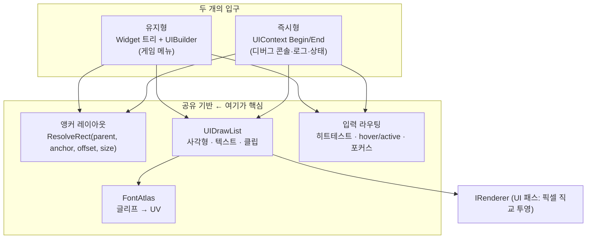

# UI 계층 설계서 — 앵커 레이아웃 + 하이브리드 모델

> 대상 독자: 이 계층을 구현할 에이전트/개발자.
> 관련 문서: [rendering-dx11.md](rendering-dx11.md)(그 위에 UI가 올라간다), [roadmap.md](roadmap.md)(마일스톤 순서).
> 장기 목표: 상용 엔진처럼 **UI 에디터 · 월드 배치**까지. 지금은 그 길을 막지 않는 최소 구조를 만든다.

---

## 0. 원칙 (절대 안 깨는 것)

1. **UI는 결정론 밖이다.** float를 쓴다. 화면 픽셀 좌표계다. 시뮬레이션 값이 아니다.
2. ⚠️ **UI가 게임 상태를 바꾸는 유일한 경로는 `InputCommand`다.** 버튼 콜백이 월드를 직접 건드리면 그 즉시 디싱크다 — 그 클라만 상태가 바뀌기 때문이다. "건물 짓기" 버튼은 월드에 엔티티를 만드는 게 아니라 **입력을 큐에 넣고**, 서버 확정을 거쳐 `InputFrame`으로 돌아온 뒤에야 월드가 바뀐다. 이건 [deterministic-input-lockstep.md](deterministic-input-lockstep.md) §2 불변식 3의 UI판이다.
   - 예외로 허용되는 것: 네트워크 요청(`ResyncRequest`), 렌더/카메라 조작, 로그 보기 — **월드 상태를 안 건드리는 것들**.
3. **UI는 `ClientPresentation` 전용.** 서버 빌드는 UI를 링크조차 하지 않는다(`roadmap.md` E2의 렌더 타깃 분리에 함께 얹는다).
4. **UI 상태는 스냅샷 대상이 아니다.** `RegisterSnapshotComponent` 하지 않는다.
5. **UI는 카메라를 쓰지 않는다.** 월드 카메라와 무관한 **픽셀 직교 투영**을 따로 쓴다. 그래서 UI는 카메라(R4)보다 먼저 만들 수 있다.

---

## 1. 하이브리드 — 무엇을 공유하는가

유지형(메뉴)과 즉시형(디버그)을 둘 다 쓴다. 여기서 제일 중요한 설계 판단은 이것이다.

> **두 모드는 UI 시스템 두 개가 아니다. 레이아웃 계산과 드로우 목록을 공유하는 한 시스템의 두 입구다.**



두 모드가 갈라지는 건 **"위젯 상태를 누가 들고 있나"** 하나뿐이다.

| | 유지형 | 즉시형 |
|---|---|---|
| 위젯 객체 | 있음 (트리에 살아 있음) | 없음 (id로만 존재) |
| 상태 소유 | 위젯 자신 | `UIContext`의 id→상태 맵 |
| 갱신 | 값이 바뀔 때만 | 매 프레임 전부 |
| 적합한 곳 | 메뉴, 나중의 UI 에디터 | 디버그, 매 프레임 바뀌는 값 |

**왜 이렇게 나눴나:** 메뉴는 레이아웃이 복잡하고 상태 변화가 드물어 트리로 들고 있는 게 싸다. 그리고 트리가 있어야 나중에 직렬화 → UI 에디터로 갈 수 있다. 반대로 디버그 패널은 매 프레임 값이 바뀌는데, 유지형으로 하면 "라벨을 찾아서 `SetText`" 코드가 값마다 필요해진다. 즉시형은 그냥 `ui.Text(...)` 한 줄이다.

---

## 2. 앵커 레이아웃 모델

Unity 방식을 간소화해서 쓴다. **내부는 정규화 min/max, 겉은 프리셋 enum.**

```cpp
// 부모 사각형 안에서의 정규화 기준 영역 (0~1)
struct AnchorRect { Float2 min{0,0}, max{0,0}; };

// 겉으로 쓰는 프리셋 — "쉬운 레이아웃"
enum class Anchor {
    TopLeft, Top, TopRight,
    Left,    Center, Right,
    BottomLeft, Bottom, BottomRight,
    StretchX,      // 좌우로 늘어남 (로그 패널 폭 100%)
    StretchY,
    StretchAll     // 부모를 가득 채움
};
```

**계산 규칙 (순수 함수 — 테스트 가능):**

```
anchorMinPx = parent.min + parent.size * anchor.min
anchorMaxPx = parent.min + parent.size * anchor.max

anchor.min == anchor.max 인 축 (점 앵커):
    size는 지정값을 그대로 쓰고, pivot으로 기준점을 맞춘다
    pos = anchorMinPx + offsetMin - size * pivot

anchor.min != anchor.max 인 축 (stretch 앵커):
    size는 부모를 따라가고, offset이 양쪽 여백(margin)이 된다
    min = anchorMinPx + offsetMin
    max = anchorMaxPx - offsetMax
```

> 📌 아래 세 항목은 U3 구현 중 이 사양이 **모순되거나 비어 있다는 것이 드러나** 확정한 내용이다.
> 원래 문서가 틀렸던 것이므로 구현이 아니라 이 문서를 고쳤다.

**(a) offset은 축마다 두 개다 (`offsetMin` / `offsetMax`).** 위 stretch 공식이 이미 두 개를 요구하는데 초안의 함수 서명은 `offset` 하나였다. 코어 구조체(`LayoutSpec`)는 둘 다 갖고, **편의 오버로드가 하나의 `offset`을 양쪽에 대칭으로 매핑**한다. 그래서 `StretchAll + offset{8,8}`은 "사방 8px 안쪽으로"가 된다 — §7.2의 로그 패널이 원하는 동작이다. 비대칭 여백(예: 40px 타이틀바를 피하는 패널)이 필요하면 `LayoutSpec`을 직접 쓴다.

**(b) 기본 pivot은 앵커 프리셋을 따라간다.** Unity처럼 상수 `{0.5, 0.5}`가 아니라 `TopLeft → {0,0}`, `BottomRight → {1,1}`, `Center → {0.5,0.5}` 식으로 **앵커와 같은 모서리**를 쓴다.
근거: 즉시형 호출부는 pivot을 생략하는 게 기본이라(§4) **그 기본값이 곧 화면에 보이는 결과**다. `{0.5,0.5}`를 기본으로 두면 §4의 `BeginPanel("debug", Anchor::TopRight, {320,200})`이 화면 밖으로 절반 튀어나간다. "우상단에 붙인다"는 말의 상식적 의미와 맞는 쪽을 기본으로 삼는다.

**(c) `StretchX` / `StretchY`의 늘어나지 않는 축은 중앙(0.5)이다.** 중립값이고 offset으로 어느 방향으로든 갈 수 있다.
"폭 100% 로그 패널"처럼 **아래에 붙는** 경우는 `StretchX`가 아니라 `AnchorRect{{0,1},{1,1}}`를 직접 준다(프리셋은 min/max 위의 표기 편의일 뿐이라 이게 가능하다). 이런 도킹 조합(`StretchTop` / `StretchBottom`)이 자주 필요해지면 그때 프리셋으로 승격한다 — 지금 넣으면 쓰이지도 않는 이름만 늘어난다.

이 한 함수가 유지형·즉시형 **양쪽에서 그대로 쓰인다.** 그래서 U3(레이아웃 코어)이 두 트랙보다 먼저 온다.

> **왜 프리셋 뒤에 min/max를 두나:** 프리셋만 있으면 stretch를 표현할 수 없고, min/max만 노출하면 쓰기 불편하다. 상용 엔진들이 둘 다 두는 이유가 이것이다. 프리셋은 min/max로 변환되는 **표기 편의**일 뿐이라, 나중에 에디터에서 자유로운 앵커 편집을 붙여도 코어를 안 고친다.

**자동 배치 컨테이너:** 메뉴 버튼 세 개를 세로로 쌓으려면 앵커만으로는 매번 offset을 손으로 줘야 한다. `VerticalLayout` / `HorizontalLayout`(간격 + 정렬)을 컨테이너 위젯으로 둔다. 앵커와 배타적이지 않다 — 컨테이너 자신은 앵커로 배치되고, 자식들만 자동 정렬된다.

---

## 3. 유지형 — Widget + UIBuilder

```cpp
auto menu = UIBuilder(root)
    .Panel("main")
        .Anchor(Anchor::Center).Size(320, 400)
        .VerticalLayout(/*spacing*/ 12)
        .Button("싱글플레이", [&]{ app.StartSingle(); })
        .Button("호스트",     [&]{ app.StartHost(); })
        .Button("참여",       [&]{ app.OpenJoinDialog(); })
    .Build();
```

- `Widget`은 부모/자식 포인터, `AnchorRect`, offset/size/pivot, 그리고 타입별 데이터(텍스트, 색, 콜백)를 갖는다.
- `UIBuilder`는 **fluent 인터페이스**로 트리를 만든다. `Build()`가 루트를 돌려준다.
- 레이아웃은 트리를 한 번 순회하며 각 위젯의 화면 `Rect`를 확정한다. 부모→자식 순서라 한 패스면 끝난다.
- 트리가 살아 있으므로 나중에 **직렬화 → 파일 → UI 에디터**로 확장할 수 있다. 이게 "상용엔진처럼" 목표로 가는 다리다.

> **주의:** 버튼 콜백에서 월드를 직접 건드리지 말 것(§0-2). 콜백은 앱 상태 전환이나 `InputCommand` 큐잉만 한다.

---

## 4. 즉시형 — UIContext

```cpp
if (ui.BeginPanel("debug", Anchor::TopRight, {320, 200})) {
    ui.Text("tick   : %llu", tick);
    ui.Text("hash   : %016llx", world.ComputeHash());
    ui.Text("clients: %zu", net.Clients().size());
    if (ui.Button("Resync")) { RequestResync(); }
    ui.EndPanel();
}
```

- 위젯 객체가 없다. `"debug"` 같은 문자열을 해시한 **id**로 hover/active/스크롤 위치 같은 상태만 맵에 남긴다.
- 한 프레임 안에서 `Begin*`이 부모 Rect를 스택에 쌓고, `End*`가 꺼낸다. 자식 Rect는 §2의 같은 함수로 계산한다.
- 버튼은 "이번 프레임에 눌렸나"를 bool로 돌려준다 — 콜백이 없으니 호출부가 곧 처리부다.

**입력의 한 프레임 지연:** 즉시형은 위젯 Rect를 그리면서 알게 되므로, 클릭 판정은 보통 **직전 프레임의 Rect**로 한다. UI가 프레임마다 크게 움직이지 않으면 문제가 없고, 이게 즉시형의 표준 트레이드오프다. 디버그 UI에는 무해하다.

---

## 5. 텍스트 렌더링 — GNU Unifont

콘솔·로그·상태표시기가 전부 글자라 폰트는 피할 수 없다. **기본 폰트는 GNU Unifont**를 쓴다. 한글까지 한 번에 해결된다.

### 왜 Unifont인가

- **애초에 비트맵 폰트다.** ASCII·라틴은 8×16, 한중일은 16×16. 래스터화가 필요 없고 픽셀이 그대로 들어 있다.
- **유니코드 BMP 전체를 덮는다.** 한글 완성형 11,172자가 전부 있다. "싱글플레이" 같은 메뉴 글자를 위해 따로 뭘 할 필요가 없다.
- ⭐ **`.hex` 배포 포맷이 순수 텍스트라 폰트 파서가 필요 없다.** TTF 파서도, stb_truetype도, GDI/DirectWrite도 필요 없다. 한 줄이 한 글리프다. 의존성 최소화 원칙에 정확히 맞는다.
- **모든 머신에서 픽셀이 동일하다.** GDI 래스터화는 설치된 폰트·렌더링 설정에 따라 결과가 달라지지만, `.hex`는 비트맵이 고정이라 재현 가능하다.
- **고정폭 그리드와 잘 맞는다.** 한글 1글자 = 영문 2글자 폭이라 콘솔 정렬이 자연스럽다.

**단점(알고 쓰자):** 투박하다. Unifont는 원래 "모든 글자를 최소한 보여주는" 폴백 폰트라 예쁜 글꼴이 아니다. 디버그 UI에는 완벽하지만, 나중에 게임 메뉴를 예쁘게 하고 싶으면 그때 다른 폰트를 얹는다 — 그래서 `IFontAtlas` 뒤에 둔다(아래).

### ⚠️ 라이선스 — 퍼블릭 도메인이 아니다

Unifont은 **OFL-1.1 과 GPLv2+ (GNU 폰트 임베딩 예외)** 듀얼 라이선스다. "저작권 free"가 아니라 "자유 라이선스"다. 실무적으로:

- ✅ 프로그램에 임베드·배포해도 된다. 비자유 소프트웨어에 쓰는 것도 **명시적으로 허용**된다(폰트 임베딩 예외와 OFL 둘 다).
- ✅ 이 저장소는 **OFL-1.1을 택해서** 쓴다. 그래야 GPL이 프로젝트 전체로 번지지 않는다.
- ⚠️ **라이선스 고지를 함께 배포해야 한다.** `assets/fonts/LICENSE`에 원문을 둔다.
- ⚠️ 폰트 자체를 **개조해서 재배포**하면 같은 조건으로 공개해야 한다. (글리프를 아틀라스로 굽는 건 개조가 아니라 사용이다.)

### `.hex` 포맷

```
CODEPOINT:BITMAPHEX
```

- 코드포인트는 BMP면 4자리 16진수(그 위는 더 길다).
- 비트맵은 **16행**. 8×16 글리프는 행당 1바이트 → 총 16바이트 → **32 hex 문자**. 16×16 글리프는 행당 2바이트 → 총 32바이트 → **64 hex 문자**. 즉 **hex 문자 길이로 글자 폭을 판별한다**(32 → 반각, 64 → 전각).

> 🔍 **구현 시 반드시 실제 파일로 검증할 것:** 행 순서(위→아래)와 바이트 안의 비트 순서(MSB가 왼쪽 픽셀인지)는 문서에 명시가 없다. `unifont.hex`에서 `0041`(대문자 A) 한 줄을 뽑아 콘솔에 `#`/`.`으로 찍어보면 즉시 확정된다. **추측으로 코드를 쓰지 말고 이 확인을 먼저 한다.**

### 구조

```
assets/fonts/unifont.hex   (전체 ≈ 12MB 텍스트)
assets/fonts/LICENSE       (OFL-1.1 원문)
        │
        ▼ 시작 시 1회 파싱
UnifontAtlas : IFontAtlas
        │  codepoint → 비트맵(16 또는 32바이트)
        ▼ 처음 그릴 때 지연 굽기(lazy)
아틀라스 텍스처 (R8) + codepoint → UV/폭 테이블
```

**지연 아틀라스를 쓰는 이유:** 65,000자를 전부 텍스처로 구우면 아틀라스가 거대해진다. 실제로 화면에 나오는 글자는 수십~수백 자다. 처음 그릴 때만 굽고 캐시한다. 콘솔이 임의의 한글을 찍어도 문제가 없다.

**파싱 비용:** 12MB 텍스트를 시작 시 한 번 훑는다. 느리면 나중에 바이너리 캐시로 바꾼다 — 지금 최적화하지 말 것.

### 교체 가능하게 둔다

```cpp
class IFontAtlas {
    virtual bool Load() = 0;
    virtual const Glyph* Find(char32_t codepoint) = 0;  // 없으면 굽고 캐시
    virtual TextureHandle Texture() const = 0;
    virtual int LineHeight() const = 0;
};
```

`UnifontAtlas`가 첫 구현이다. 나중에 예쁜 TTF(stb_truetype)나 다른 비트맵 폰트를 쓰고 싶으면 이 인터페이스 뒤에서 갈아끼운다. `IRenderer` 뒤에 DX11을 둔 것과 같은 패턴이다.

### UTF-8 처리

문자열은 소스에서 UTF-8(`u8`)로 들어온다. `DrawText`는 **UTF-8 → 코드포인트 디코딩**을 먼저 한다. 짧은 디코더 하나면 되고 외부 의존이 없다.

---

## 6. 입력 라우팅 ⚠️ 기존 `Input`으로는 부족하다

[Base/InputManager.hpp](../../EngineCore/Base/InputManager.hpp)의 `Input`은 키 상태를 **전역 폴링**으로 읽고 마우스 좌표를 **화면 좌표**로 준다. UI에는 두 가지가 모자란다.

1. **문자 입력이 없다.** 콘솔 명령과 참여 화면의 IP 입력에는 "어떤 문자가 입력되었나"가 필요하다. 키 상태 폴링으로는 Shift·키보드 레이아웃·키 반복을 제대로 다룰 수 없다. → Win32 `WM_CHAR`를 받아 문자 큐에 넣는 경로를 `Win32Window`에 추가한다.
2. **마우스 좌표가 창 기준이 아니다.** 히트테스트는 클라이언트 좌표라야 한다. → `ScreenToClient` 변환을 거친다.

**UI가 입력을 먼저 먹는다:** 마우스가 UI 위에 있거나 콘솔에 포커스가 있으면, 그 입력은 게임 입력(`InputCommand`)으로 내려가면 안 된다. `UIContext`가 `WantsMouse()` / `WantsKeyboard()`를 노출하고, 게임 입력 수집(트랙 I)이 그걸 먼저 확인한다.

---

## 7. 만들 화면들

### 7.1 시작 UI (유지형)

```
메인 메뉴
 ├ 싱글플레이 → GameEngine에 ServerSimulation + ClientPresentation 월드 생성,
 │               MemoryConnection::CreatePair()로 연결  (= 호스트와 같은 경로)
 ├ 호스트     → 위와 같되 UDPConnection도 열어 외부 접속을 받는다
 ├ 참여       → IP 입력 → UDPConnection으로 접속 → Hello 핸드셰이크
 └ 종료
```

**엔진이 이미 세 경로를 다 갖고 있다**(`CLAUDE.md`의 "핵심 설계 포인트"). 그래서 이 화면이 하는 일은 대부분 **이미 있는 것을 버튼에 연결하는 것**이다. 새로 필요한 건 접속 진행/실패 상태 표시 정도다.

### 7.2 디버그 UI (즉시형)

| 패널 | 내용 | 필요한 것 |
|---|---|---|
| 상태표시기 | tick, `ComputeHash()`, 접속 클라 수, `clientSimTick` vs `serverTickEstimate`, FPS | 전부 이미 접근 가능 |
| 로그 | 최근 N줄 스크롤 | **`Logger`에 링버퍼 싱크 추가 필요** (아래) |
| 콘솔 | 명령 입력·실행, 히스토리 | 명령 등록 테이블 + `WM_CHAR` 경로 |

**로그 싱크:** 현재 `Logger`는 `std::cout`과 파일로만 나간다. UI가 읽으려면 메모리에 남아야 한다. 다행히 [Base/RingBuffer.hpp](../../EngineCore/Base/RingBuffer.hpp)에 `SimpleRingBuffer<T>`가 이미 있으니, `SimpleRingBuffer<LogLine>` 싱크를 하나 추가한다.

**콘솔 명령:** `name → std::function<void(args)>` 테이블. 초기 명령 예: `resync`, `hash`, `spawn`, `net.stats`, `clear`.
> ⚠️ 월드 상태를 바꾸는 명령(`spawn` 등)은 §0-2에 걸린다. 그런 명령은 직접 월드를 건드리지 말고 **`InputCommand`를 큐잉**해야 한다. 그래야 서버 확정을 거쳐 전 peer에 똑같이 적용된다. 디버그라고 예외를 두면 디싱크의 원인이 된다.

---

## 8. 마일스톤

**R 트랙(렌더링)과 엮인다.** UI는 카메라가 필요 없으므로(§0-5) 쿼드를 그릴 수 있게 되는 **R3 직후**부터 만들 수 있다. 그리고 디버그 UI를 일찍 만들어 두면 R4~R7을 만들 때 "무엇이 왜 안 보이는지"를 화면에서 볼 수 있다. 그래서 순서를 이렇게 끼운다.

```
R0 → R1 → R2 → R3 ──┬─→ U1 → U2 → U3 → U4 → U5(디버그 오버레이)
                     │                            │
                     └──────────← 도움 받으며 ────┘
                                  R4 → R5 → R6 → R7
                                                  ↓
                                        U6 → U7 → U8
```

| # | 산출물 | "됐다"의 기준 |
|---|---|---|
| **U1** | `Rect`/`Color`/`UIDrawList`(사각형+클립) + UI 패스(픽셀 직교 투영) | 화면 좌표 (10,10)에 100x50 사각형이 정확히 그려진다 |
| **U2** | `IFontAtlas` + `UnifontAtlas`(.hex 파싱 + 지연 아틀라스) + UTF-8 디코더 + `DrawText` | **화면에 "싱글플레이 tick:1234"가 한글까지 안 깨지고 나온다** |
| **U3** | 앵커 레이아웃 코어(`ResolveRect`) + 프리셋 | **순수 함수 단위 테스트** — 9개 프리셋과 stretch가 기대 Rect를 낸다 |
| **U4** | `UIContext` 즉시형(`BeginPanel`/`Text`/`Button`) + 히트테스트 | 버튼에 마우스를 올리면 색이 바뀌고 클릭이 감지된다 |
| **U5** | 디버그 오버레이 — 상태표시기 + 로그 패널(`Logger` 링버퍼 싱크) | 실행 중 tick·hash·클라 수가 실시간으로 보이고 로그가 쌓인다 |
| **U6** | 콘솔 — `WM_CHAR` 입력 경로 + 명령 테이블 + 히스토리 | 콘솔에 `hash`를 치면 현재 월드 해시가 출력된다 |
| **U7** | 유지형 `Widget` + `UIBuilder` + `VerticalLayout` | §3 예제 코드가 그대로 동작해 메뉴가 그려진다 |
| **U8** | 시작 화면 — 싱글/호스트/참여 → 실제 월드·연결 생성 | **메뉴에서 "호스트"를 누르면 게임이 시작되고, 다른 창이 "참여"로 접속해 같은 월드를 본다** |

U8이 이 트랙의 결승선이다. 그 시점에 `roadmap.md`의 R 트랙과 합쳐지면 **창을 띄우고, 메뉴에서 접속하고, 화면 속 엔티티를 키보드로 움직이고, 디버그 오버레이로 해시가 맞는 걸 확인**할 수 있다.

---

## 9. 아직 정하지 않은 것

| 열린 질문 | 언제 정하나 |
|---|---|
| UI 직렬화 포맷 | U7로 트리가 생긴 뒤. 그전엔 형태를 알 수 없다. → 이게 [roadmap.md §10](roadmap.md)의 **X4(UI 에디터)**로 이어진다. |
| 월드 배치 에디터(엔티티를 마우스로 놓기) | 공장 게임 건설(트랙 G)과 **사실상 같은 문제**다. G2를 만들고 나서 판단한다. → [roadmap.md §10](roadmap.md) **X2**. |

> 📌 **U7을 만들 때 염두에 둘 것:** 유지형 위젯 트리는 나중에 UI 에디터의 문서 포맷이 된다.
> 지금 직렬화를 *만들* 필요는 없지만, 트리를 직렬화 불가능한 모양(예: 위젯 안에 캡처된 람다만으로 상태를 들고 있는 구조)으로 만들지는 말 것. 막지만 않으면 된다.
| UI 스케일링(DPI, 해상도 대응) | 창 리사이즈를 실제로 다룰 때. 지금은 픽셀 고정. |
| 예쁜 폰트(메뉴용 TTF 등) | 게임 메뉴를 다듬을 때. Unifont은 투박하지만 정확하다. `IFontAtlas` 뒤라 교체가 싸다. |
| `unifont.hex` 시작 파싱이 느릴 때의 바이너리 캐시 | 실제로 느린 걸 재고 나서. 지금 최적화하지 않는다. |
| 텍스트 입력의 IME(한글 조합) | 채팅이 필요해질 때. 콘솔·IP 입력은 ASCII로 충분하다. 표시는 이미 한글이 되지만 **입력 조합은 별개 문제**다. |
